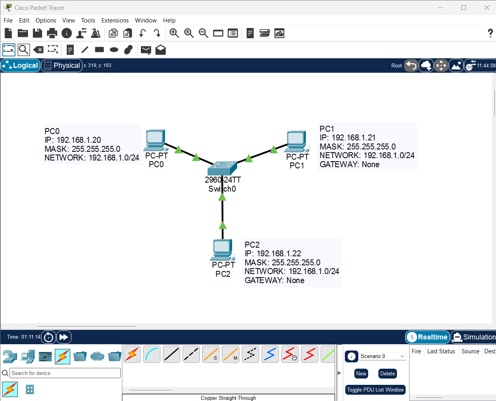
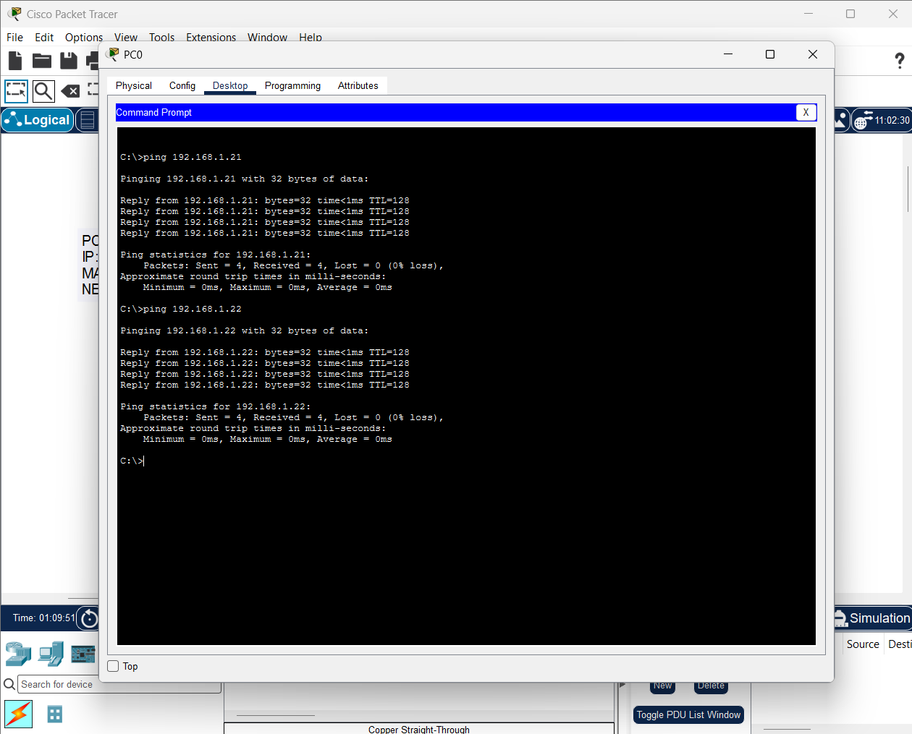
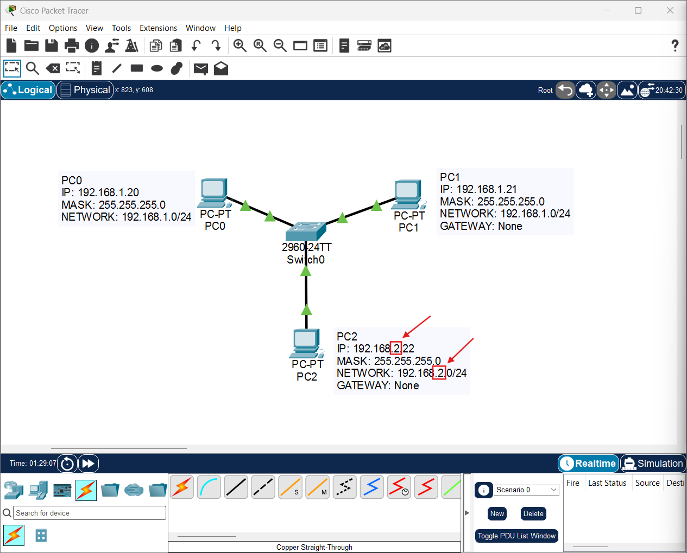
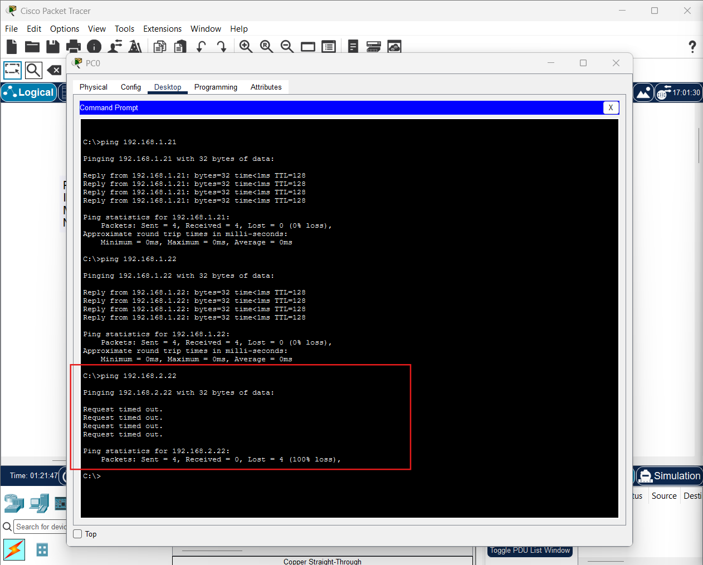
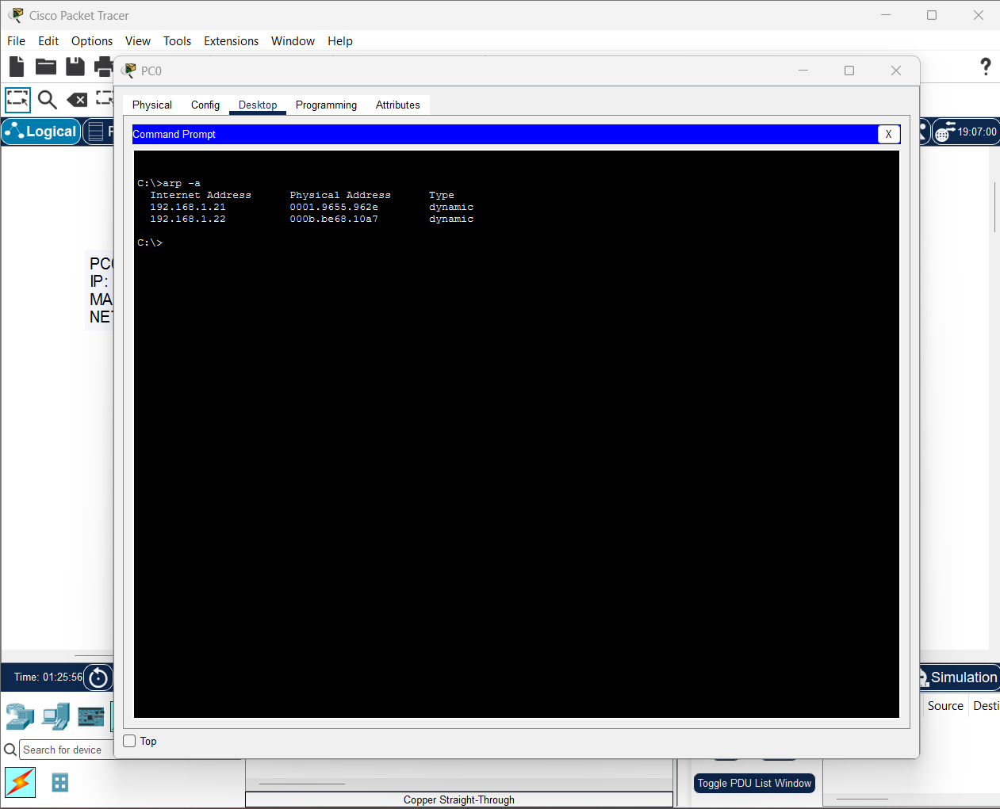

# IPv4 Addressing & Subnet Boundaries
### Network Infrastructure Lab — Cisco Packet Tracer

**Project:** IPv4 Addressing, Subnet Masks, Network Boundaries & Connectivity Troubleshooting  
**Environment:** Cisco Packet Tracer  
**Difficulty:** Beginner  
**Category:** Network Infrastructure / Networking Fundamentals  
**Status:** Completed

---

## 1. Project Overview

This lab explores how IPv4 addressing and subnet masks determine whether devices can communicate directly within a local network.

Using Cisco Packet Tracer, I built a small Ethernet LAN consisting of three computers connected to a Cisco 2960 switch.

The investigation began with all three computers configured within the same IPv4 subnet. After successfully verifying connectivity, I deliberately changed the IPv4 address of one host to place it in a different subnet.

By comparing successful and unsuccessful ICMP tests and inspecting the ARP cache, I examined how logical IPv4 network boundaries affect communication even when all devices remain physically connected to the same Ethernet switch.

The objective was not simply to establish connectivity, but to understand **why connectivity succeeds or fails depending on the network configuration**.

---

## 2. Learning Objectives

The main objectives of this lab were:

- Build a basic Ethernet LAN from scratch.
- Configure static IPv4 addresses on multiple hosts.
- Understand the purpose of a subnet mask.
- Identify network and host portions of an IPv4 address.
- Verify connectivity using ICMP Echo Requests and Echo Replies.
- Investigate the consequences of assigning a host to a different IPv4 subnet.
- Understand why a Layer 2 switch does not automatically provide routing between different IPv4 networks.
- Inspect the ARP cache and interpret existing IPv4-to-MAC address mappings.
- Practice basic network connectivity troubleshooting.

---

## 3. Lab Environment

### Software

- Cisco Packet Tracer
- Cisco IOS CLI
- Packet Tracer PC Command Prompt

### Devices

| Device | Model | Purpose |
|---|---|---|
| PC0 | PC-PT | Primary testing host |
| PC1 | PC-PT | Local network host |
| PC2 | PC-PT | Host used for subnet experiments |
| Switch0 | Cisco 2960-24TT | Layer 2 Ethernet switching |

### Network Topology

All three PCs are physically connected to Switch0 using Copper Straight-Through Ethernet cables.

[View initial network topology](screenshots/001.png)

The physical topology remains unchanged throughout the investigation.

Only PC2's IPv4 address is modified during the subnet boundary experiment.

---

## 4. Initial IPv4 Configuration

All computers were initially configured with static IPv4 addresses belonging to the same subnet.

| Device | IPv4 Address | Subnet Mask | Network |
|---|---|---|---|
| PC0 | 192.168.1.20 | 255.255.255.0 | 192.168.1.0/24 |
| PC1 | 192.168.1.21 | 255.255.255.0 | 192.168.1.0/24 |
| PC2 | 192.168.1.22 | 255.255.255.0 | 192.168.1.0/24 |

No default gateways or DNS servers were configured.

### Understanding the Subnet Mask

The subnet mask `255.255.255.0` is equivalent to the CIDR prefix `/24`.

For this specific subnet mask:

- The first 24 bits identify the network.
- The remaining 8 bits identify the host portion.

For example:

**PC0: 192.168.1.20/24**

- Network portion: `192.168.1`
- Host portion: `20`
- Network address: `192.168.1.0`

All three devices initially shared the same network address, `192.168.1.0/24`, while using different host addresses.

Because the devices were on the same Ethernet LAN and belonged to the same IPv4 subnet, they could communicate directly without requiring a router.

---

## 5. Phase 1 — Initial Connectivity Verification

After configuring the three hosts, I used the Command Prompt on PC0 to test connectivity with PC1 and PC2.

### Test 1 — PC0 to PC1

Command:

`ping 192.168.1.21`

Result:

- Packets sent: 4
- Packets received: 4
- Packet loss: 0%

**Status: SUCCESS**

### Test 2 — PC0 to PC2

Command:

`ping 192.168.1.22`

Result:

- Packets sent: 4
- Packets received: 4
- Packet loss: 0%

**Status: SUCCESS**

### Evidence

[View successful connectivity tests](screenshots/002.png)

### Technical Explanation

The successful ICMP tests confirm that the hosts were reachable using their initial IPv4 configuration.

Because the destinations belonged to the same local subnet, PC0 could communicate with them without an IP router.

At the Ethernet layer, ARP enables the resolution of local IPv4 addresses into destination MAC addresses.

The switch then forwards Ethernet frames through the appropriate physical ports.

This demonstrates the cooperation between IPv4, ARP, Ethernet switching, and ICMP.

---

## 6. Phase 2 — Modifying the IPv4 Network Boundary

The next experiment investigated what happens when a host is configured in a different IPv4 subnet.

Only PC2's IPv4 address was changed.

### Original PC2 Configuration

- IP Address: `192.168.1.22`
- Subnet Mask: `255.255.255.0`
- Network: `192.168.1.0/24`

### Modified PC2 Configuration

- IP Address: `192.168.2.22`
- Subnet Mask: `255.255.255.0`
- Network: `192.168.2.0/24`

PC0 and PC1 remained unchanged.

### Updated Addressing Table

| Device | IPv4 Address | Subnet Mask | Network |
|---|---|---|---|
| PC0 | 192.168.1.20 | 255.255.255.0 | 192.168.1.0/24 |
| PC1 | 192.168.1.21 | 255.255.255.0 | 192.168.1.0/24 |
| PC2 | 192.168.2.22 | 255.255.255.0 | 192.168.2.0/24 |

### Evidence

[View subnet boundary configuration](screenshots/003.png)

### Important Observation

The physical topology was not modified.

All Ethernet connections remained active.

However, PC2 was now logically assigned to a different IPv4 network.

PC0 and PC1 belonged to:

`192.168.1.0/24`

PC2 belonged to:

`192.168.2.0/24`

This distinction is determined by the combination of the IPv4 address and subnet mask, not by physical cable placement.

---

## 7. Phase 3 — Connectivity Failure Between Subnets

After changing PC2's IPv4 address, I initiated another connectivity test from PC0.

### Command

`ping 192.168.2.22`

### Observed Result

The Command Prompt returned:

`Request timed out.`

Final statistics:

- Packets sent: 4
- Packets received: 0
- Packets lost: 4
- Packet loss: 100%

**Status: FAILED**

### Evidence

[View failed connectivity test](screenshots/004.png)

### Why Did the Ping Fail?

PC0 was configured as:

`192.168.1.20/24`

The destination was:

`192.168.2.22`

Using its subnet mask, PC0 determines that the destination is outside its local IPv4 subnet.

A host normally requires an appropriate route, commonly through a default gateway, to reach another IPv4 network.

However, this laboratory contained:

- No router
- No configured default gateway
- No additional route toward `192.168.2.0/24`

Consequently, PC0 had no suitable Layer 3 path to the destination.

The Cisco 2960 switch provided Layer 2 connectivity but was not configured to route IPv4 traffic between the two networks.

**Important:** A ping timeout alone does not identify the cause of a failure. In this controlled experiment, the relevant configuration change and the absence of a route explain the observed connectivity problem.

---

## 8. Phase 4 — ARP Cache Investigation

To investigate the host's existing IPv4-to-MAC address mappings, I inspected the ARP cache on PC0.

### Command

`arp -a`

### Observed Result

The ARP cache contained dynamic entries for:

- `192.168.1.21`
- `192.168.1.22`

No entry for `192.168.2.22` was displayed.

### Evidence

[View ARP cache investigation](screenshots/005.png)

### Technical Explanation

ARP (Address Resolution Protocol) is used to resolve IPv4 addresses to MAC addresses on a local Ethernet network.

In this lab, PC0 had previously communicated with PC1 and PC2 while both belonged to the original subnet.

The ARP cache retained an entry associated with PC2's previous IPv4 address:

`192.168.1.22`

This demonstrates that an ARP cache can temporarily retain previously learned information even after an IP configuration changes elsewhere in the network.

The absence of a new ARP entry for `192.168.2.22` is consistent with PC0 treating that destination as outside its directly connected IPv4 subnet.

Without an appropriate route, PC0 cannot reach that destination through normal IPv4 forwarding.

### ARP Cache vs. Switch MAC Address Table

These two mechanisms must not be confused.

**ARP Cache**

Maintained by hosts and other IP-capable devices to associate IPv4 addresses with MAC addresses.

**MAC Address Table**

Maintained by Ethernet switches to associate learned MAC addresses with switch ports within their VLANs.

Both mechanisms are important, but they serve different purposes.

---

## 9. Connectivity Test Summary

| Test | Source | Destination | Result |
|---|---|---|---|
| Initial connectivity | PC0 | 192.168.1.21 | SUCCESS |
| Initial connectivity | PC0 | 192.168.1.22 | SUCCESS |
| After subnet change | PC0 | 192.168.2.22 | FAILED |
| ARP inspection | PC0 | Local ARP Cache | COMPLETED |

### Key Finding

**Physical Ethernet connectivity does not automatically guarantee IPv4 connectivity.**

Even when devices are connected to the same physical switch, their IPv4 addressing, subnet masks, and available routes determine how they can communicate at Layer 3.

---

## 10. Troubleshooting Methodology

The investigation followed a basic networking troubleshooting workflow:

1. Build the physical topology.
2. Configure static IPv4 addresses.
3. Establish baseline connectivity.
4. Introduce one deliberate configuration change.
5. Repeat the relevant connectivity test.
6. Compare successful and unsuccessful results.
7. Inspect the ARP cache.
8. Identify the relationship between the observed failure and the IPv4 network configuration.

Changing a single variable made it easier to isolate the cause of the connectivity failure.

This is an important principle in systematic network troubleshooting.

---

## 11. Commands Used

### Packet Tracer PC Command Prompt

| Command | Purpose |
|---|---|
| `ipconfig` | Display host IP configuration |
| `ping 192.168.1.21` | Test PC1 connectivity |
| `ping 192.168.1.22` | Test initial PC2 connectivity |
| `ping 192.168.2.22` | Test connectivity after PC2 subnet change |
| `arp -a` | Display cached IPv4-to-MAC mappings |

### Important Notes

Packet Tracer provides a simplified PC Command Prompt and does not implement every command available in a real Windows or Linux terminal.

The ICMP tests were performed inside a simulated network.

No production infrastructure or external network was involved.

---

## 12. Key Lessons Learned

### 1. An IPv4 Address Identifies an Interface

Each computer requires an appropriate IP configuration to participate in IPv4 communication.

### 2. The Subnet Mask Defines the Network Boundary

An IPv4 address must be interpreted together with its subnet mask.

The same physical infrastructure can contain hosts configured for different IP networks.

### 3. A Layer 2 Switch Does Not Replace a Router

An Ethernet switch forwards frames using MAC addresses.

Communication between different IPv4 networks normally requires an appropriate Layer 3 routing path.

### 4. Successful Ping Tests Verify Reachability

ICMP Echo Requests and Echo Replies can help verify IPv4 connectivity.

A timeout indicates that a reply was not received within the expected interval, but additional investigation is needed to determine the cause.

### 5. ARP Connects IPv4 Addressing with Ethernet

ARP allows hosts to discover the MAC address associated with an IPv4 address reachable on the local link.

### 6. Old ARP Entries May Remain Cached

An IP address change does not necessarily remove previously learned ARP information from other devices immediately.

### 7. Network Troubleshooting Requires Controlled Experiments

Modifying one configuration parameter at a time helps establish cause and effect.

---

## 13. Project Evidence

All screenshots were captured during the Cisco Packet Tracer investigation.

| Screenshot | Description |
|---|---|
| [001.png](screenshots/001.png) | Initial three-host LAN topology |
| [002.png](screenshots/002.png) | Successful ICMP tests within the original subnet |
| [003.png](screenshots/003.png) | PC2 moved to a different IPv4 subnet |
| [004.png](screenshots/004.png) | Failed ICMP connectivity after the subnet change |
| [005.png](screenshots/005.png) | ARP cache inspection on PC0 |

The accompanying `.pkt` file contains the Packet Tracer laboratory topology and configuration.

---

## 14. Conclusion

This laboratory demonstrated how IPv4 addressing and subnet masks influence connectivity within an Ethernet network.

Starting from a fully functional three-host LAN, I deliberately moved one host into a different IPv4 subnet while leaving the physical infrastructure unchanged.

The resulting ICMP failure illustrated the distinction between physical connectivity and logical IP reachability.

The investigation also reinforced the roles of ARP, Ethernet switching, and routing in basic network communication.

The most important lesson was that **network troubleshooting requires understanding the relationship between physical connections, IPv4 addressing, and routing decisions rather than relying on successful or unsuccessful ping results alone.**

---

**Project Type:** Independent Hands-On Networking Lab  
**Platform:** Cisco Packet Tracer  
**Focus:** IPv4 Addressing, Subnet Masks, ARP & Connectivity Troubleshooting
