# LAB003 — Inter-Subnet Routing with Cisco Packet Tracer

## Overview

This lab demonstrates how two separate IPv4 networks communicate through a Cisco router.

The network was built from scratch using Cisco Packet Tracer, with manual IPv4 configuration, router interface configuration, connectivity testing, routing table inspection, and packet-level analysis.

The lab also explores what happens when a router interface is administratively disabled and how a router forwards traffic between different subnets.

## Network Topology

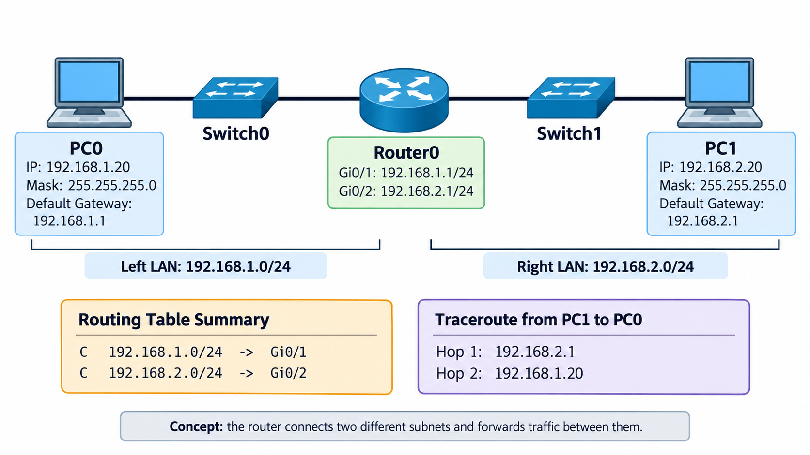

### Devices

- 1 × Cisco 2911 Router
- 2 × Cisco 2960-24TT Switches
- 2 × PC-PT End Devices
- Copper Straight-Through Ethernet Cables

### Network Configuration

| Device | Interface | IPv4 Address | Subnet Mask | Default Gateway |
|---|---|---|---|---|
| PC0 | FastEthernet0 | 192.168.1.20 | 255.255.255.0 | 192.168.1.1 |
| Router0 | GigabitEthernet0/1 | 192.168.1.1 | 255.255.255.0 | N/A |
| Router0 | GigabitEthernet0/2 | 192.168.2.1 | 255.255.255.0 | N/A |
| PC1 | FastEthernet0 | 192.168.2.20 | 255.255.255.0 | 192.168.2.1 |

**Network A:** `192.168.1.0/24`

**Network B:** `192.168.2.0/24`

Both networks are directly connected to Router0.

---

## 1. Lab Objectives

The objectives of this lab were to:

- Build two independent IPv4 LANs.
- Configure static IPv4 addresses and subnet masks.
- Understand the purpose of the default gateway.
- Configure Cisco router interfaces through IOS CLI.
- Enable and disable interfaces using `no shutdown` and `shutdown`.
- Understand directly connected routes.
- Inspect the routing table using `show ip route`.
- Test network connectivity using `ping`.
- Trace packets using `tracert`.
- Analyze ICMP traffic using Packet Tracer Simulation Mode.
- Observe Ethernet frame rewriting during Layer 3 forwarding.

---

## 2. Building the Network

The topology consists of two separate LANs connected through Router0.

```text
PC0 --- Switch0 --- Router0 --- Switch1 --- PC1

Network A                       Network B
192.168.1.0/24                  192.168.2.0/24
```

Initially, the router interfaces were not operational.

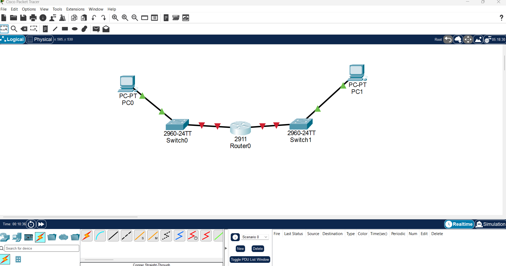

The red link indicators showed that the router connections were down.

### Enabling Router Interfaces

The router interfaces were enabled using Cisco IOS CLI.

```cisco
enable
configure terminal

interface gigabitEthernet 0/1
no shutdown

interface gigabitEthernet 0/2
no shutdown

end
```

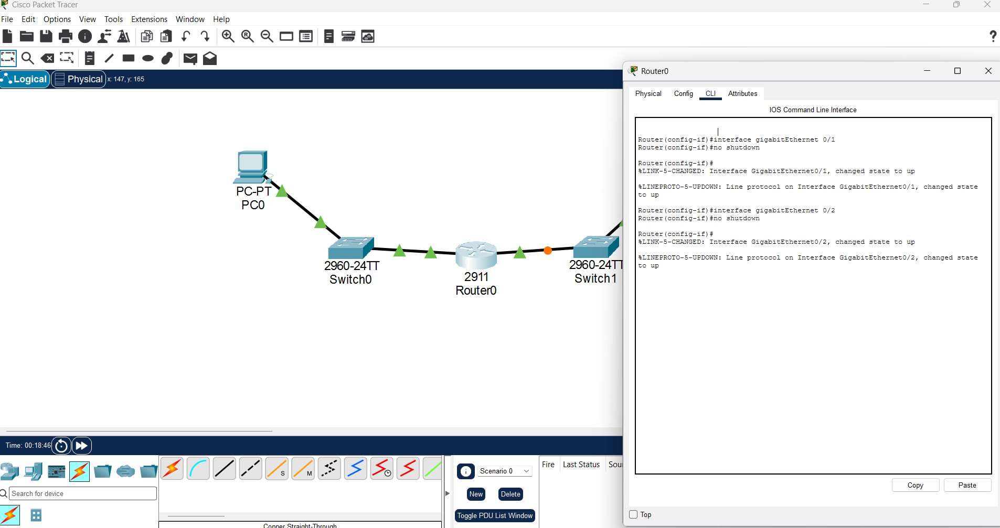

**Key concept:** Cisco router interfaces may be administratively disabled. The `no shutdown` command enables an interface, allowing it to become operational when the physical connection is working.

---

## 3. Router IPv4 Configuration

Router0 was configured with one IPv4 address for each directly connected network.

```cisco
enable
configure terminal

interface gigabitEthernet 0/1
ip address 192.168.1.1 255.255.255.0
no shutdown

interface gigabitEthernet 0/2
ip address 192.168.2.1 255.255.255.0
no shutdown

end
```

### Verifying Router Interfaces

```cisco
show ip interface brief
```

Expected configuration:

```text
Interface              IP-Address       Status    Protocol
GigabitEthernet0/1     192.168.1.1      up        up
GigabitEthernet0/2     192.168.2.1      up        up
```

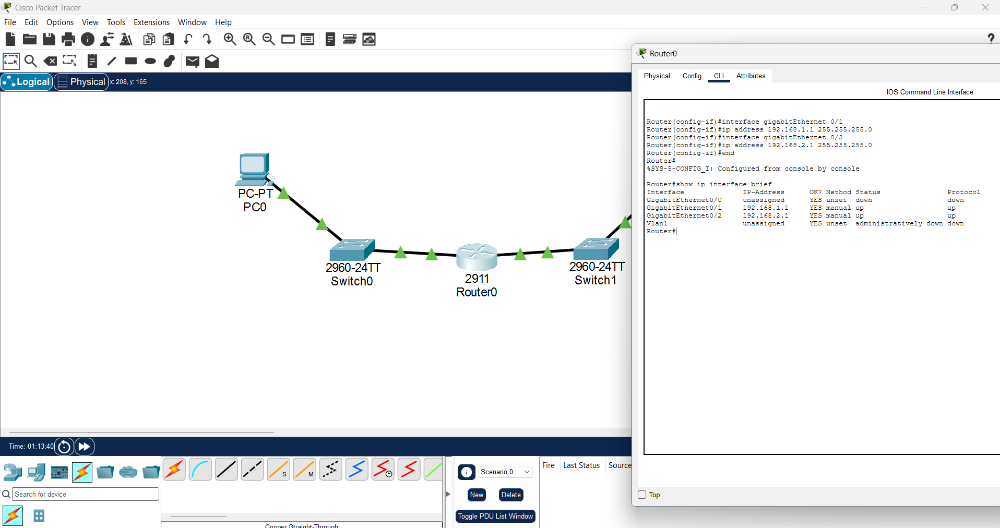

Both interfaces were successfully configured and operational.

---

## 4. PC0 IPv4 Configuration

PC0 belongs to Network A.

Configuration:

```text
IPv4 Address:     192.168.1.20
Subnet Mask:      255.255.255.0
Default Gateway:  192.168.1.1
```

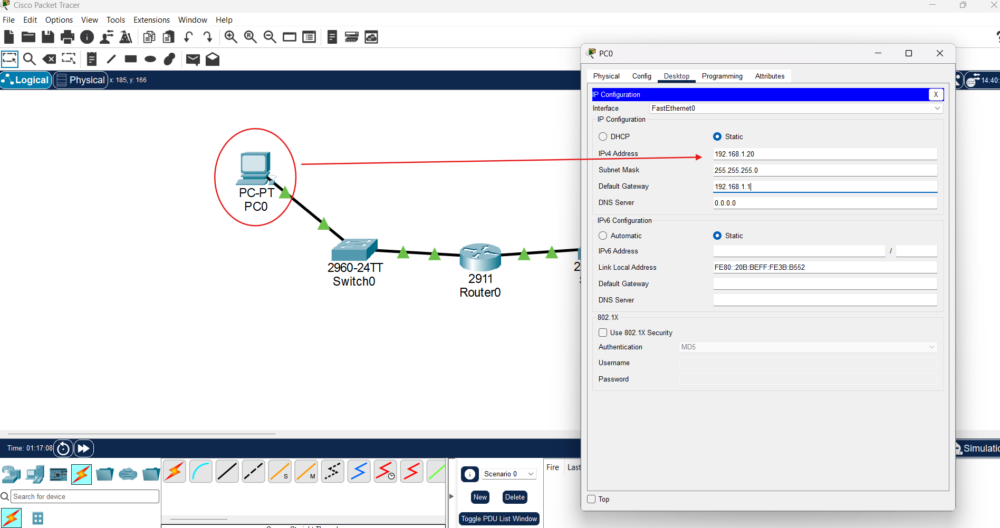

### Testing the Default Gateway

From PC0:

```cmd
ping 192.168.1.1
```

Result:

```text
Packets: Sent = 4, Received = 4, Lost = 0
```

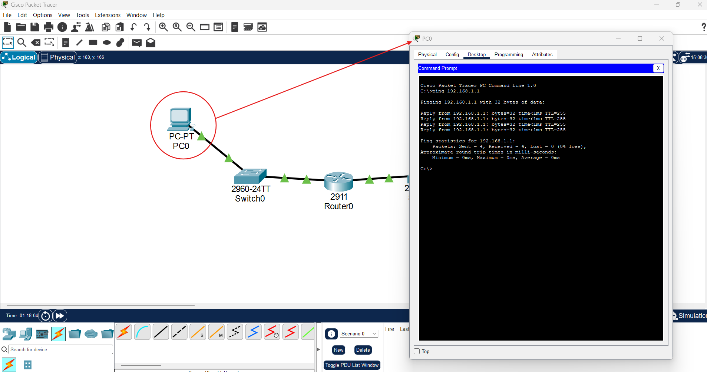

The successful ping confirms IP connectivity between PC0 and the router interface on Network A.

---

## 5. PC1 IPv4 Configuration

PC1 belongs to Network B.

Configuration:

```text
IPv4 Address:     192.168.2.20
Subnet Mask:      255.255.255.0
Default Gateway:  192.168.2.1
```

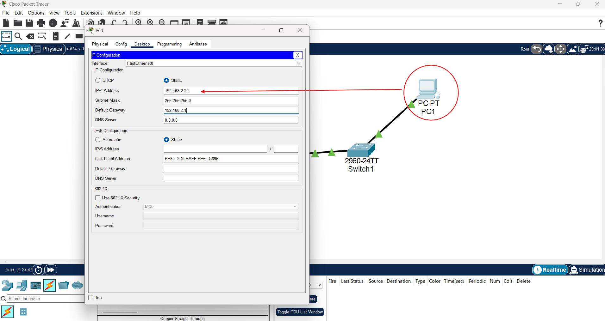

### Understanding the Default Gateway

When PC1 communicates with an address outside its local subnet, it sends the Ethernet frame toward its configured default gateway.

For this network:

```text
PC1:              192.168.2.20
Default Gateway:  192.168.2.1
Destination:      192.168.1.20
```

Because `192.168.1.20` is outside `192.168.2.0/24`, PC1 uses Router0 to reach the destination.

---

## 6. Testing Communication Between Subnets

From PC1:

```cmd
ping 192.168.1.20
```

Result:

```text
Packets: Sent = 4
Packets: Received = 4
Packets: Lost = 0
```

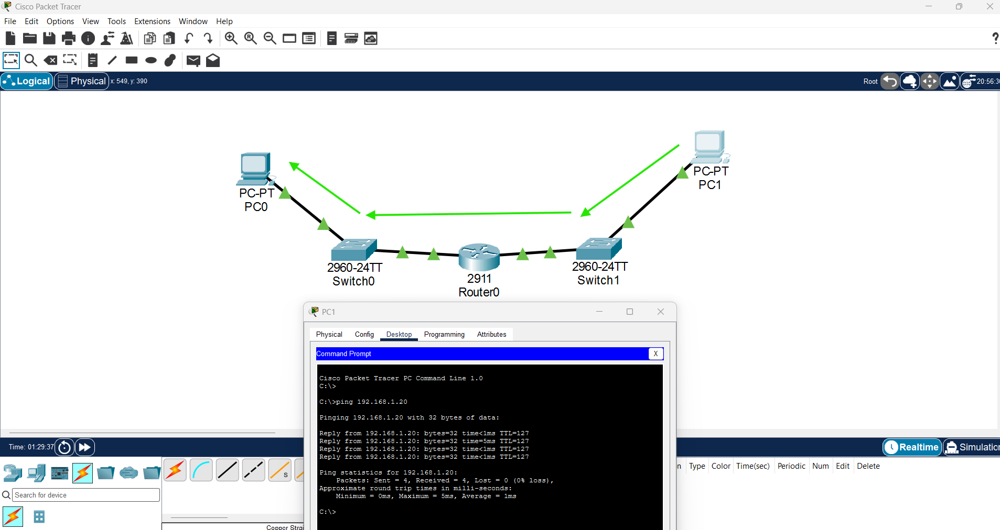

The successful test demonstrates that Router0 forwards traffic between the two directly connected networks.

### Packet Path

```text
PC1
 |
Switch1
 |
Router0
 |
Switch0
 |
PC0
```

The switches forward Ethernet frames within their respective LANs.

Router0 performs Layer 3 forwarding between the networks.

---

## 7. Inspecting the Routing Table

The router's routing table was inspected using:

```cisco
show ip route
```

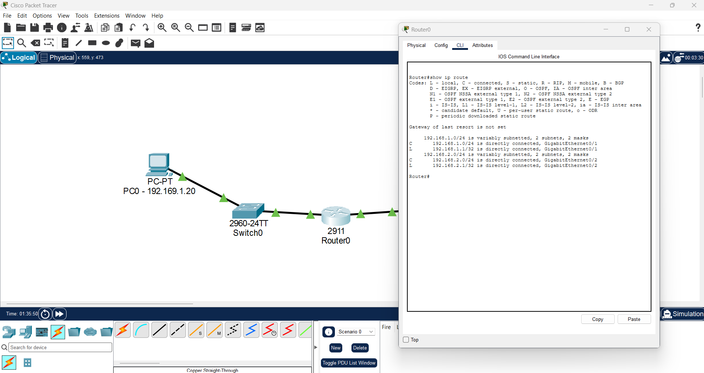

Relevant entries:

```text
C 192.168.1.0/24 is directly connected, GigabitEthernet0/1
L 192.168.1.1/32 is directly connected, GigabitEthernet0/1

C 192.168.2.0/24 is directly connected, GigabitEthernet0/2
L 192.168.2.1/32 is directly connected, GigabitEthernet0/2
```

### Understanding Route Codes

| Code | Meaning |
|---|---|
| C | Directly connected network |
| L | Local interface IPv4 address |
| S | Static route |
| R | RIP-learned route |
| O | OSPF-learned route |

In this lab, only connected and local routes were needed.

No static routes or dynamic routing protocols were required because both networks were directly connected to the same router.

### Gateway of Last Resort

The routing table displayed:

```text
Gateway of last resort is not set
```

This was not a configuration error.

Router0 already knew how to reach both lab networks.

A default route would become relevant if Router0 needed to forward traffic toward additional unknown destinations, such as an upstream network.

---

## 8. Traceroute Analysis

From PC1:

```cmd
tracert 192.168.1.20
```

Observed result:

```text
1    192.168.2.1
2    192.168.1.20

Trace complete.
```

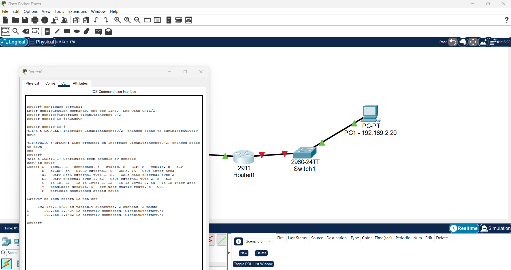

### Interpretation

**Hop 1 — 192.168.2.1**

The packet reaches Router0 through the default gateway configured on PC1.

**Hop 2 — 192.168.1.20**

The packet reaches the destination host on Network A.

The traceroute confirms that the communication crosses one router.

---

## 9. ICMP Packet Simulation

Cisco Packet Tracer Simulation Mode was used to observe the movement of an ICMP Echo Request.

The simulation filters were configured to display:

- ARP
- ICMP

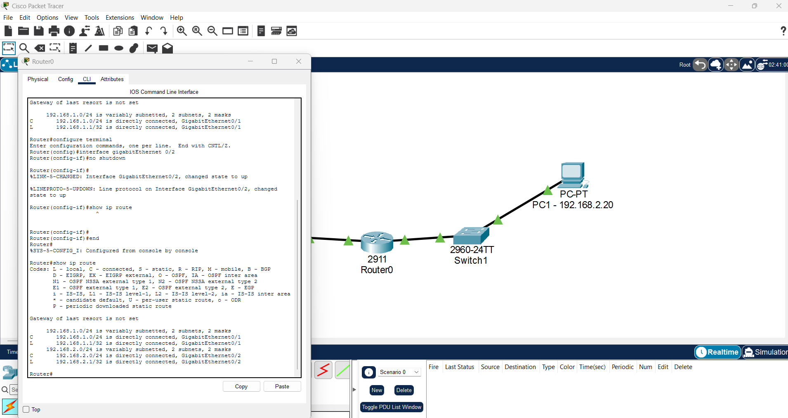

### ICMP Forwarding Path

```text
PC1
  |
  v
Switch1
  |
  v
Router0
  |
  v
Switch0
  |
  v
PC0
```

The ICMP Echo Request originated from:

```text
Source IP:      192.168.2.20
Destination IP: 192.168.1.20
```

### Packet Arrival at the Router

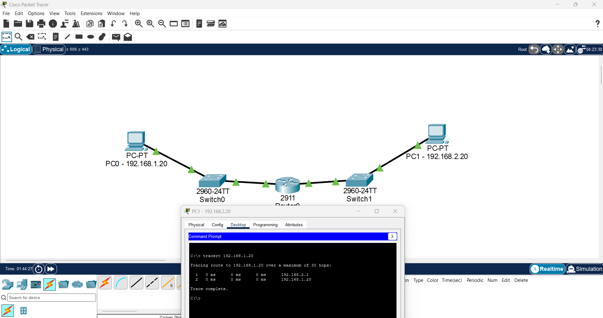

The router received the Ethernet frame through GigabitEthernet0/2.

It inspected the destination IPv4 address and selected GigabitEthernet0/1 as the outgoing interface.

### Ethernet Frame Rewriting

The packet retained its original IPv4 source and destination addresses during forwarding.

However, the Ethernet frame changed.

**Inbound Ethernet frame:**

```text
Source MAC:      PC1 MAC address
Destination MAC: Router0 Gi0/2 MAC address
```

**Outbound Ethernet frame:**

```text
Source MAC:      Router0 Gi0/1 MAC address
Destination MAC: PC0 MAC address
```

This demonstrates an important difference between Layer 2 and Layer 3.

- Layer 2 Ethernet addresses are used for delivery on the current local link.
- Layer 3 IPv4 addresses identify the source and destination hosts across networks.
- The router removes the incoming Ethernet encapsulation and constructs a new Ethernet frame for the outgoing network.
- The IPv4 TTL is decremented during routing.

---

## 10. Packet Forwarding Verification

The simulation was advanced one event at a time.

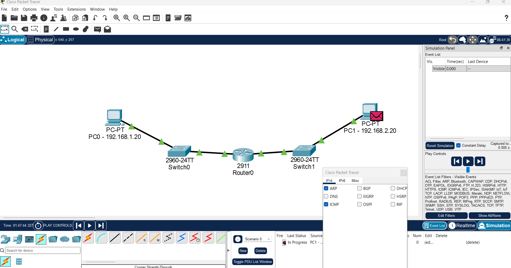

The ICMP packet successfully crossed Router0.

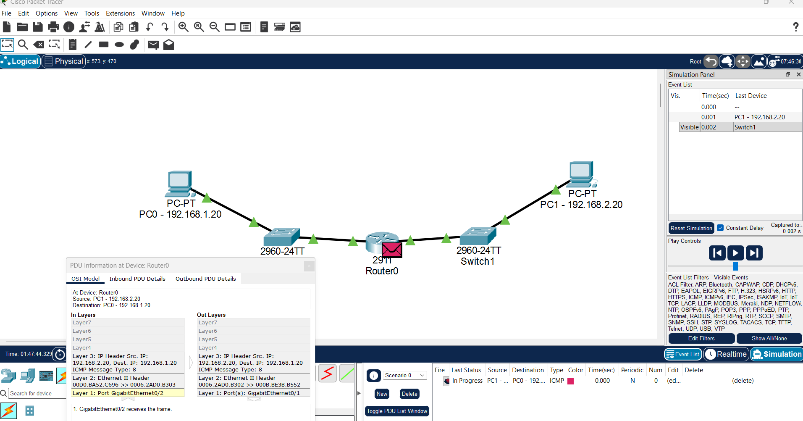

The router forwarded the packet toward Switch0 and PC0.

### Final Packet Delivery

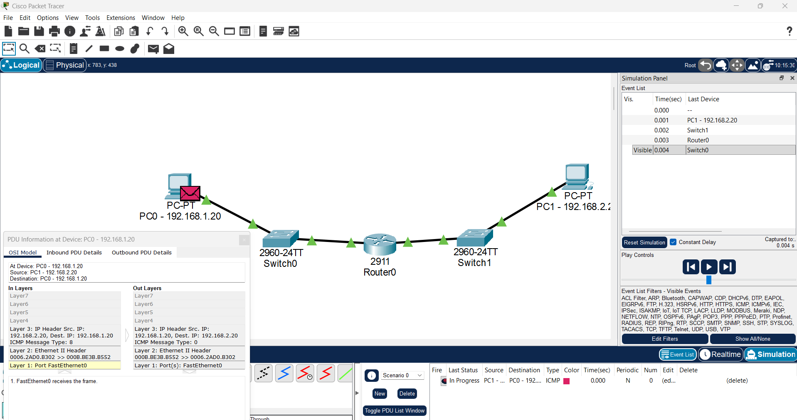

The inbound PDU at PC0 showed:

```text
Source IP:      192.168.2.20
Destination IP: 192.168.1.20
ICMP Type:      8
```

ICMP Type 8 identifies an Echo Request.

The simulation also showed the corresponding Echo Reply being prepared.

The destination PC received the request, confirming successful forwarding between the two subnets.

---

## 11. Troubleshooting — Administratively Disabled Interface

An additional experiment was performed by disabling GigabitEthernet0/2.

```cisco
enable
configure terminal

interface gigabitEthernet 0/2
shutdown

end
```

The physical link went down.

The router's routing table no longer contained the connected route for `192.168.2.0/24`.

### Why?

A directly connected route is normally installed when its associated Layer 3 interface is operational and has a valid IPv4 configuration.

Disabling the interface makes the connected network unavailable through that interface.

The interface was subsequently restored:

```cisco
configure terminal

interface gigabitEthernet 0/2
no shutdown

end
```

The connected route returned once the interface became operational.

**Lesson:** Interface state directly affects routing table entries and network reachability.

---

## 12. Additional Technical Diagrams

The following diagrams summarize the concepts investigated during this lab.

### Two Separate IPv4 Networks

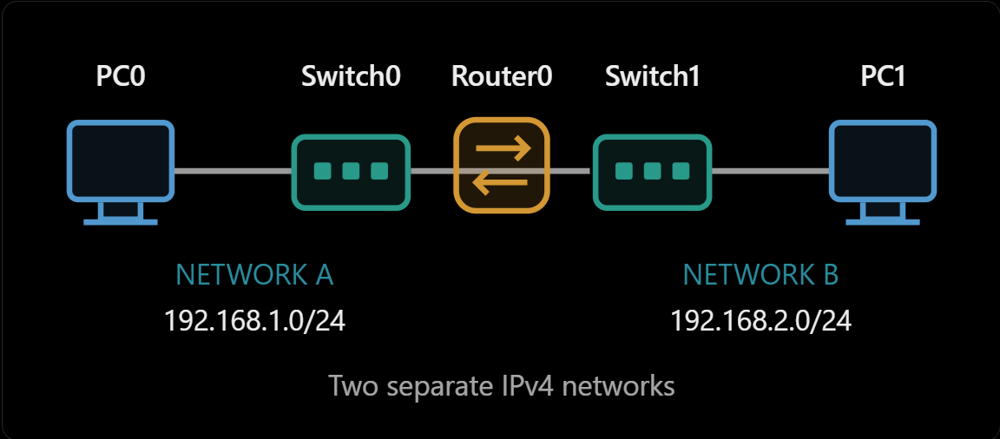

### Network A and Router Interface


### Default Gateway Concept

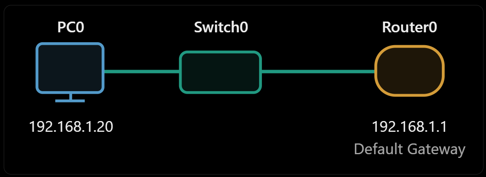

### Gateway Configuration on Both Networks

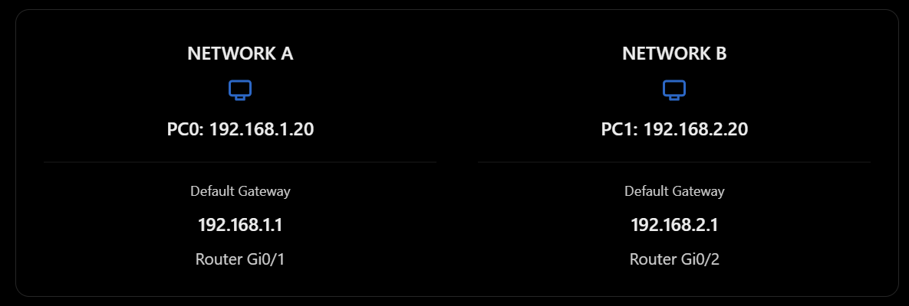

### ICMP Echo Request Path

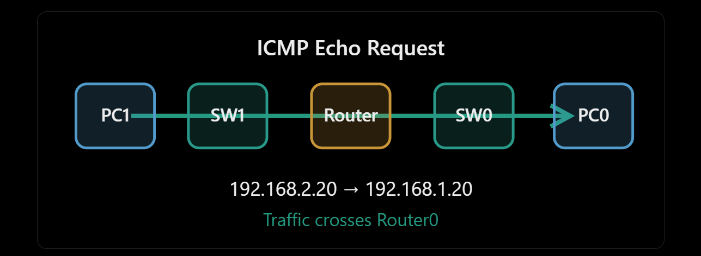

---

## 13. Commands Used

### Cisco IOS

```cisco
enable
configure terminal

interface gigabitEthernet 0/1
ip address 192.168.1.1 255.255.255.0
no shutdown

interface gigabitEthernet 0/2
ip address 192.168.2.1 255.255.255.0
no shutdown

end

show ip interface brief
show ip route
```

### Interface Troubleshooting

```cisco
configure terminal
interface gigabitEthernet 0/2
shutdown
no shutdown
end
```

### Windows / Packet Tracer PC

```cmd
ipconfig
ping 192.168.1.1
ping 192.168.1.20
tracert 192.168.1.20
```

---

## 14. Key Concepts Learned

**1. Different subnets require Layer 3 forwarding**

A conventional Layer 2 switch does not route IPv4 packets between separate subnets.

**2. The default gateway provides a path outside the local subnet**

Hosts use their configured gateway when the destination is not directly reachable on their local IPv4 network and no more specific route applies.

**3. Routers maintain routing tables**

A router uses the destination IP address and its routing table to select an outgoing interface or next hop.

**4. Directly connected routes are automatically installed**

An operational, properly configured router interface creates connected and local route entries.

**5. IP and MAC addresses serve different purposes**

The IPv4 source and destination addresses remain associated with the end hosts during ordinary forwarding, while Ethernet addressing changes between routed links.

**6. Interface status affects connectivity**

An administratively disabled interface cannot forward traffic and its directly connected route is withdrawn.

**7. Simulation Mode reveals protocol behavior**

Packet Tracer provides visibility into ARP, ICMP, Ethernet encapsulation, and router forwarding decisions.

---

## 15. Lab Results

| Test | Result |
|---|---|
| Router interface configuration | PASS |
| PC0 default gateway connectivity | PASS |
| PC1 to PC0 ICMP connectivity | PASS |
| Directly connected routes verification | PASS |
| Traceroute across router | PASS |
| ICMP packet forwarding simulation | PASS |
| Ethernet frame inspection | PASS |
| Interface shutdown troubleshooting | PASS |
| Route restoration after `no shutdown` | PASS |

All major lab objectives were successfully completed.

---

## Conclusion

This lab demonstrated the practical configuration and operation of inter-subnet routing using a Cisco 2911 router.

By manually configuring interfaces, assigning default gateways, inspecting routing tables, and following ICMP traffic through Simulation Mode, I gained practical experience with fundamental Layer 3 networking behavior.

The most important observation was that a router forwards packets between different IPv4 networks while rebuilding the Layer 2 Ethernet encapsulation for each outgoing link.

This knowledge provides a foundation for more advanced networking topics, including static routing, multiple-router topologies, VLAN routing, network segmentation, and troubleshooting.

---

**Tools:** Cisco Packet Tracer, Cisco IOS CLI, ICMP, ARP, IPv4, Ethernet

**Project:** Network Infrastructure — Hands-On Labs

**Lab:** LAB003 — Inter-Subnet Routing
