# LAB006 — Inter-VLAN Routing (Router-on-a-Stick)

**Cisco Packet Tracer | Network Infrastructure | VLANs | 802.1Q Trunking | Layer 3 Routing**

## Overview

This lab demonstrates how **two isolated VLANs can communicate through a router while sharing a single physical router-to-switch connection**. It builds on the previous VLAN-segmentation exercise: creating VLANs separates Layer 2 broadcast domains; adding inter-VLAN routing makes communication between their IP networks possible.

The environment was built from scratch in Cisco Packet Tracer using one Cisco 2911 router, one Cisco 2960 switch, and two PCs. The configuration was validated using switch and router status commands, an ICMP ping, and `tracert`.

**Verified result:** PC0 (`192.168.10.10`, VLAN 10) reached PC1 (`192.168.20.10`, VLAN 20) through Router0. The traceroute showed the VLAN 10 gateway (`192.168.10.1`) as the first hop and PC1 as the second.

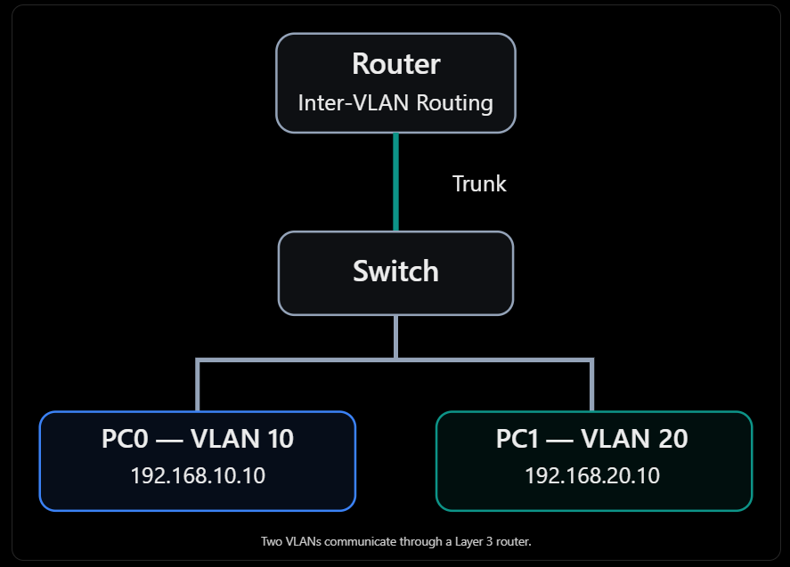

## Objectives

- Create and identify two separate VLANs on a Layer 2 switch.
- Assign each PC-facing switch port to the correct VLAN.
- Configure the router-to-switch link as an **IEEE 802.1Q trunk**.
- Create two router subinterfaces with one gateway IP address per VLAN.
- Verify the router's directly connected routes.
- Prove inter-VLAN communication with `ping` and confirm the path with `tracert`.
- Understand the difference between **network segmentation**, **routing**, and **traffic filtering**.

## Network Topology and Addressing

| Device | Interface / connection | VLAN | IPv4 address | Subnet mask | Default gateway |
| --- | --- | --- | --- | --- | --- |
| PC0 | FastEthernet0 → Switch Fa0/1 | 10 | `192.168.10.10` | `255.255.255.0` | `192.168.10.1` |
| PC1 | FastEthernet0 → Switch Fa0/2 | 20 | `192.168.20.10` | `255.255.255.0` | `192.168.20.1` |
| Switch0 (2960) | GigabitEthernet0/1 → Router Gi0/0 | 802.1Q trunk | Not assigned | — | — |
| Router0 (2911) | GigabitEthernet0/0.10 | 10 | `192.168.10.1` | `255.255.255.0` | — |
| Router0 (2911) | GigabitEthernet0/0.20 | 20 | `192.168.20.1` | `255.255.255.0` | — |

All three physical connections use **Copper Straight-Through** cables. The router's `Gi0/0` interface is the physical uplink; `.10` and `.20` are *logical subinterfaces*, not additional physical cables.

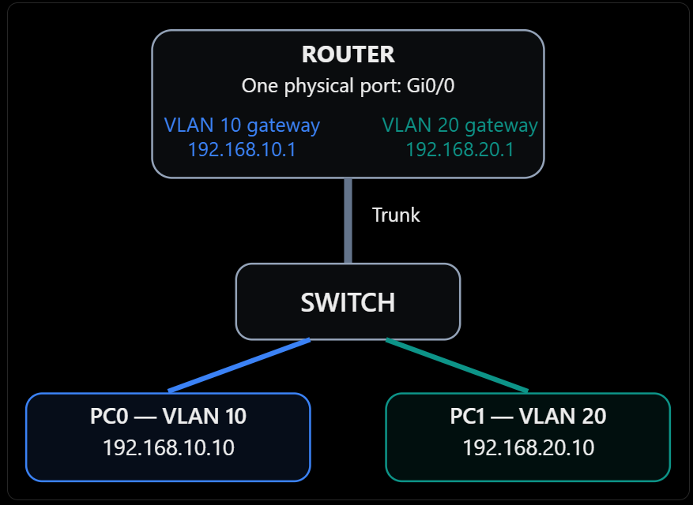

## Implementation and Evidence

### 1. Create VLAN 10 and VLAN 20 on Switch0

On the **Cisco 2960 switch**, create the VLANs:

```cisco
Switch> enable
Switch# configure terminal
Switch(config)# vlan 10
Switch(config-vlan)# name VLAN10
Switch(config-vlan)# exit
Switch(config)# vlan 20
Switch(config-vlan)# name VLAN20
Switch(config-vlan)# exit
Switch(config)# end
Switch# show vlan brief
```

**Observation:** both VLANs were listed as active, but the PC-facing ports initially remained in the default VLAN 1. Creating a VLAN does not automatically move devices into it.

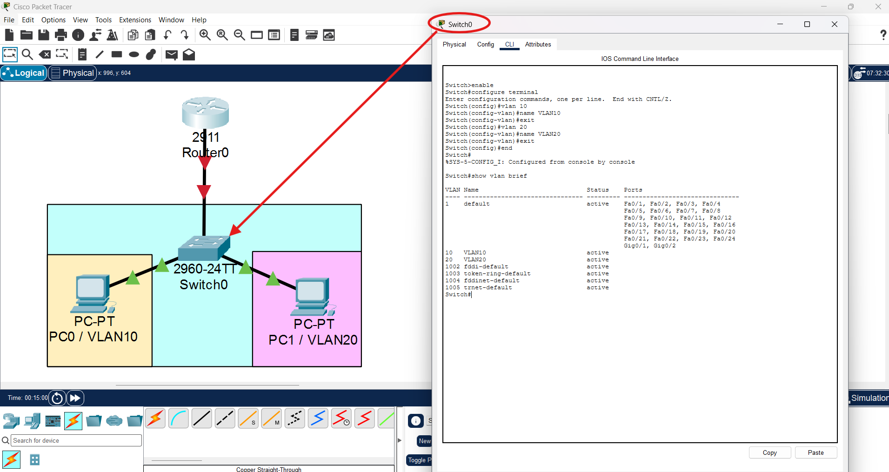

### 2. Assign switch access ports

Assign PC0 to VLAN 10 and PC1 to VLAN 20:

```cisco
Switch# configure terminal
Switch(config)# interface fastEthernet0/1
Switch(config-if)# switchport mode access
Switch(config-if)# switchport access vlan 10
Switch(config-if)# exit
Switch(config)# interface fastEthernet0/2
Switch(config-if)# switchport mode access
Switch(config-if)# switchport access vlan 20
Switch(config-if)# end
Switch# show vlan brief
```

**Verified result:** `Fa0/1` appeared under VLAN 10, and `Fa0/2` under VLAN 20.

An **access port** belongs to one VLAN for normal host traffic; it is different from the trunk uplink, which carries traffic for multiple VLANs.

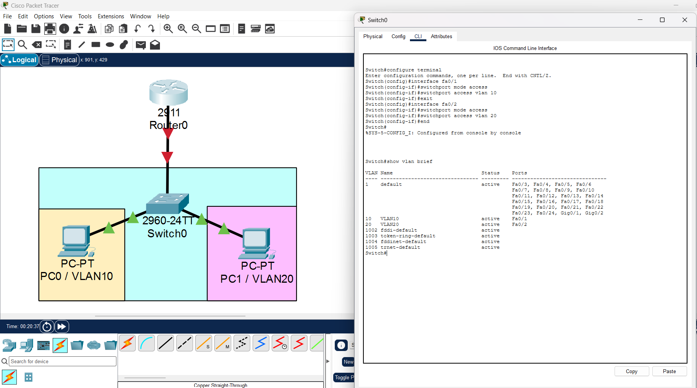

### 3. Configure the PCs

Both PCs use static IPv4 addresses and a default gateway in their own subnet:

```text
PC0 (VLAN 10)                  PC1 (VLAN 20)
IP:      192.168.10.10         IP:      192.168.20.10
Mask:    255.255.255.0         Mask:    255.255.255.0
Gateway: 192.168.10.1          Gateway: 192.168.20.1
```

When PC0 wants to reach `192.168.20.10`, the destination is **outside** `192.168.10.0/24`. PC0 therefore sends the packet to its default gateway (`192.168.10.1`) for routing rather than trying to deliver it directly to PC1.

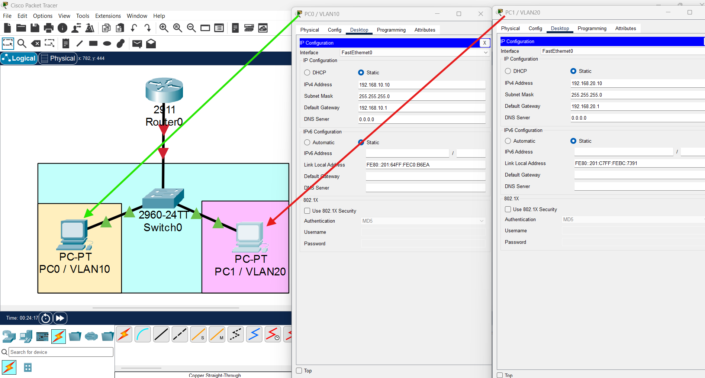

### 4. Bring the router's physical interface up

The link initially appeared down in Packet Tracer because the router's physical interface had not yet been enabled.

On **Router0 (2911)**:

```cisco
Router> enable
Router# configure terminal
Router(config)# interface gigabitEthernet0/0
Router(config-if)# no shutdown
Router(config-if)# end
Router# show ip interface brief
```

**Verified result:** `GigabitEthernet0/0` transitioned to **up/up**. Its IP address remained `unassigned`, because the gateway IP addresses would be configured on its subinterfaces instead.

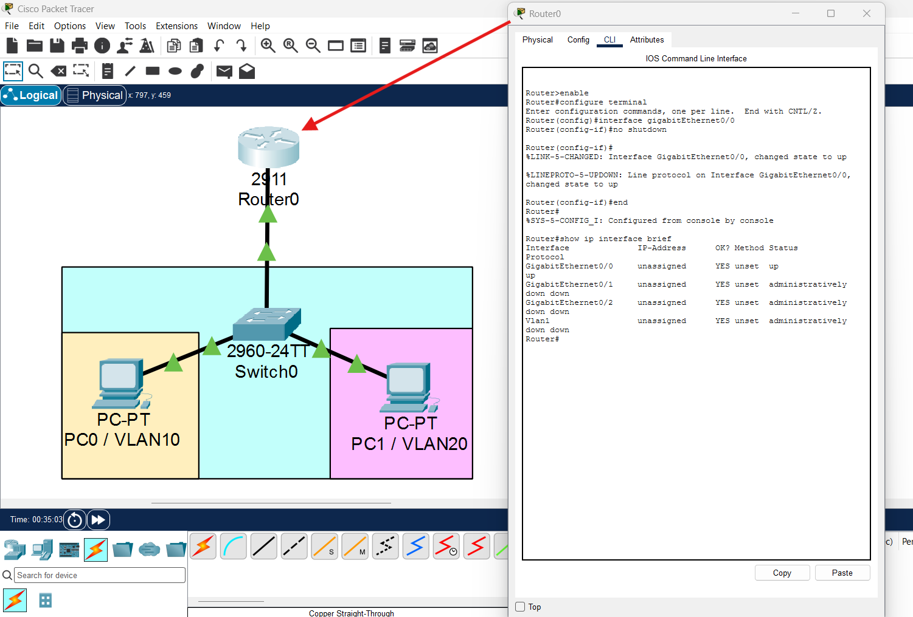

### 5. Configure and verify the switch trunk

On **Switch0**, configure the uplink to the router:

```cisco
Switch# configure terminal
Switch(config)# interface gigabitEthernet0/1
Switch(config-if)# switchport mode trunk
Switch(config-if)# end
Switch# show interfaces trunk
```

**Verified result:** `Gi0/1` displayed `802.1q` encapsulation and `trunking` status, with VLANs **1, 10, and 20** active and forwarding. The trunk allowed multiple VLANs across one physical link while retaining VLAN identification.

> The trunk-status output was initially empty while the router-side link was down. After enabling `Gi0/0`, the operational trunk appeared. A configured trunk is not necessarily an *operational* trunk until the link is up.

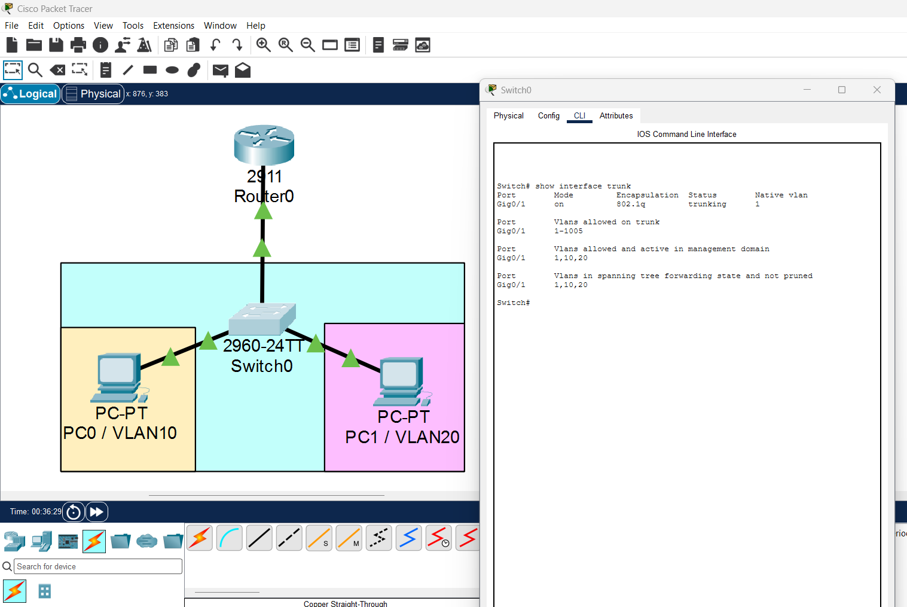

### 6. Configure router subinterfaces (Router-on-a-Stick)

One physical router port handles both VLANs through two logical subinterfaces. Each subinterface is associated with its VLAN using an **802.1Q tag** and has the appropriate gateway IP address.

On **Router0**:

```cisco
Router# configure terminal
Router(config)# interface gigabitEthernet0/0.10
Router(config-subif)# encapsulation dot1Q 10
Router(config-subif)# ip address 192.168.10.1 255.255.255.0
Router(config-subif)# exit
Router(config)# interface gigabitEthernet0/0.20
Router(config-subif)# encapsulation dot1Q 20
Router(config-subif)# ip address 192.168.20.1 255.255.255.0
Router(config-subif)# end
Router# show ip interface brief
```

**Verified result:**

```text
GigabitEthernet0/0       unassigned      up   up
GigabitEthernet0/0.10    192.168.10.1     up   up
GigabitEthernet0/0.20    192.168.20.1     up   up
```

A **subinterface is a logical Layer 3 interface**, not a new physical port. `encapsulation dot1Q 10` and `encapsulation dot1Q 20` tell the router which tagged frames belong to each VLAN.

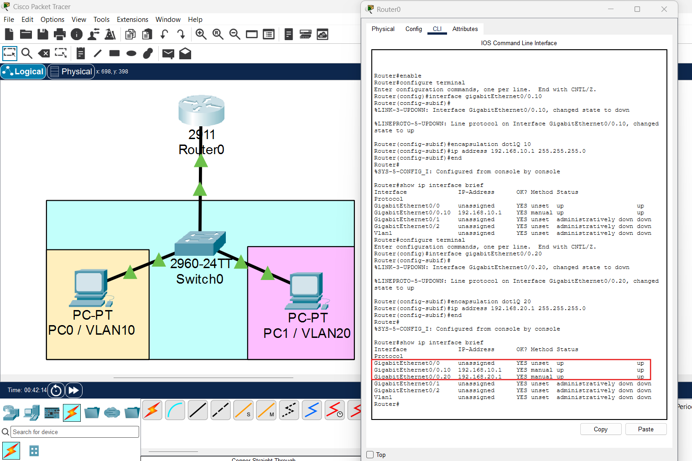

### 7. Verify inter-VLAN connectivity and the actual path

From **PC0 → Desktop → Command Prompt**:

```cmd
ping 192.168.20.10
tracert 192.168.20.10
```

**Observed ping result:**

```text
Packets: Sent = 4, Received = 3, Lost = 1 (25% loss)
```

The first echo request timed out, while the following three received replies. This is consistent with initial ARP resolution or Packet Tracer convergence; the capture alone does not prove the exact reason. Successful subsequent replies established connectivity between VLANs.

**Observed traceroute:**

```text
1    192.168.10.1
2    192.168.20.10
```

The first hop is **Router0's VLAN 10 gateway**; the second is the destination PC in VLAN 20. This confirms that traffic crosses a Layer 3 router rather than being switched directly between VLANs.

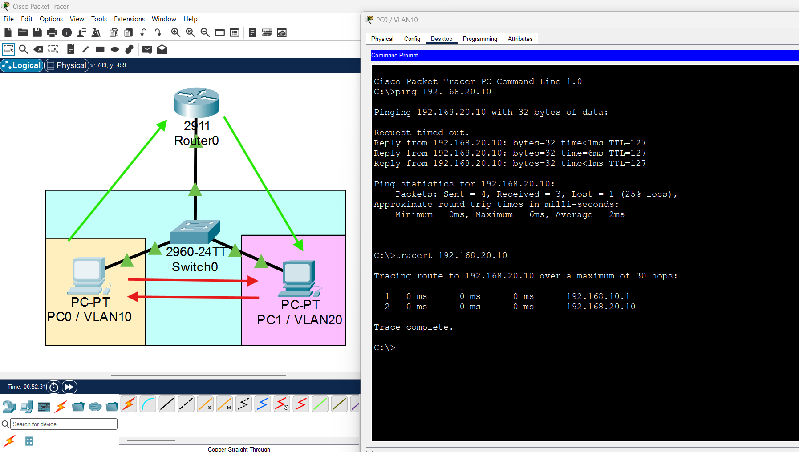

### 8. Verify the router's forwarding knowledge

On **Router0**:

```cisco
Router> show ip route
```

**Verified routes:**

```text
C 192.168.10.0/24 is directly connected, GigabitEthernet0/0.10
L 192.168.10.1/32 is directly connected, GigabitEthernet0/0.10
C 192.168.20.0/24 is directly connected, GigabitEthernet0/0.20
L 192.168.20.1/32 is directly connected, GigabitEthernet0/0.20
```

- **`C` — Connected:** the router has an interface on that network and can forward traffic to it.
- **`L` — Local:** the exact IP address assigned to the router's interface (`/32` identifies one host address).
- **`Gateway of last resort is not set`:** no default route exists, which does not prevent routing between these two directly connected networks.

No static route was required because both networks are directly connected to Router0.

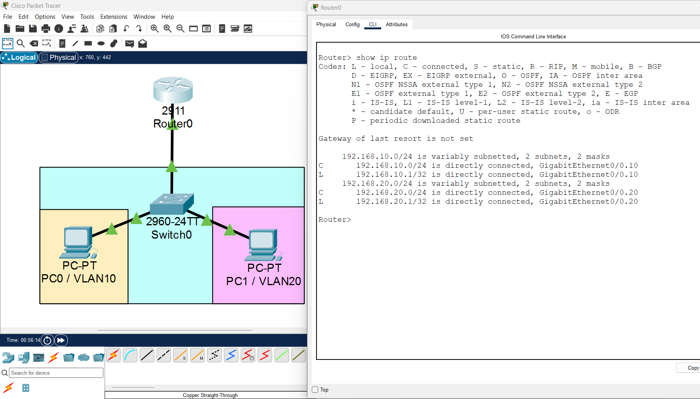

## How a Packet Travels Between VLANs

```text
PC0: 192.168.10.10 (VLAN 10)
    |
    | Destination 192.168.20.10 is outside PC0's /24 subnet
    v
Switch0: Fa0/1 (VLAN 10 access port)
    |
    | VLAN 10 traffic crosses the 802.1Q trunk (Gi0/1)
    v
Router0: Gi0/0.10 (192.168.10.1)
    |
    | Router selects connected 192.168.20.0/24 route
    v
Router0: Gi0/0.20 (192.168.20.1)
    |
    | VLAN 20 traffic crosses the same physical trunk
    v
Switch0: Fa0/2 (VLAN 20 access port)
    |
    v
PC1: 192.168.20.10
```

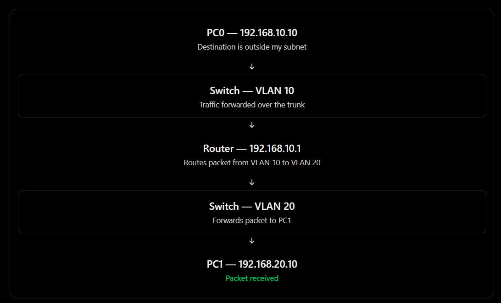

The packet crosses the **same router-to-switch cable twice in the logical forwarding path**: toward the router in VLAN 10 and back toward the switch in VLAN 20. This is the defining feature of **Router-on-a-Stick**.

## Technical Findings and Security Relevance

| Finding | Significance |
| --- | --- |
| VLANs separate Layer 2 broadcast domains | Hosts in different VLANs do not communicate directly through Layer 2 switching. |
| The trunk carries multiple VLANs | 802.1Q tags identify VLAN traffic over a single physical uplink. |
| Router subinterfaces provide separate gateways | Each VLAN gets a Layer 3 interface in its own IP subnet. |
| Inter-VLAN routing succeeded | Successful replies and `tracert` verify the intended path. |
| No ACL or firewall policy was configured | Once routing is enabled, these VLANs can communicate; VLAN separation **alone** does not enforce a security policy between them. |

For an enterprise network, this pattern can be scaled to multiple VLANs, although larger deployments often use **Layer 3 switches** instead of a single router uplink. Security teams must distinguish **segmentation** (separate VLANs) from **access control** (rules governing which inter-VLAN traffic is allowed).

## Troubleshooting Notes

Two practical issues occurred during setup:

1. **Device context:** the Cisco 2911 router does not accept the same `vlan 10` configuration used on a 2960 switch. The `Router#` and `Switch#` prompts identify which device is being configured.
2. **Interface state:** `show interfaces trunk` initially showed no operational trunk while Router0's `Gi0/0` was disabled. Enabling it with `no shutdown` brought the link up.

These are configuration-context and operational-state issues, not failures of the inter-VLAN routing design.

## Conclusion

**Outcome: Successful.** The lab demonstrated **Router-on-a-Stick inter-VLAN routing** with two VLANs and one router-to-switch trunk. The configuration was verified at three levels: **switch VLAN/trunk state**, **router subinterfaces/routing table**, and **end-to-end PC connectivity with traceroute**.

The key lesson is that a VLAN determines a host's Layer 2 segment, while a router forwards packets between the resulting IP networks. Enabling routing is not the same as enforcing isolation: inter-VLAN restrictions require additional controls such as ACLs or firewall policies.

---

*Environment: Cisco Packet Tracer. All devices, addresses, and connectivity tests belong to an isolated educational lab.*
