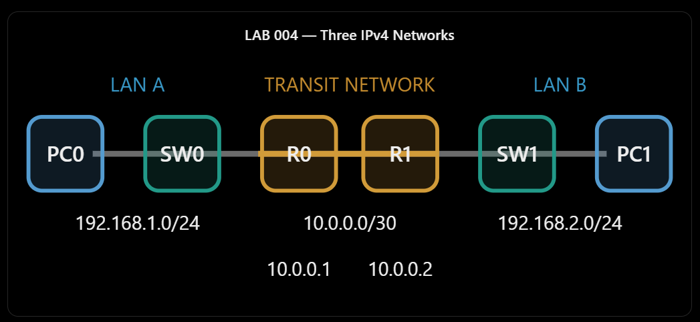
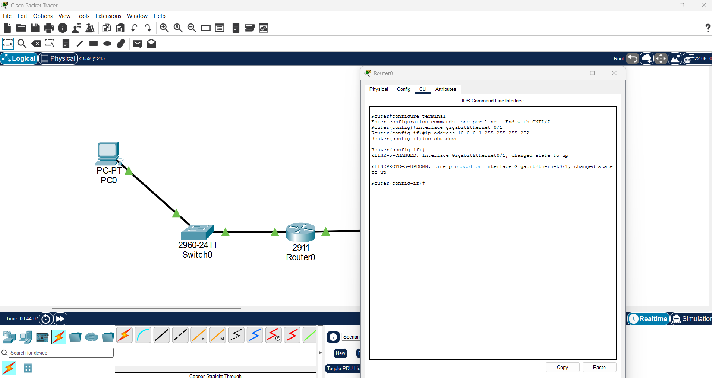
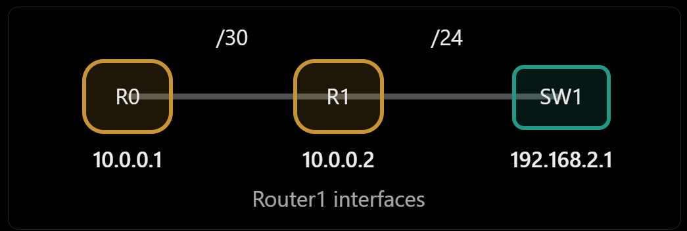
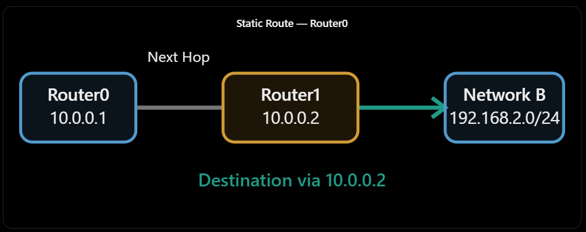
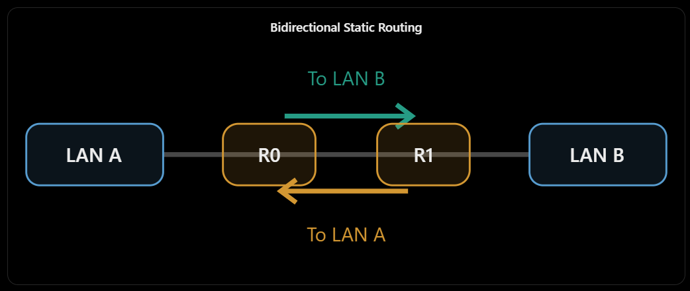

# LAB004 — Static Routing Between Two Routers

## Overview

This hands-on Cisco Packet Tracer lab demonstrates **bidirectional static routing** between two separate IPv4 LANs through two Cisco routers. I built the topology from scratch, configured router interfaces and PC default gateways, added one static route on each router, inspected both routing tables, and validated end-to-end traffic with `ping` and `tracert`.

**Result:** The second PC0-to-PC1 ping succeeded with **4/4 replies (0% loss)**. Traceroute identified **Router0, Router1, and the destination host**.

> Scope: Basic IPv4 static routing. This lab does not configure a dynamic routing protocol or test route-failure recovery.

## Network Topology


**Physical path:** `PC0 → Switch0 → Router0 → Router1 → Switch1 → PC1`

| Device | Interface | IPv4 address | Mask / Gateway |
|---|---|---|---|
| PC0 | FastEthernet0 | `192.168.1.20` | `/24`; gateway `192.168.1.1` |
| Router0 | GigabitEthernet0/0 | `192.168.1.1` | `/24` (LAN A) |
| Router0 | GigabitEthernet0/1 | `10.0.0.1` | `/30` (transit) |
| Router1 | GigabitEthernet0/1 | `10.0.0.2` | `/30` (transit) |
| Router1 | GigabitEthernet0/0 | `192.168.2.1` | `/24` (LAN B) |
| PC1 | FastEthernet0 | `192.168.2.20` | `/24`; gateway `192.168.2.1` |

Three IPv4 networks are involved:

- **LAN A:** `192.168.1.0/24`
- **Transit network:** `10.0.0.0/30` — two usable host addresses, one for each router
- **LAN B:** `192.168.2.0/24`

The Layer 2 switches do not need management IP addresses to forward Ethernet frames in this basic topology.



## 1. Building the Topology

Equipment: two PC-PT hosts, two Cisco 2960-24TT switches, and two Cisco 2911 routers. The topology was created using **File → New**, not by modifying a previous lab.


Connections used:

| From | Interface | To | Interface | Cable |
|---|---|---|---|---|
| PC0 | Fa0 | Switch0 | Fa0/1 | Copper straight-through |
| Switch0 | Gi0/1 | Router0 | Gi0/0 | Copper straight-through |
| Router0 | Gi0/1 | Router1 | Gi0/1 | Copper cross-over |
| Router1 | Gi0/0 | Switch1 | Gi0/1 | Copper straight-through |
| Switch1 | Fa0/1 | PC1 | Fa0 | Copper straight-through |

Red link indicators initially appeared on router connections because their interfaces were not yet enabled.

Supporting diagrams: [Connection order](screenshots/x-tra-001.png) · [PC0–Switch0–Router0 ports](screenshots/x-tra-002.png) · [Router-to-router cross-over cable](screenshots/x-tra-003.png)

## 2. Configuring Router0

Router0 supplies the default gateway for LAN A and one end of the inter-router transit network.

```cisco
Router> enable
Router# configure terminal
Router(config)# interface gigabitEthernet 0/0
Router(config-if)# ip address 192.168.1.1 255.255.255.0
Router(config-if)# no shutdown
Router(config-if)# interface gigabitEthernet 0/1
Router(config-if)# ip address 10.0.0.1 255.255.255.252
Router(config-if)# no shutdown
Router(config-if)# end
Router# show ip interface brief
```

**Troubleshooting observed:** Router0's `Gi0/1` was initially `unassigned` and `administratively down`; the inter-router link therefore remained red. Assigning `10.0.0.1/30` and issuing `no shutdown` restored the link. This is different from a missing static route: the physical/operational connection itself was not yet ready.



## 3. Configuring Router1

Router1 provides the other transit IP and the gateway for LAN B.

```cisco
Router> enable
Router# configure terminal
Router(config)# interface gigabitEthernet 0/1
Router(config-if)# ip address 10.0.0.2 255.255.255.252
Router(config-if)# no shutdown
Router(config-if)# interface gigabitEthernet 0/0
Router(config-if)# ip address 192.168.2.1 255.255.255.0
Router(config-if)# no shutdown
Router(config-if)# end
```




**Why `/30`?** On `10.0.0.0/30`, `10.0.0.0` is the network address, `10.0.0.1` and `10.0.0.2` are usable host addresses, and `10.0.0.3` is the broadcast address. This fits the two router interfaces on our point-to-point Ethernet link.

## 4. Configuring the PCs

**PC0 — Desktop → IP Configuration → Static**

```text
IP Address:      192.168.1.20
Subnet Mask:     255.255.255.0
Default Gateway: 192.168.1.1
```

**PC1 — Desktop → IP Configuration → Static**

```text
IP Address:      192.168.2.20
Subnet Mask:     255.255.255.0
Default Gateway: 192.168.2.1
```


The **default gateway** is the local router interface to which a PC sends IPv4 traffic for remote networks. It is **not** the `10.0.0.x` transit address.

## 5. Examining Directly Connected Routes

Before static routes were added, Router0's `show ip route` showed only its directly connected networks (plus local `/32` entries):

```text
C 10.0.0.0/30       is directly connected, GigabitEthernet0/1
L 10.0.0.1/32       is directly connected, GigabitEthernet0/1
C 192.168.1.0/24    is directly connected, GigabitEthernet0/0
L 192.168.1.1/32    is directly connected, GigabitEthernet0/0
```

Router0 did **not** yet have a route to `192.168.2.0/24`; Router1 likewise needed a route to `192.168.1.0/24`.

**Route codes:** `C` = connected, `L` = local interface address, `S` = manually configured static route.

## 6. Configuring Static Routes

### Router0 → LAN B

```cisco
Router0# configure terminal
Router0(config)# ip route 192.168.2.0 255.255.255.0 10.0.0.2
Router0(config)# end
Router0# show ip route
```

Expected and observed static route:

```text
S 192.168.2.0/24 [1/0] via 10.0.0.2
```




### Router1 → LAN A

```cisco
Router1# configure terminal
Router1(config)# ip route 192.168.1.0 255.255.255.0 10.0.0.1
Router1(config)# end
Router1# show ip route
```

Expected and observed static route:

```text
S 192.168.1.0/24 [1/0] via 10.0.0.1
```




**Important distinction:** `10.0.0.2` is Router0's **next hop** to reach LAN B. `192.168.1.1` is PC0's **default gateway**. They serve different roles.

## 7. Testing End-to-End Connectivity

On **PC0**:

```bat
ping 192.168.2.20
```

First run: **2 replies / 4 attempts (50% loss)**. Second run: **4 replies / 4 attempts (0% loss)**, with `TTL=126` in successful replies.


The early timeouts are consistent with initial ARP resolution in Packet Tracer, but the ping output alone does not conclusively identify their cause. The second run demonstrates working two-way IP reachability in the final tested setup.

With PC1's simulated initial TTL of 128, the Echo Reply arriving at PC0 with **TTL 126** is consistent with two router hops.

## 8. Traceroute: Confirming the Forwarding Path

From **PC0**:

```bat
tracert 192.168.2.20
```

Observed result:

```text
1    192.168.1.1      Router0
2    10.0.0.2         Router1
3    192.168.2.20     Destination PC1
Trace complete.
```


The traceroute shows **two routers**, followed by the destination PC. The Layer 2 switches do not appear as IP router hops.

## 9. Findings and Takeaways

1. **Connected routes are automatic:** A router learns networks on its own operational interfaces.
2. **Remote routes require information:** Without a matching remote route, Router0 cannot choose where to send traffic for LAN B.
3. **Two-way communication requires a return path:** Each router must know how to reach the remote LAN for ping replies to return.
4. **A default gateway and a static-route next hop are not the same thing:** PCs use their local LAN gateway, while routers use routing-table entries to select forwarding paths.
5. **Physical status and Layer 3 routing are separate:** A red inter-router link required an interface fix; adding a route would not have made a disabled port operational.
6. **Validation matters:** Both routing tables, a successful end-to-end ping, and traceroute provide complementary evidence.

## 10. Evidence Index

All links below point to files in this project's `screenshots/` directory.

| Evidence | File |
|---|---|
| Initial topology | [Initial topology](screenshots/001-first-config%282%29.png) |
| Router0 interface activation | [Router0 interface configuration](screenshots/002-router-config.png) |
| Router1 interface configuration | [Router1 interface configuration](screenshots/003-router-config2%281%29.png) |
| Both PC configurations | [PC IP configuration](screenshots/004-PCs-config%281%29.png) |
| Router0 static route | [Router0 routing table](screenshots/004-router0-config%281%29.png) |
| Router1 static route | [Router1 routing table](screenshots/005-router1-config%281%29.png) |
| Ping verification | [Ping: initial and repeat](screenshots/006-first-test-ping%282%29.png) |
| Traceroute | [Trace through two routers](screenshots/007-second-test-tracert%281%29.png) |
| Complete IP topology | [IP topology diagram](screenshots/Linear%20Network%20Topology%20Diagram%281%29.png) |
| Simplified topology | [Diagram 1](screenshots/x-tra-001.png) |
| First connection diagram | [Diagram 2](screenshots/x-tra-002.png) |
| Router cross-over connection | [Diagram 3](screenshots/x-tra-003.png) |
| Router1 interfaces | [Diagram 4](screenshots/x-tra-004.png) |
| Three IPv4 networks | [Diagram 5](screenshots/x-tra-005.png) |
| Router0 next hop | [Diagram 6](screenshots/x-tra-006.png) |
| Bidirectional static routing | [Diagram 7](screenshots/x-tra-007.png) |

## Conclusion

I configured and validated **manual, bidirectional IPv4 static routing** between two LANs connected through two Cisco 2911 routers and a `/30` transit network. The completed lab confirms that remote network reachability depends on both interface configuration and correct routing-table entries. The project establishes a practical foundation for troubleshooting routing failures and studying more advanced network designs.

**Tool:** Cisco Packet Tracer  
**Focus:** IPv4 subnetting, Cisco IOS, static routing, next-hop selection, default gateways, ICMP, traceroute
