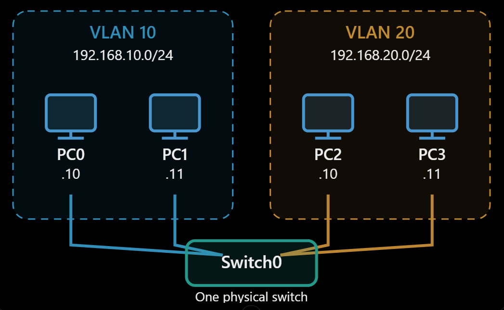
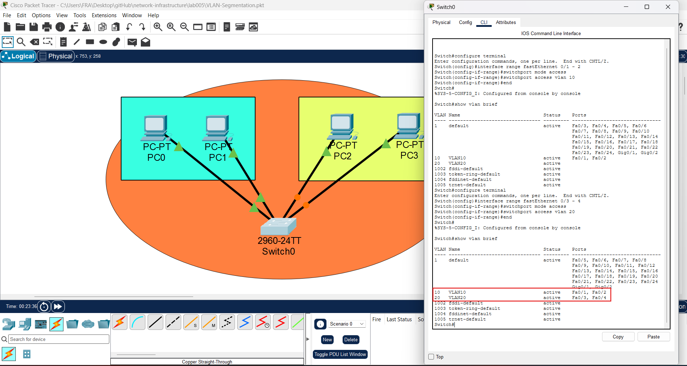
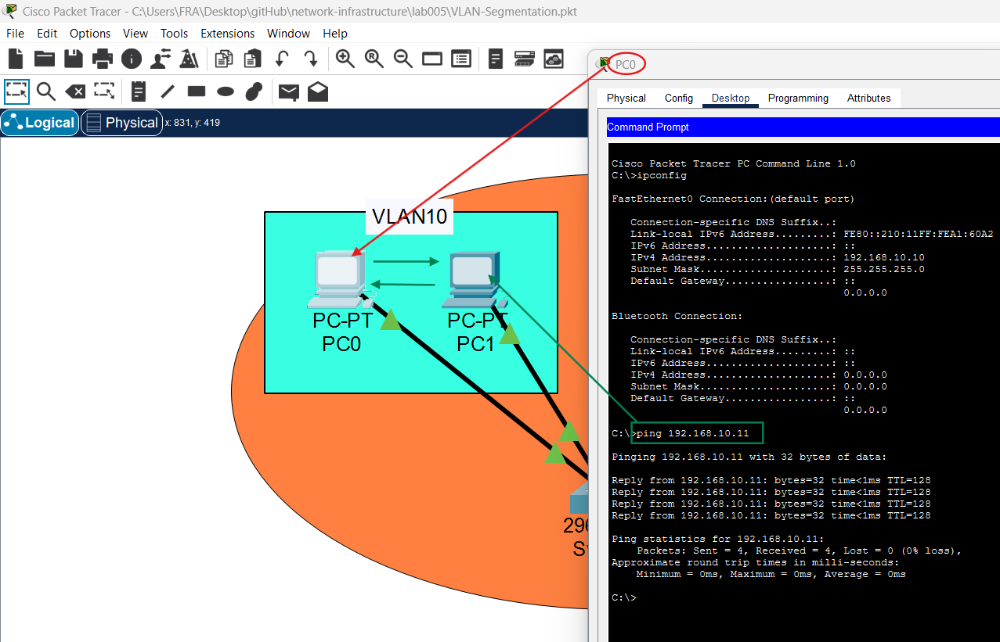
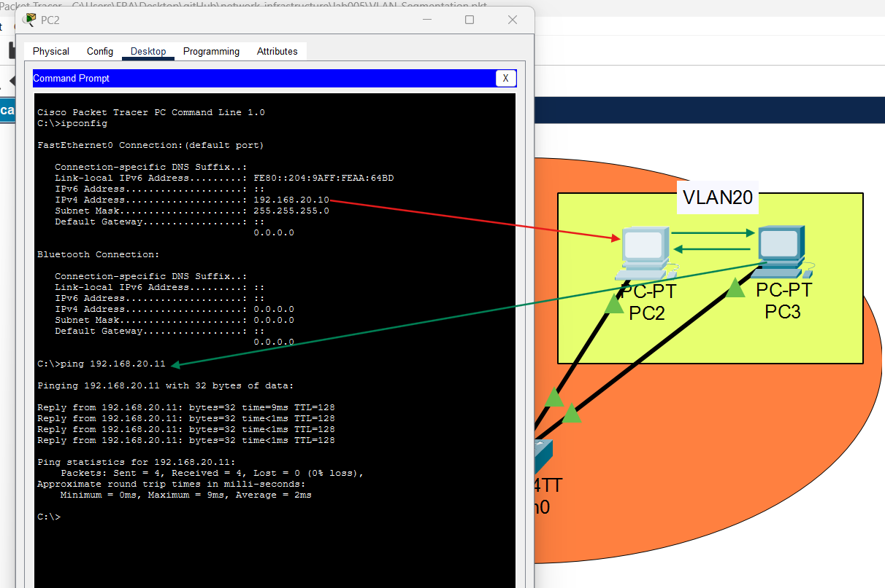
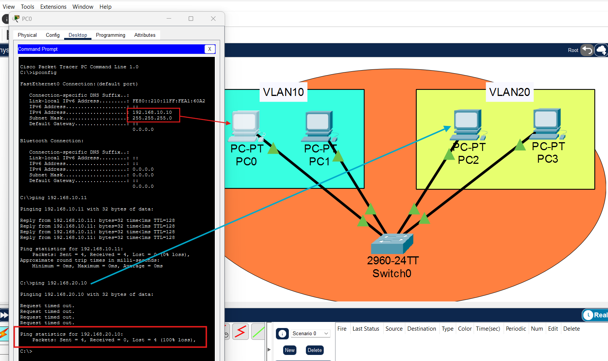

# VLAN Segmentation & Network Isolation

**Cisco Packet Tracer | Layer 2 Switching | VLANs | Network Segmentation**

## Overview

This lab demonstrates how a single **Cisco 2960-24TT switch** can be logically divided into two isolated Layer 2 broadcast domains using VLANs.

Four PCs share the same physical switch but are assigned to two different VLANs and IPv4 subnets.

The project covers VLAN creation, access-port assignment, host addressing, and connectivity testing. No router or inter-VLAN routing is configured.



## Objectives

- Build a four-PC topology using one Layer 2 switch.
- Create VLAN 10 and VLAN 20 through the Cisco IOS CLI.
- Assign switch access ports to their respective VLANs.
- Verify communication within each VLAN.
- Observe the absence of inter-subnet connectivity without Layer 3 routing.

## Network Topology and IP Addressing

| Device | Switch Interface | VLAN | IPv4 Address | Subnet Mask | Default Gateway |
|---|---|---|---|---|---|
| PC0 | Fa0/1 | 10 | 192.168.10.10 | 255.255.255.0 | None |
| PC1 | Fa0/2 | 10 | 192.168.10.11 | 255.255.255.0 | None |
| PC2 | Fa0/3 | 20 | 192.168.20.10 | 255.255.255.0 | None |
| PC3 | Fa0/4 | 20 | 192.168.20.11 | 255.255.255.0 | None |

**VLAN 10:** `192.168.10.0/24`

**VLAN 20:** `192.168.20.0/24`

All PCs are connected to Switch0 using copper straight-through cables.

The switch functions at Layer 2; there is no router in the topology.

### Initial Topology

[View Initial Network Layout](screenshots/01.png)

### Physical Connections

[View Completed Cabling](screenshots/02.png)

[View Port-to-PC Mapping Diagram](screenshots/x-tra_02.png)

## Implementation

### Step 1 — Create the VLANs

From Switch0 → CLI, enter privileged and global configuration modes, then define the two VLANs:

```cisco
enable
configure terminal

vlan 10
name VLAN10
exit

vlan 20
name VLAN20
exit

end
show vlan brief
```

At this stage, the VLANs exist, but the PC-facing interfaces are still members of the default VLAN 1.

**Evidence:**

[View VLAN Creation and Initial Verification](screenshots/03.png)

### Step 2 — Assign Access Ports

Configure the first two FastEthernet interfaces for VLAN 10 and the next two for VLAN 20.

```cisco
configure terminal

interface range fastEthernet 0/1 - 2
switchport mode access
switchport access vlan 10
exit

interface range fastEthernet 0/3 - 4
switchport mode access
switchport access vlan 20
exit

end
show vlan brief
```

The resulting VLAN membership was confirmed on the switch:

```text
VLAN  Name      Status    Ports
10    VLAN10    active    Fa0/1, Fa0/2
20    VLAN20    active    Fa0/3, Fa0/4
```

**Evidence:**



### Step 3 — Configure Static IPv4 Addresses

Using Desktop → IP Configuration on each PC, assign the addresses from the table above.

Each pair of PCs uses the same `/24` subnet within its VLAN.

Default gateways are left unconfigured because this lab does not implement Layer 3 routing.

**Evidence:**

[View PC0 IP Configuration — VLAN 10](screenshots/05.png)

[View PC2 IP Configuration — VLAN 20](screenshots/06.png)

## Connectivity Tests and Results

### Test A — Communication Within VLAN 10

From PC0, execute:

```cmd
ping 192.168.10.11
```

**Result:**

```text
Packets: Sent = 4, Received = 4, Lost = 0 (0% loss)
```

PC0 and PC1 communicate successfully within VLAN 10.



[View VLAN 10 Communication Diagram](screenshots/x-tra_03.png)

### Test B — Communication Within VLAN 20

From PC2, execute:

```cmd
ping 192.168.20.11
```

**Result:**

```text
Packets: Sent = 4, Received = 4, Lost = 0 (0% loss)
```

PC2 and PC3 communicate successfully within VLAN 20.



[View VLAN 20 Communication Diagram](screenshots/x-tra_04.png)

### Test C — Communication Between VLAN 10 and VLAN 20

From PC0, execute:

```cmd
ping 192.168.20.10
```

**Result:**

```text
Request timed out.
Request timed out.
Request timed out.
Request timed out.

Packets: Sent = 4, Received = 0, Lost = 4 (100% loss)
```

PC0 cannot reach PC2 in this configuration.



[View Inter-VLAN Isolation Diagram](screenshots/x-tra_05.png)

**Technical interpretation:**

The switch VLAN configuration verifies that the hosts belong to separate Layer 2 broadcast domains.

The failed cross-subnet ping is consistent with the lack of inter-VLAN connectivity, but the ping alone does not prove Layer 2 isolation.

PC0 also has no default gateway, so it cannot route traffic to a different IP subnet.

## Technical Findings

### 1. Physical vs. Logical Networks

All four PCs share the same physical switch, but VLAN 10 and VLAN 20 operate as separate Layer 2 broadcast domains.

### 2. VLAN Membership

The `show vlan brief` command confirms:

- Fa0/1 and Fa0/2 belong to VLAN 10.
- Fa0/3 and Fa0/4 belong to VLAN 20.

### 3. Intra-VLAN Communication

Both same-VLAN ICMP tests succeeded with 0% packet loss.

Devices within the same VLAN and IPv4 subnet can communicate through the switch.

### 4. Inter-VLAN Communication

Inter-VLAN communication requires Layer 3 forwarding.

A router or Layer 3 switch, appropriate gateway configuration, and routing policies are needed to enable controlled communication between the two IPv4 subnets.

### 5. Network Security

VLANs provide logical segmentation and separate broadcast domains.

However, VLAN segmentation alone is not a complete security solution. Access controls and network configuration still matter when inter-VLAN routing is introduced.

## Security Relevance

VLANs are commonly used in enterprise networks to separate:

- User workstations
- Servers
- Management interfaces
- Other device groups

Understanding VLAN membership, broadcast domains, and Layer 3 reachability is useful when mapping enterprise networks or evaluating segmentation during an authorized penetration test.

## Tools and Files

- **Simulation:** Cisco Packet Tracer
- **Switch:** Cisco Catalyst 2960-24TT
- **Hosts:** Four Packet Tracer PC-PT systems
- **Project file:** `VLAN-Segmentation.pkt`
- **Evidence:** [Screenshots Directory](screenshots/)

## Conclusion

This lab successfully configured two VLANs on a single physical switch and verified successful communication within each VLAN.

The inter-subnet ping failed as expected without Layer 3 routing.

The next logical exercise is **Inter-VLAN Routing**, enabling controlled connectivity between VLAN 10 and VLAN 20.
