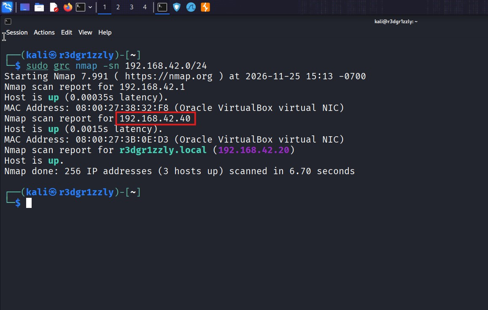
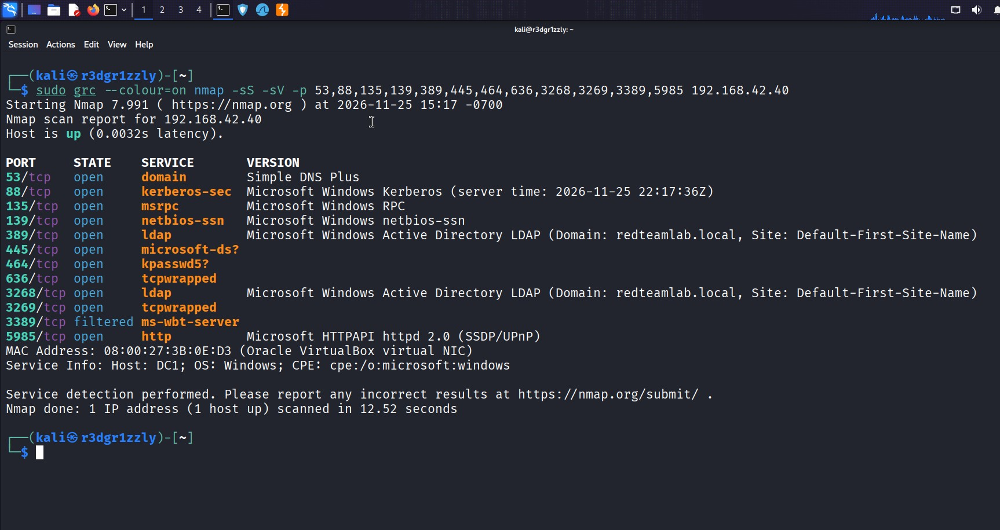
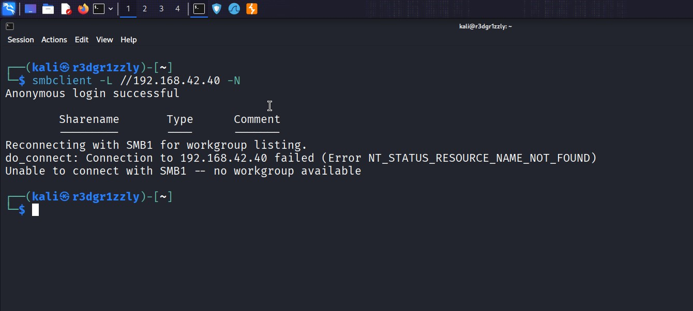
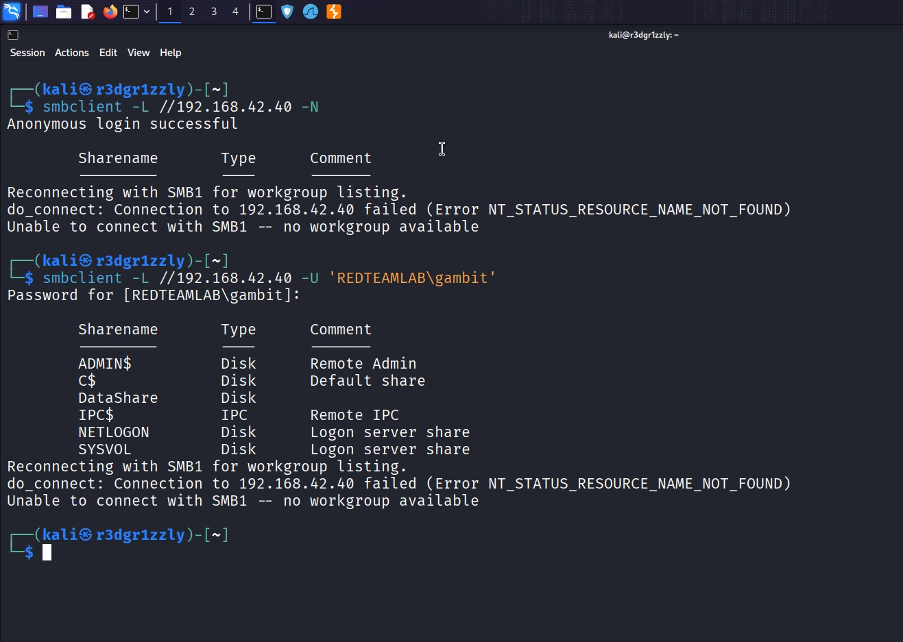
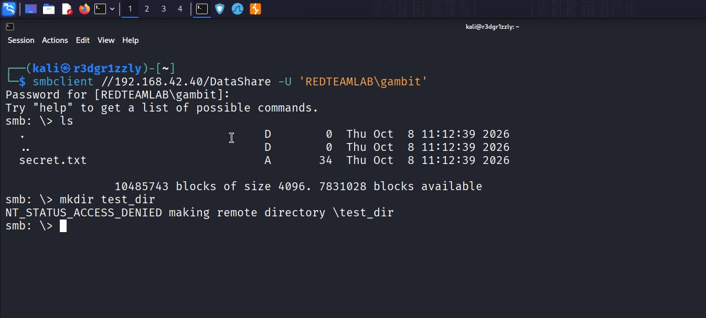
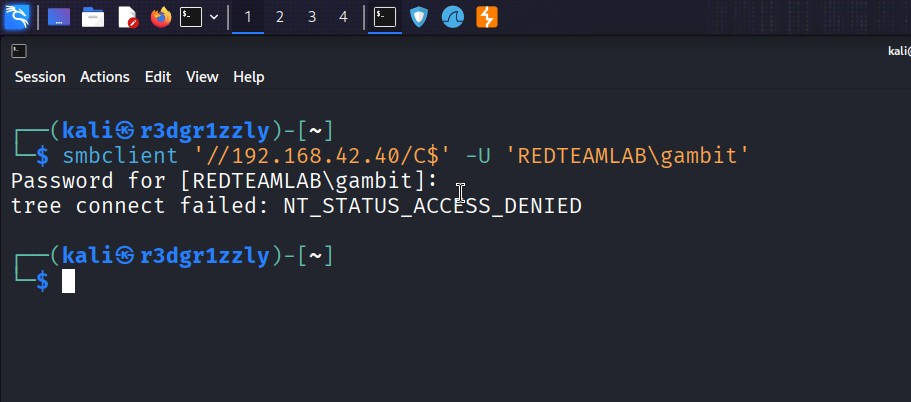
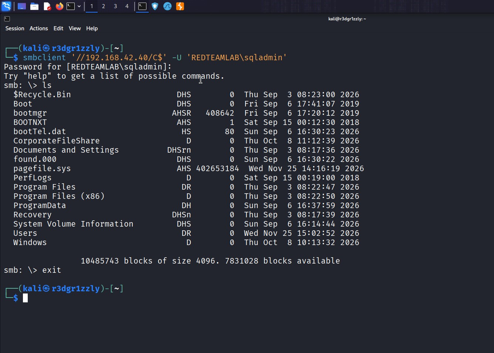
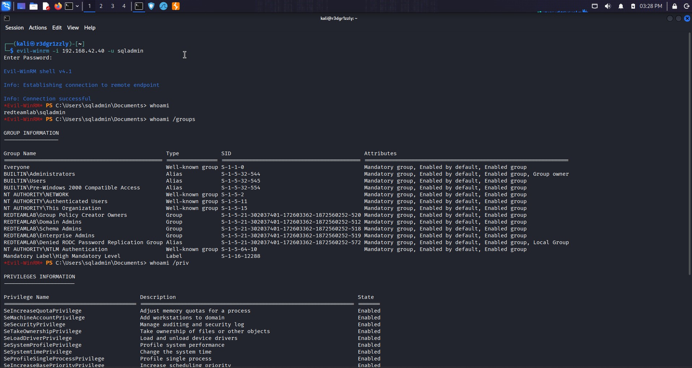

# Active Directory Assessment — SMB Enumeration to Privileged Remote Access

**Project:** R3DGRIZZLY Home Cybersecurity Lab  
**Assessment date:** November 25, 2026  
**Environment:** Isolated, personally controlled VirtualBox Active Directory lab  
**Target:** `DC1` — `192.168.42.40` — `redteamlab.local`  
**Assessment host:** Kali Linux — `192.168.42.20`  
**Scope:** Network discovery, service enumeration, SMB access-control comparison, and authorized WinRM administrative-session verification.

> **Authorization:** All activity was performed against systems and accounts in a controlled, self-hosted training environment. No production or third-party systems were targeted. Credentials and secrets are intentionally omitted.

## Executive summary

This assessment traced a verified path from network visibility to privileged remote administration on a Windows domain controller. Nmap identified the reachable host and its exposed Active Directory services. SMB tests then demonstrated an important distinction between *share discovery*, *share access*, and *permissions*: unauthenticated enumeration returned no share list; an authenticated standard user (`gambit`) could enumerate shares and list a custom share but could not create a directory there or connect to the administrative `C$` share. By contrast, `sqladmin` could connect to `C$` and list the root of the Windows system volume.

Finally, the already-available `sqladmin` credentials successfully authenticated to WinRM, yielding a remote PowerShell session. The Windows access token reported enabled membership in local `Administrators`, `Domain Admins`, `Schema Admins`, and `Enterprise Admins`, with a **High Mandatory Level** integrity label and multiple enabled administrative privileges.

**Important distinction:** This exercise did **not** exploit a vulnerability in SMB or WinRM. It validated the impact of possession of a highly privileged account's credentials. Earlier Kerberoasting work is background context only; credential acquisition was **not reproduced** in this assessment.

## Lab architecture and tools

| Component | Details |
|---|---|
| Attack workstation | Kali Linux (`192.168.42.20`) |
| Target | Windows Server / DC1 (`192.168.42.40`) |
| Domain | `redteamlab.local` |
| Lab network | `192.168.42.0/24`, VirtualBox isolated lab segment |
| Accounts tested | `REDTEAMLAB\gambit`, `REDTEAMLAB\sqladmin` |
| Tools | Nmap, smbclient (Samba), Evil-WinRM |
| Protocols | TCP/IP, SMB, WinRM / PowerShell remoting |

## Methodology and evidence

### 1. Network discovery

Discover active hosts without scanning their ports:

```bash
sudo nmap -sn 192.168.42.0/24
```

**Observed:** Three hosts responded in this run: `192.168.42.1` (a VirtualBox-associated interface; its role was not further assessed), `192.168.42.20` (Kali), and `192.168.42.40` (DC1). This established target reachability on the expected lab network.



### 2. DC1 service enumeration

```bash
sudo nmap -sS -sV -p 53,88,135,139,389,445,464,636,3268,3269,3389,5985 192.168.42.40
```

**Observed:** Open TCP ports included `53` (DNS), `88` (Kerberos), `135` (MSRPC), `139` (NetBIOS), `389` (LDAP), `445` (SMB), `464` (Kerberos password change), `636`, `3268` (Global Catalog LDAP), `3269`, and `5985` (HTTP endpoint consistent with WinRM). Port `3389` was reported **filtered**. Nmap labeled `636` and `3269` as `tcpwrapped`, which is not sufficient to establish the exact application behavior. The LDAP results identified the `redteamlab.local` domain.

**Interpretation:** The scan mapped reachable services; it did not establish a software flaw or successful authentication.



### 3. SMB share enumeration without a password

```bash
smbclient -L //192.168.42.40 -N
```

**Observed:** `Anonymous login successful` appeared, but no share names were returned. A subsequent SMB1 workgroup-discovery attempt failed with `NT_STATUS_RESOURCE_NAME_NOT_FOUND`.

**Interpretation:** A successful anonymous session setup does **not** establish permission to enumerate shares, read files, or perform other SMB operations. The SMB1 follow-up failure is distinct from the SMB2 session result.



### 4. Authenticated SMB share enumeration as Gambit

```bash
smbclient -L //192.168.42.40 -U 'REDTEAMLAB\gambit'
```

**Observed:** The authenticated request enumerated six shares: `ADMIN$`, `C$`, `DataShare`, `IPC$`, `NETLOGON`, and `SYSVOL`. A later SMB1 workgroup-discovery attempt failed, but it did not invalidate the successful share enumeration.

**Interpretation:** Seeing a share listed does **not** imply permission to connect to it or access its contents.



### 5. DataShare: listing allowed, directory creation denied

```bash
smbclient //192.168.42.40/DataShare -U 'REDTEAMLAB\gambit'
```

In the interactive `smbclient` prompt:

```text
ls
mkdir test_dir
```

**Observed:** Gambit connected to `DataShare` and listed `secret.txt` (34 bytes). The server rejected `mkdir test_dir` with `NT_STATUS_ACCESS_DENIED`.

**Interpretation:** Directory listing was permitted, while this directory-creation operation was denied. The screenshot does **not** demonstrate reading the contents of `secret.txt`, so this report does not claim confirmed file-content read permission based on the captured evidence. The failed operation created no directory requiring cleanup.



### 6. Gambit denied access to the administrative share

```bash
smbclient '//192.168.42.40/C$' -U 'REDTEAMLAB\gambit'
```

**Observed:** `tree connect failed: NT_STATUS_ACCESS_DENIED`.

**Interpretation:** Although Gambit could *enumerate the existence* of `C$`, DC1 denied a tree connection to that administrative share using Gambit's credentials.



### 7. SQLADMIN granted access to the same share

```bash
smbclient '//192.168.42.40/C$' -U 'REDTEAMLAB\sqladmin'
```

In `smbclient`:

```text
ls
exit
```

**Observed:** SQLADMIN connected and listed the Windows volume root, including `Windows`, `Users`, `Program Files`, and other system directories.

**Interpretation:** SQLADMIN had materially greater access to `C$` than Gambit. The test demonstrated share connection and directory listing; it did not attempt or prove modification of system files.



### 8. WinRM remote PowerShell and effective privileges

```bash
evil-winrm -i 192.168.42.40 -u sqladmin
```

Once connected:

```powershell
whoami
whoami /groups
whoami /priv
```

**Observed:** Evil-WinRM reported `Connection successful`; `whoami` returned `redteamlab\sqladmin`. Group information included enabled `BUILTIN\Administrators`, `REDTEAMLAB\Domain Admins`, `REDTEAMLAB\Schema Admins`, and `REDTEAMLAB\Enterprise Admins`, plus `High Mandatory Level`. Privilege output in the assessment included enabled `SeDebugPrivilege`, `SeBackupPrivilege`, `SeRestorePrivilege`, `SeTakeOwnershipPrivilege`, and others.

**Interpretation:** These observations demonstrate successful remote PowerShell execution as a highly privileged account, rather than merely SMB file enumeration. They do **not** show that WinRM itself was vulnerable; authorization was granted to an already-privileged identity.

The session was closed with `exit`. No payloads, user accounts, persistence mechanisms, or server-side files were created by this phase.



## Consolidated access-control matrix

| Check | Anonymous / `-N` | `gambit` | `sqladmin` |
|---|---|---|---|
| SMB session establishment | Reported successful | Authenticated | Authenticated |
| List share names | No names returned | Allowed | Not separately tested in this evidence sequence |
| Connect to `DataShare` | Not tested | Allowed | Not separately tested in this sequence |
| List `DataShare` root | Not tested | Allowed | Not separately tested in this sequence |
| Create directory in `DataShare` | Not tested | Denied | Not separately tested in this sequence |
| Connect to administrative `C$` | Not tested | Denied | Allowed |
| List root of `C$` | Not tested | Denied at connection | Allowed |
| Remote PowerShell via WinRM | Not tested | Not tested | Allowed; elevated privileges observed |

## Security significance

1. **Authentication and authorization are separate.** Establishing an SMB session, seeing a share listed, connecting to that share, and performing a particular filesystem operation are different permission checks.
2. **Administrative shares are high-value resources.** Access to `C$` with an authenticated account is a strong indicator of substantial privileges on the target, but operations and token privileges must still be verified.
3. **Exposed management services are not vulnerabilities by themselves.** An open WinRM endpoint becomes consequential when an attacker possesses credentials authorized to use it.
4. **Privileged credential protection matters.** Credential theft or cracking outside the scope of this specific run could turn legitimate administrative functionality into a compromise path.

## Limitations and conclusion

- Tests were limited to one domain controller in an isolated lab and the selected service ports.
- No exhaustive network vulnerability scan, SMB share ACL audit, or domain-wide privilege review was performed.
- No credential acquisition, Kerberoasting, password cracking, or privilege escalation was performed during this evidence-collection run.
- This evidence demonstrates **different effective permissions for two accounts**, culminating in **successful administrative remote access using SQLADMIN**.
- The screenshots support the claims as described; no sensitive credential values are included.

**Outcome:** Network enumeration → authenticated SMB access comparison → verified privileged WinRM PowerShell session. **No standalone SMB or WinRM vulnerability claimed.**

## Evidence index

| ID | Screenshot | What it demonstrates |
|---|---|---|
| 01 | [Network discovery](screenshots/01-network-discovery.png.jpg) | Hosts identified on the AD segment |
| 02 | [Service enumeration](screenshots/02-service-enumeration.png.jpg) | DC1 TCP service exposure |
| 03 | [SMB anonymous](screenshots/03-smb-anonymous.png.jpg) | Anonymous session without enumerated shares |
| 04 | [SMB Gambit](screenshots/04-smb-gambit.png.jpg) | Authenticated share enumeration |
| 05 | [DataShare permissions](screenshots/05-datashare-permissions.png.jpg) | Listing allowed; directory creation denied |
| 06 | [Admin share denied](screenshots/06-admin-share-denied.png.jpg) | Gambit denied `C$` connection |
| 07 | [Admin share access](screenshots/07-admin-share-access.png.jpg) | SQLADMIN allowed `C$` connection and listing |
| 08 | [WinRM privileges](screenshots/08-winrm-privileges.png.jpg) | Remote PowerShell and administrative group/privilege evidence |

---

*R3DGRIZZLY — Authorized home-lab offensive security research and documentation.*
