# Image Steganography Investigation

**Category:** Security Research / Digital Forensics / Steganalysis  
**Environment:** Kali Linux  
**Language:** Python 3  
**Status:** Completed — hidden message recovered

## Overview

Can a seemingly ordinary image carry a hidden message without any obvious visual change? And can that message be recovered without the software originally used to hide it?

This investigation consists of two independent, hands-on experiments:

1. **Controlled LSB experiment:** I created an RGB PNG, embedded the character `A` in its least significant bits (LSBs), extracted it, and measured the exact pixel changes.
2. **Unknown-image investigation:** I examined a JPEG and a corresponding PNG from an external steganography demonstration, compared them at the pixel and channel levels, reconstructed the correct decoding order, and recovered the concealed text.

### Final result

```text
HIDDEN MESSAGE FOUND:
Swayam Kamble
```

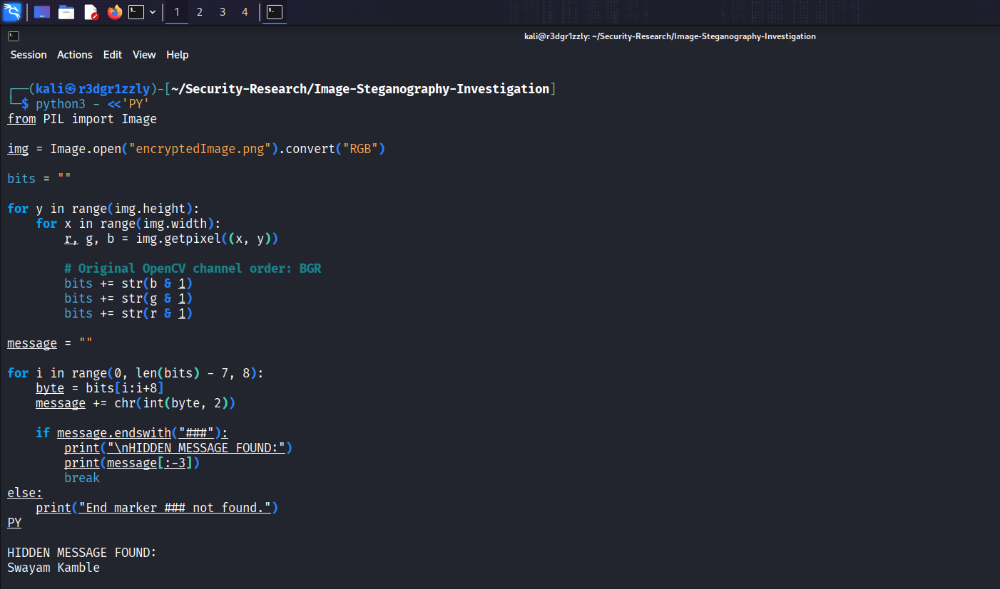

**Key takeaway:** Steganography hides information inside another medium; it does not automatically encrypt that information. The recovered message required no decryption key once the embedding layout and terminator were understood.

---

## Tools

| Tool | Purpose |
|---|---|
| Python 3 / Pillow 12.3.0 | Generate images, edit pixel channels, extract LSBs, compare images |
| `file` | Identify actual file formats |
| ExifTool 13.55 | Inspect image properties and metadata |
| Steghide 0.6.0 | Check for Steghide-compatible embedded data in JPEG |
| Binwalk | Identify recognizable file signatures inside a binary |
| `strings` | Look for plain-text sequences |
| SHA-256 (`sha256sum`) | Record file fingerprints |

Pillow was installed from Kali's package repository (`python3-pil`) rather than overriding the externally managed Python environment.

```bash
sudo apt install -y python3-pil steghide libimage-exiftool-perl binwalk
python3 -c "from PIL import Image; print('Pillow OK')"
steghide --version
exiftool -ver
```

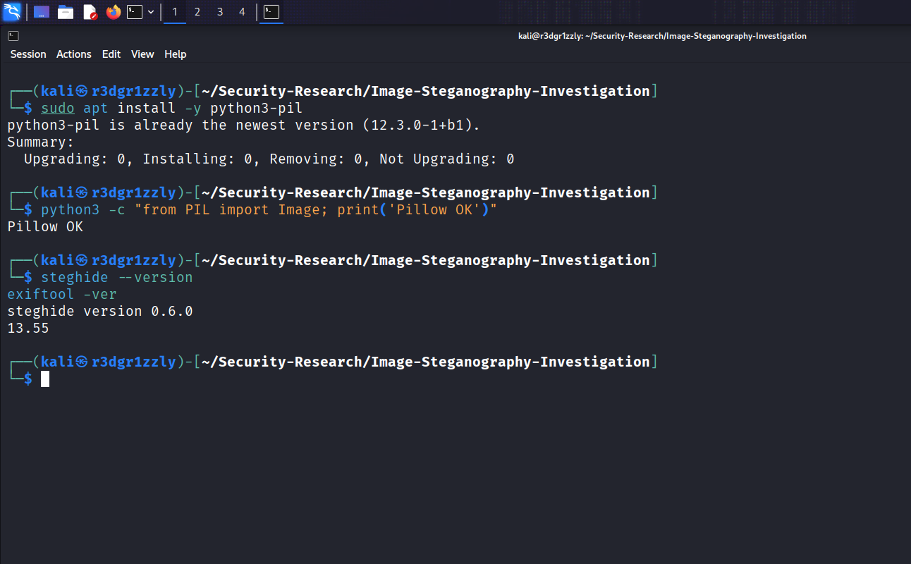

---

## Part I — Building and Verifying an LSB Image

### 1. Create the carrier image

I generated a 400 × 300 RGB PNG containing a simple color gradient using Pillow.

```python
from PIL import Image

img = Image.new("RGB", (400, 300))

for y in range(300):
    for x in range(400):
        r = int(x / 400 * 255)
        g = int(y / 300 * 255)
        b = 150
        img.putpixel((x, y), (r, g, b))

img.save("original.png")
```

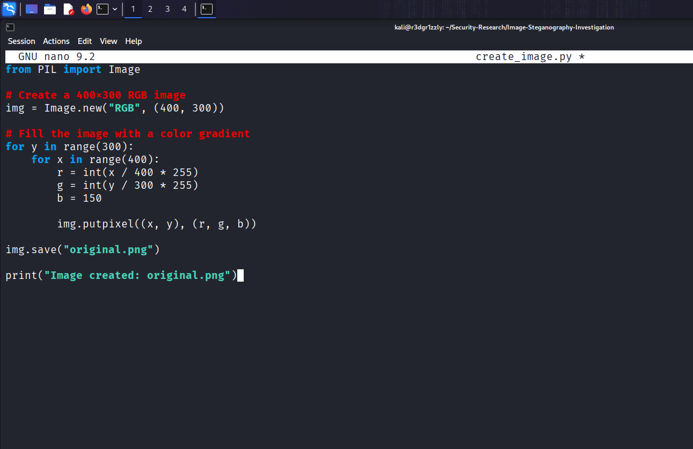
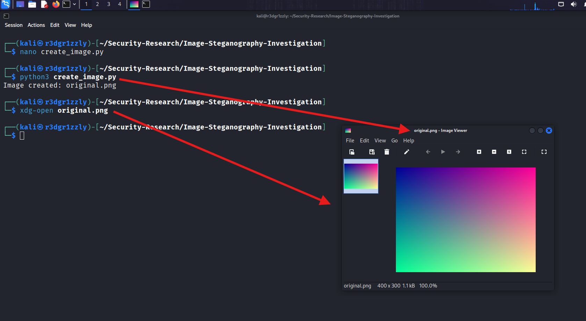

`file` and `exiftool` confirmed the image was an **8-bit-per-channel RGB PNG**, **400 × 300 pixels**, using lossless PNG compression.

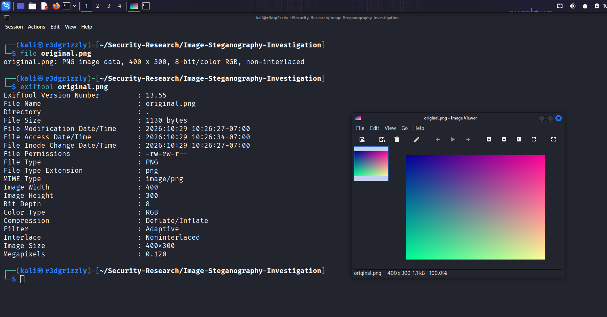

### 2. Encode a character in pixel LSBs

The letter `A` has ASCII value **65**, represented by the 8-bit sequence:

```text
A = 01000001
```

I stored one bit in the blue channel of each of the first eight pixels. The embedding operation was:

```python
new_b = (b & 0b11111110) | int(bit)
```

`& 0b11111110` clears the last bit; `| int(bit)` sets it to the desired message bit.

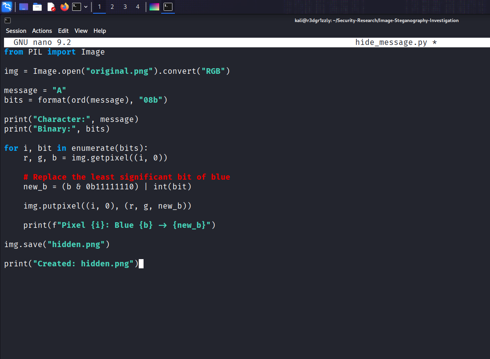
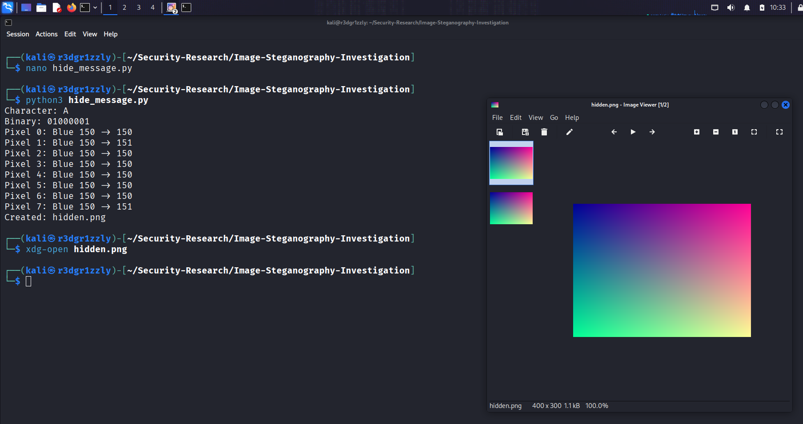

Even though eight bits were written, **only two blue channel values actually changed**: the two positions that needed their last bit changed from `0` to `1`.

### 3. Recover the character

The extraction script read the blue-channel LSB from those same eight pixels:

```python
from PIL import Image

img = Image.open("hidden.png").convert("RGB")
bits = ""

for i in range(8):
    r, g, b = img.getpixel((i, 0))
    bits += str(b & 1)

print("Recovered message:", chr(int(bits, 2)))
```

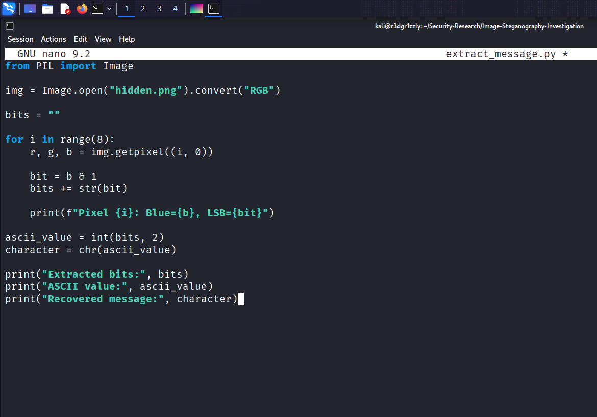

The output confirmed:

```text
Extracted bits: 01000001
ASCII value: 65
Recovered message: A
```

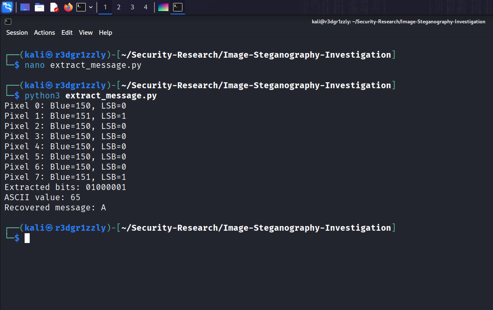

### 4. Pixel-by-pixel forensic comparison

I compared `original.png` with `hidden.png`, counted changed pixels, and generated a difference image using Pillow's `ImageChops.difference`.

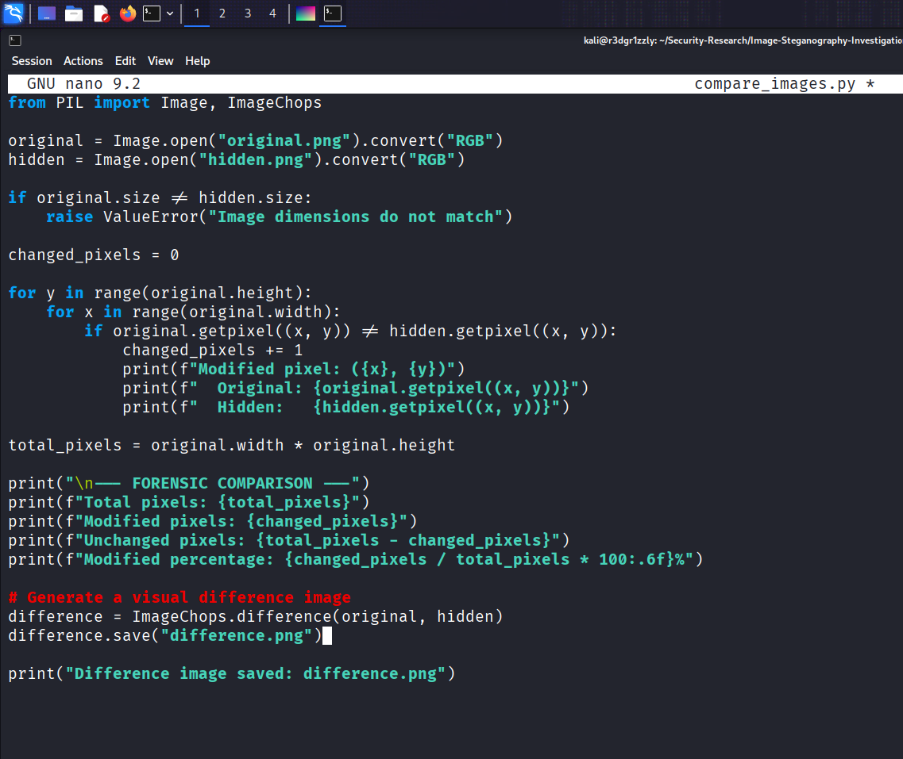

| Metric | Observed result |
|---|---:|
| Total pixels | 120,000 |
| Modified pixels | 2 |
| Unchanged pixels | 119,998 |
| Modified share | 0.001667% |
| Changed coordinates | `(1, 0)` and `(7, 0)` |
| Blue-channel change | `150 → 151` |

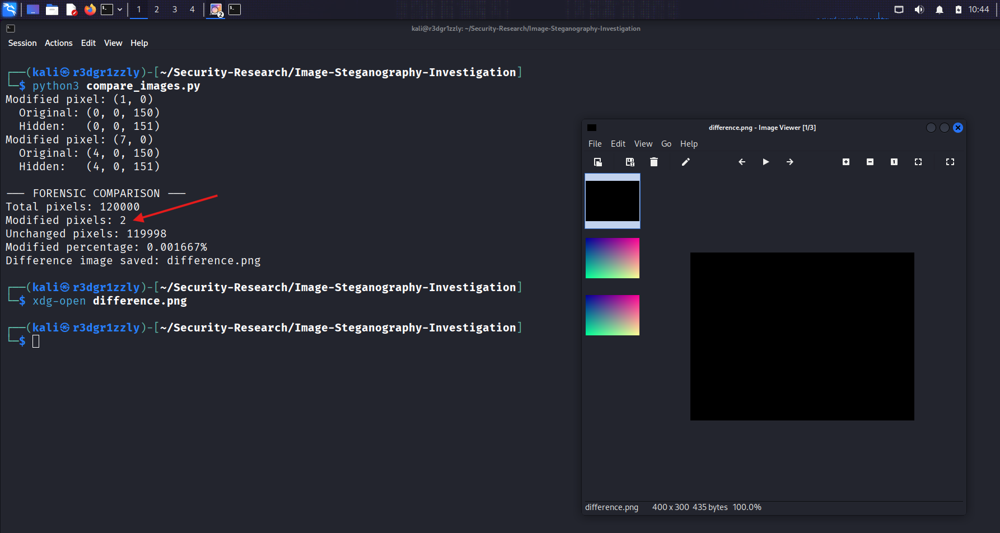

The raw difference image looked black because the nonzero differences were only one intensity unit. I therefore created an amplified visualization in which every changed pixel appeared red and enlarged the image with nearest-neighbor scaling.

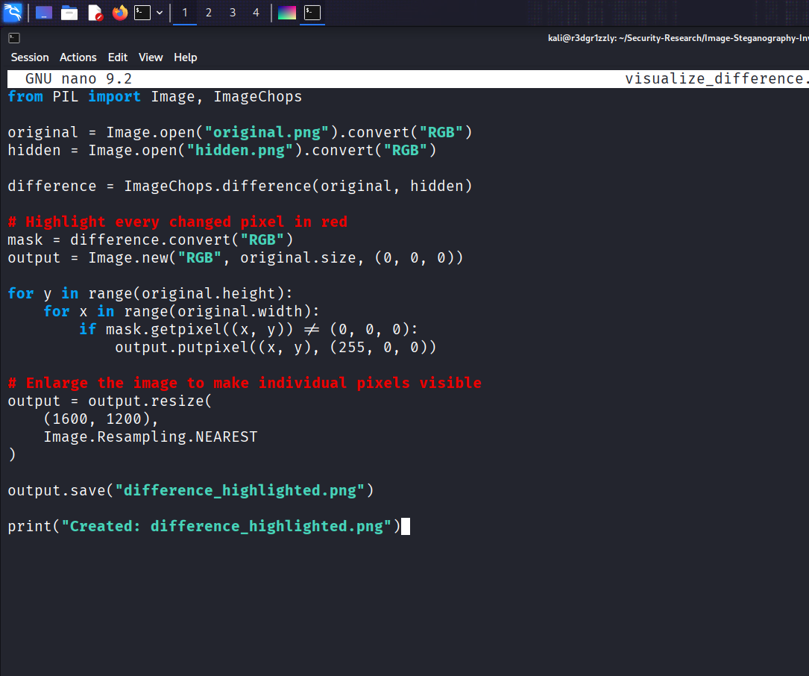
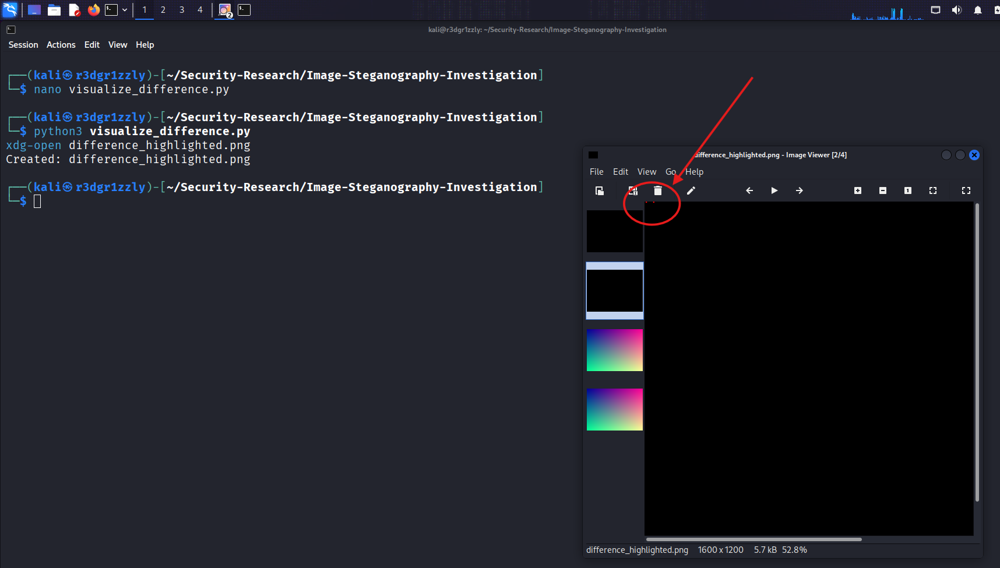

**Finding:** The message was recoverable even though the two images looked indistinguishable during normal viewing. This comparison was possible because both the original and modified images were available.

---

## Part II — Investigating an External Steganographic Image

### 5. Identify the suspicious files

I investigated two files associated with a public steganography demonstration:

- `suspect.jpg` — possible original carrier image
- `encryptedImage.png` — possible modified image

Source context: [Swayam-spec-cyber/Stegnograaphy](https://github.com/Swayam-spec-cyber/Stegnograaphy). I did **not** clone or execute the repository's code; the analysis and extraction were performed locally with inspection tools and my own Python commands.

Initial inspection used:

```bash
file suspect.jpg
exiftool suspect.jpg
sha256sum suspect.jpg

file encryptedImage.png
exiftool encryptedImage.png
sha256sum encryptedImage.png
```

| Property | `suspect.jpg` | `encryptedImage.png` |
|---|---|---|
| Format | JPEG (JFIF) | PNG |
| Dimensions | 640 × 425 | 640 × 425 |
| File size | ~87 KB | ~440 KB |
| Color channels | 3 | RGB |

The two files having the same dimensions supported treating them as a possible carrier/stego pair; the different file sizes alone were **not** evidence of hidden content, because JPEG and PNG encode images differently.

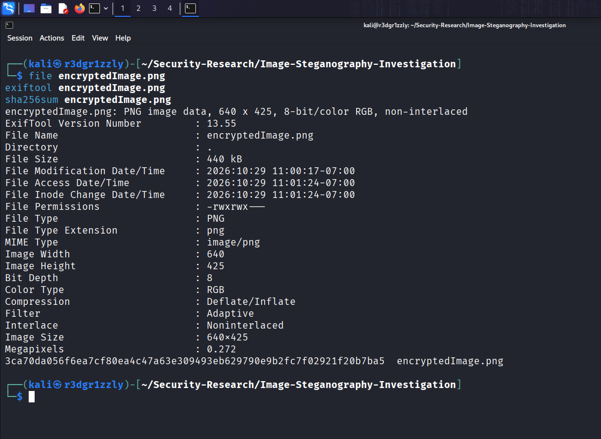

### 6. Initial static triage

The early checks were inconclusive:

```bash
steghide info suspect.jpg
binwalk suspect.jpg
strings -a -n 8 suspect.jpg | head -n 40
```

- **Steghide** recognized a JPEG with roughly 4.8 KB theoretical embedding capacity, but could not extract data with an empty passphrase. Capacity is not proof that a payload exists.
- **Binwalk** identified only the JPEG signature at offset zero; it did not report a recognizable embedded file signature.
- **`strings`** produced no meaningful plain-text message.

**Interpretation:** Negative results from these checks do not rule out steganography, especially when a different embedding technique or a different file is involved.

### 7. Compare original and modified image data

I converted both files to RGB pixel arrays and compared corresponding pixels and channels.

```python
from PIL import Image

a = Image.open("suspect.jpg").convert("RGB")
b = Image.open("encryptedImage.png").convert("RGB")

changed = sum(
    a.getpixel((x, y)) != b.getpixel((x, y))
    for y in range(a.height)
    for x in range(a.width)
)

print("Modified pixels:", changed)
```

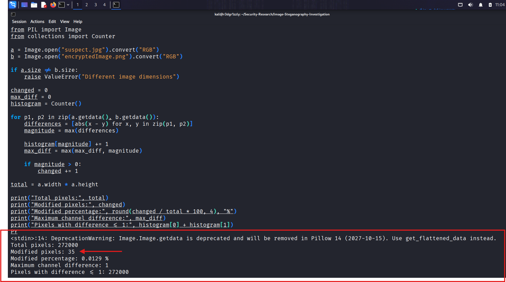

| Metric | Observed result |
|---|---:|
| Total pixels | 272,000 |
| Different pixels | 35 |
| Changed percentage | 0.0129% |
| Maximum per-channel difference | 1 |
| Changed red channels | 20 |
| Changed green channels | 19 |
| Changed blue channels | 18 |
| Total altered channels | 57 |

**35 pixels** and **57 channels** are not contradictory: one pixel may have multiple changed color channels.

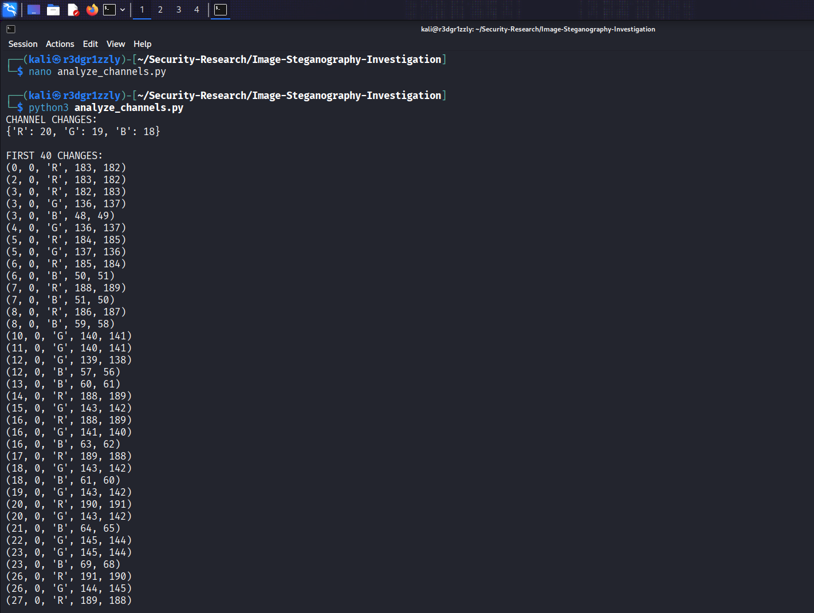

The altered values differed by at most one unit, strongly suggesting an LSB-based method.

The modified pixels were concentrated in a small contiguous area:

```text
First modified pixel: (0, 0)
Last modified pixel:  (41, 0)
Rows containing modifications: [0]
```

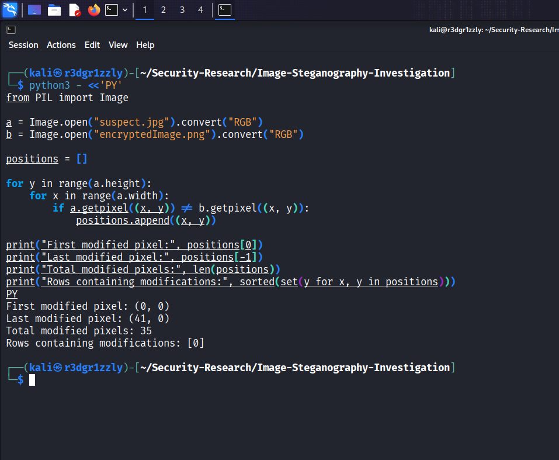

This spatial pattern supported a sequential embedding hypothesis. It did not, by itself, reveal the byte order, termination rule, or hidden message length.

### 8. First decoding attempt: RGB order

I initially collected LSBs in conventional Pillow **RGB** order, grouping every eight bits into a byte.

The output contained isolated printable characters but no recognizable message.

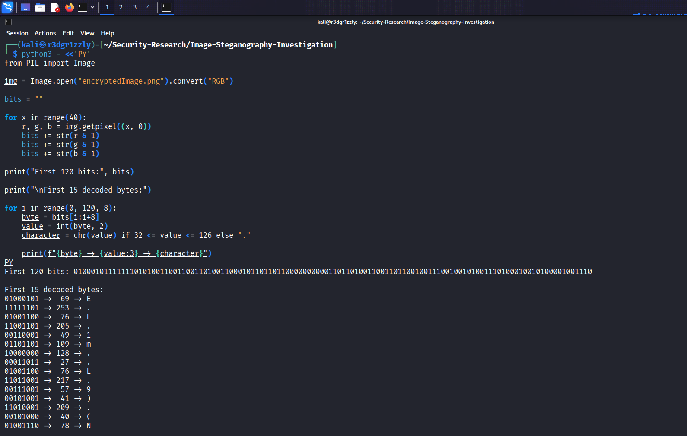

**Why it failed:** the embedding logic used **BGR channel order**, as commonly exposed by OpenCV, rather than Pillow's RGB order. The channel order matters because it changes the sequence of bits and therefore every decoded byte.

### 9. Correct decoder: BGR with terminator

The successful decoding approach reads channel LSBs in **Blue → Green → Red** order and stops at the `###` marker. The marker is an application-level delimiter, not an encryption mechanism.

```python
from PIL import Image

img = Image.open("encryptedImage.png").convert("RGB")
message = ""
byte_bits = ""
found = False

for y in range(img.height):
    if found:
        break
    for x in range(img.width):
        r, g, b = img.getpixel((x, y))
        for value in (b, g, r):  # OpenCV-style BGR order
            byte_bits += str(value & 1)
            if len(byte_bits) == 8:
                message += chr(int(byte_bits, 2))
                byte_bits = ""
                if message.endswith("###"):
                    print("HIDDEN MESSAGE FOUND:")
                    print(message[:-3])
                    found = True
                    break
        if found:
            break

if not found:
    print("End marker ### not found")
```

**Observed output:**

```text
HIDDEN MESSAGE FOUND:
Swayam Kamble
```


---

## Security Findings

### Steganography is not encryption

The image concealed the existence of a message, but the data were readable after reconstructing the bit order and end marker. The decoder did not require a password.

A password prompt in an application does not necessarily mean that its embedded data are cryptographically protected. Access-control checks in an interface are fundamentally different from encrypting the payload itself.

### What the evidence does and does not establish

**Demonstrated:**

- Successful LSB embedding and recovery in a self-generated PNG.
- Only 2 of 120,000 pixels changed in the controlled single-character example.
- A likely original/stego image pair differed at 35 of 272,000 pixels, with 57 channel changes of at most one unit each.
- A complete external hidden message was recovered using BGR-ordered LSB extraction and the `###` terminator.
- The recovered sample required no cryptographic key for this extraction method.

**Not demonstrated:**

- That all hidden-image messages can be decoded without a key.
- That the image would remain decodable after resizing or JPEG recompression.
- That the tool's password control provided meaningful encryption or that any separate secret was broken.
- That `strings`, Binwalk, or Steghide can universally detect steganographic content.

### Operational lessons

- Start with file identification and preserve the original sample.
- Record hashes to maintain a reproducible evidence trail.
- Compare candidate original and modified files when both are available.
- Treat tiny, localized, single-unit channel changes as evidence worth testing, not automatic proof.
- Confirm image-library channel conventions before decoding.
- Distinguish *hidden*, *encoded*, and *encrypted* content.

---

## Suggested Project Layout

Place this `README.md` in `Security-Research/Image-Steganography-Investigation/`. All image links above resolve relative to this file, inside its `screenshots/` subdirectory.

```text
Security-Research/
└── Image-Steganography-Investigation/
    ├── README.md
    ├── create_image.py
    ├── hide_message.py
    ├── extract_message.py
    ├── compare_images.py
    ├── visualize_difference.py
    ├── analyze_channels.py
    ├── original.png
    ├── hidden.png
    ├── difference.png
    ├── difference_highlighted.png
    ├── suspect.jpg
    ├── encryptedImage.png
    └── screenshots/
        ├── 01-first-setup.png
        ├── 02-create-image-script.png
        ├── 03-open-image-script.png
        ├── 04-image-info.png
        ├── 05-letter-script.png
        ├── 06-letter-alterating-image.png
        ├── 07-extract-script.png
        ├── 08-message-extraction.png
        ├── 09-compare-images-script.png
        ├── 10-images-comparison.png
        ├── 11-visualize-differences.png
        ├── 12-visualize-differences.png
        ├── 13-suspect-info.png
        ├── 14-comparison.png
        ├── 15-analyzing-channels.png
        ├── 16-analyzing-decoder.png
        ├── 17-analyzing-concentration.png
        └── 18-message-found.png
```

If publishing external sample images, verify their license and retain the original author's attribution.

---

## Conclusion

This project began with a controlled one-character steganography demonstration and progressed to recovering a real hidden message from an externally obtained image.

The decisive findings were the unusually small pixel differences, the concentration of changed channels at the beginning of the image, and finally the correct **BGR** bit order and `###` delimiter.

**Outcome: hidden message successfully recovered — `Swayam Kamble`.**

This investigation illustrates how binary reasoning, scripting, file analysis, and measured evidence can reveal information that is invisible during normal image viewing.

**Scope:** Educational digital forensics on local samples; no untrusted repository code was executed.
